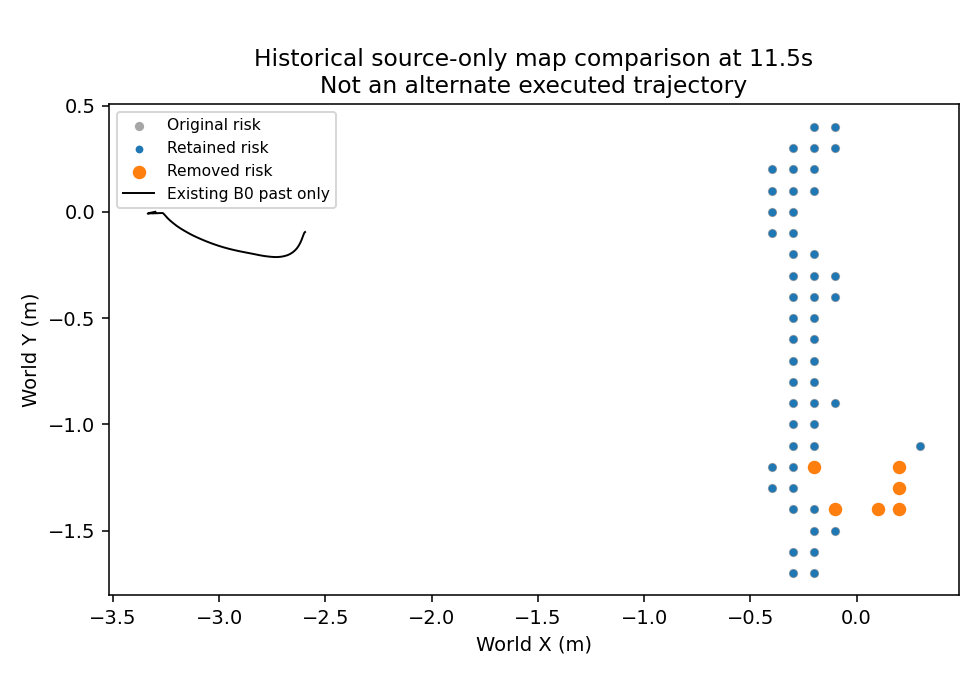
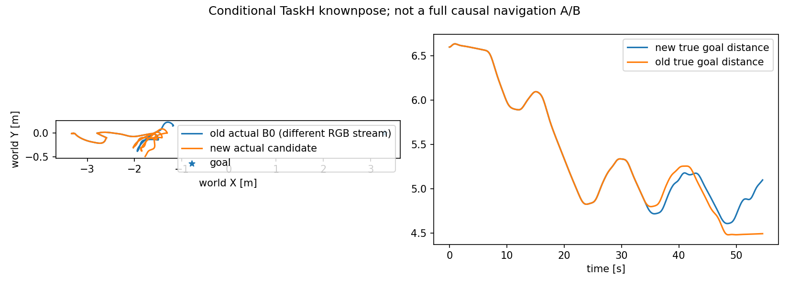

# 原完整E1：当前双目像素资格与风险消费实验

研究尚未完成。此轮唯一控制候选是：原纹理/高度/CAD来源包中，任一当前对应像素RGB恰为全零的点不进入风险消费者。网络原始输出保留；没有宣称两端非黑能认证同一可见物理表面，没有认证完整障碍体积或自由空间。

## 历史必要筛查

使用此前minimum_prefix_transition_navigation_run_v1完整E1实际数据；不是fresh验证，不是新在线运行。原546个风险图的labels、codes及hazard acquisition time逐个精确重建，110个来源曝光的点身份与原raw包核验一致。

唯一筛选移除347点，影响461个风险图，首次差异8.5秒；11.5秒最多改变6格。不是此前单柱域“附加风险仍行为等价”的重跑。图中的黑线仅为实际旧B0过去轨迹，橙色为移除的风险格，不能解释成候选已经走过的轨迹。

筛选输出封存后才读取教师标签：347点中334没有有效GT深度，13有标签；其中10点误差不超过10厘米。原60877点中60211正确，保留60530点中60201正确，描述性比例98.906%→99.456%。这只是历史删点后的统计，不能替代旧gate或认证覆盖改善。

10个被删的正确点分别来自15.5/16/18/19.5/22秒曝光；其预测XY所在风险格在当前候选图中仍有支持。这排除了这10点在该曝光的“最后一份相同格支持被删”，并不证明真实完整体积或后续过期后的支持。

## 唯一候选、测试与预运行审查

保持原规划器、初始观察前缀、minimum-F、roll-PID、动作范围、速度策略、10秒记忆TTL、相机和照明。只改变上述来源消费。采用known-GT-pose TaskH条件层；不是估计位姿、严格cold-start或原35秒评测。

新候选独立存储未筛选B0来源；同一当前RGB/NN包驱动只读B0。只比较实际请求分叉前的同流行为，分叉后停止，不给另一计划赋予实际候选轨迹标签。历史B0完整54.6秒日志另作条件参考；RGB重复运行可能变化，所以不是完整单因果导航A/B。

预算事前冻结最多54.6秒、546请求，一条序列，无重试。原局部门槛保留：目标剩余距离≤4.182900500米且X进度≥2.427377623米；真实到达仍≤0.2米。旧来源gate与历史拒绝不改，正式35秒E0/E1/E2未启动。

首审两项Important在启动前修复：旧曝光不得配用当前图像，在读任何payload前要求曝光时间等于当前时间；超时先SIGTERM并留45秒清理，然后才强制kill，记录强制退出，失败产物不能命名为正常post-close。另修正旧120秒身份文字。

作者8项测试通过1.38秒，独立复核8项通过1.52秒，Critical/Important为0。包含stale/future poison拒绝以及真实子进程SIGTERM清理/忽略SIGTERM后强制退出。协议全部source/input SHA与AST核验通过。独立审查支持执行这条条件实验，不代表导航或来源通过。

## 实际运行状态

唯一运行已启动，执行session1688。结果尚未关闭，不报告新成功率。产物目录：experiments/stereo_memory_navigation_20261004_v1/E1_current_pixel_navigation_run_v1。封存完成后再核验请求、物理步、捕获、视频、首次分叉、真实接触/进度及原局部门槛；未通过即明确拒绝，不调整门槛重跑。

## 实际闭环关闭与拒绝

实际stage session1688，2026-10-09 01:04:58—01:11:37 UTC正常退出0；wall约399秒，不是10Hz实时达标。546请求、547捕获、2731物理状态、110双目曝光；3277条接触检查全部可用且接触0。两段视频均逐帧解码547帧/10fps，作者查看30秒双目截图与整条轨迹图，未声称人工看完全部视频。

3400原产物封存SHA核验通过。110曝光筛选输出逐字段等于同流原点包中仅删除exact-black对应点的结果，共删除405点；546地图完整因果重建精确，461张与同一物理流的未筛选风险图不同。但同流B0影子546次请求全部相同，零首次分叉。判定：风险地图有干预，执行行为无干预，拒绝称为控制改善。

真实54.6秒目标剩余5.098011119米，沿X进度1.526037616米，均未达到原4.182900500/2.427377623门槛；实际路程约6.17855米，到达失败。零接触不能替代到达。没有延长运行或放宽门槛重试。

新旧实际运行的108个请求不同，首次在frame331（33.1秒）：旧参考版本5开始制动换向，新参考版本4继续正向转弯。此前至frame331状态的相对XY轨迹完全相同；初始左/右RGB已分别有291204/256992个数值不同。新运行内筛选/未筛选请求始终相同，所以新旧终态差异不能归因于本轮筛选。尚未隔离渲染/网络/来源地图各自的原因。

## 来源核验与环境记录

完整独立CAD/source重建先于教师读取完成，110曝光的raw packet及4个筛选字段一致。61285个所选点中≤10cm比例99.361997%，无条件p90=0.039246866米，保留原≥100点/95%/≤0.1米/两曝光≥100门槛，所选几何子集通过。这不认证完整3D障碍、自由空间、全来源模型或严格视觉导航；历史来源/体积/估计位姿拒绝保留。

第一CPU评价缺pxr退出1；补Python路径后缺libtf退出1；再补库路径的受限环境评价退出143、没有结果。记录按字节保留，未解释为模型拒绝。限制线程并在授权环境中加180秒上限的session44857正常退出0，无新仿真或网络推理重跑。独立简化postseal几何评价session41449退出0，使用相同门槛，结果为独立核验，不用于挑选更好分数。

独立结果复核Critical/Important=0：所选来源几何通过、地图变化、动作等价、局部进度失败四层分别报告。研究整体未完成，正式原35秒E0/E1/E2未运行，没有新导航成功率。

## 同轮继续与具体接续

已完成33.1秒首个历史请求差异的有界参考链诊断：保存329/330/331的已安装几何、版本、方向锁存及请求，不二次调用policy。下一项只读因果核验针对相同实际物理前缀下的来源/地图差异如何进入参考重安装；先检查现有plan metadata/cost/触发理由，区分几何变化与持久参考守护，再决定是否存在唯一可证的参考消费改动。不能据RGB差异直接断言渲染噪声或网络不稳定，不能再扫黑色阈值、记忆TTL、PID/速度或重复本条导航。该首差异域已读标签，是历史诊断而非fresh验证。

同流参考身份也已继续核验：546次已安装几何与B0影子相同；新旧历史参考差异首次仍为331，共215帧。初版把candidate的null与影子的空列表误当116个初始参考差异，保留v1；独立v2只规范“未安装参考”表示，首次None reshape适配失败记录后显式处理，结果0差异。不改动作、门槛或旧结果。需要继续定位的是历史不同来源/地图触发的重新安装，而非本轮筛选。

同轮再继续：将331时刻完全相同的既有bridge/suffix固定，仅替换old/newfiltered/newraw风险labels，调用原tube_retention_screen。准确复现旧0.8602325267 FAIL，新筛选及未筛选均0.8944271910 PASS，原门槛0.8707106781不变；旧与新未筛选图有7格不同。旧最近风险格世界XY(-0.2,1.0)，新最近(-0.4,0.6)。这给出了地图→保留/重建分支的直接机制证据，尚未定位上游RGB、匹配、量化/持久化各层的原因，也不能将原安全裕量降低救分。独立review C0I0；Minor要求把相同物理前缀身份在脚本内重新断言，已补充并重跑CPU退出0。546参考身份的可复用v3脚本与v2结果精确一致，旧版本与适配失败保留。
