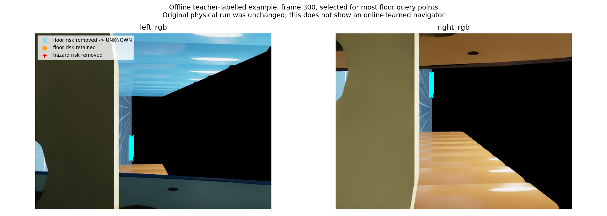

# 唯一学习记忆风险资格候选：离线结果

问题是减少“地面点被写成障碍风险”的误插入，不是重新拟合被拒绝的未来双目流网络。使用唯一线性逻辑分类器（23个当前双目与过去观测特征），输出风险资格；被剔除点成为未知，不变成观测自由。没有读取未来动作、未来深度或未来位姿。

训练4条历史完整序列，47872个hazard、81个floor，21次优化迭代收敛；旧设计数据不称fresh。两个fresh完整序列在采集前预留，拟合后先封存两条全部feature-only预测，经独立审查后才读取同帧GT深度与实际相机变换作离线教师。独立重建概率最大误差8.9e-16，112个教师文件及标签复核一致。

|fresh序列|地面点|保留地面风险|真实正风险点|保留正风险|误地面风险减少|正风险保留|原gate结果|
|---|---:|---:|---:|---:|---:|---:|---|
|native E1|0|0|37420|37420|不可评估|100%|地面覆盖不足|
|native E2|65|10|10417|10414|84.615%|99.9712%|该序列局部通过|

E1/E2另有5784/2401个不可用教师标签，保持排除与计数。E2超过事前固定30%误风险减少及90%真实风险保留门槛；E1没有地面样本，不能把“没有误报”当作该能力通过。整体按原每序列至少20地面、20风险点要求为覆盖不足、候选未准入。它不是E1预测性能失败，也不能称整体模型可用。

不降低门槛、不添加新数据、不再训练、不启动该候选的物理A/B。保留E2局部证据，保留整体未准入；该结果不等于到达率改善、盲区完整安全或动力学世界模型。当前候选只看被双目选中的可见点，同场景完整序列划分不证明空间泛化。传统基线不受该学习gate阻塞。

实际执行：fit完成14:36:21–35 UTC，predict完成14:37:05–14 UTC，teacher评价完成14:39:04–06 UTC，均正常退出0；唯一actual fit=1。两次先前缺库/历史manifest格式错误发生在训练前，记录原状态/日志后独立核验恢复，不算模型性能拒绝或重新拟合。安装依赖只放研究目录，原项目未改。8项CPU检查通过、独立closed审查C0I0。

下一项实际工作转回传统参考消费：新速度反馈下，E1在12秒以0.331m/s实际向前、主轴0.850rad/s，却因沿用旧cusp-coast域（速度0.160–0.224、主轴0.428–0.462）而不提供first-primitive方向约束，随后安装首段倒车参考。这是具体接口域耦合，不预先称bug。只对该已记录当前边界重建原规划并比较一个方向资格候选；不改变换向低速确认或cusp-coast本身，不重复标定、不使用未来真值规划。

整体导航研究仍未完成。

离线示意图（按地面教师点最多选取第300帧，非平均指标、非在线学习控制视频）：

图中青色代表由同帧GT深度与实际相机变换得到的低高度教师点，其预测风险资格被剔除后只标未知。颜色不是送给模型的语义输入；黑色/遮挡/没有深度仍不能推断自由。作者查看了该示意图，未声称观看整段视频。
