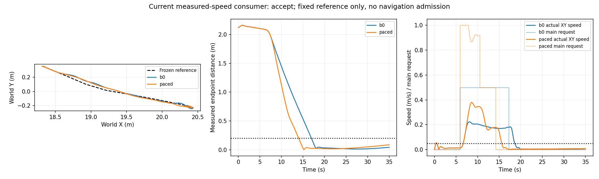
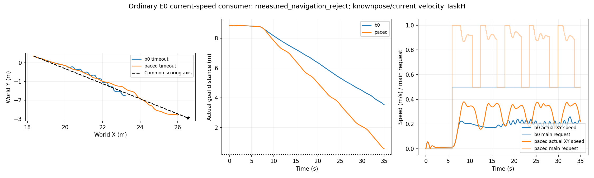

# 当前实测速度反馈：固定参考局部通过，普通导航待验证

这是已知当前位姿、实际WORLD XY速度诊断层。原双目来源、相机/光照、roll-PID及辅助轴指令保持；唯一新增环节是最终主轴速度请求反馈生产者，明确覆盖原策略+.5主轴cap。正式协议动作范围不改。它不是新动力学模型、纯RGB定位或新导航成功率。

## 方法与前提

target=.34m/s，ff=.92679233646，Kp=1.47322358192；clip(.5,1)。仅当前正常forward tracking原始main全+.5时消费当时proprio的WORLD XY速度。距当前局部/全局终点任一小于原冻结.94593776863m余量时回退原动作；转向/制动/其他main分支保留。副轴、原映射、PID增益、方向确认/反弹清零规则不改。直行点仅提供固定局部静态参数，不是全域动态或转弯预测。此前high-main同bank gate拒绝不倒改。

## 实际35秒固定参考结果

|指标|B0|反馈候选|
|---|---:|---:|
|完整请求/capture/physics/contact|350/351/1751/2101|350/351/1751/2101|
|真实接触|0|0|
|终点距离m|.041408324|.086473377|
|横向RMS m|.021897939|.019406469|
|横向peak m|.048820118|.046303373|
|首次到终点.2m邻域，相对6s安装时间|11s|8s|
|终末连续实际低速样本|164|195|

首次实际干预frame60，总46行；干预前请求、全部非raw物理字段、执行状态/初始状态精确一致。首到达时间比.727273，满足原≤.8门槛；所有原冻结gate通过。候选终末低速连续段始于15.6s；初始6.4s的低速资格不能称到达停稳。完整35s没有裁掉后续漂移救分。

B0实际12:52:06–12:56:07 UTC，parent402901/child402902；候选12:56:34–13:00:34，parent408092/child408093；均durable CLOSED0、无重试。两臂各2214原文件SHA核验，两路视频各351帧@10Hz真实解码。四CPU tests通过；独立prelaunch v2和closed review C0I0。作者实际查看轨迹图，未声称人工观看全部视频。

## 直接接续

已经准备同一消费者移植普通TaskH E0的独立完整对照，不冻结局部路径、不改普通planner或参考重建。普通组合包含6.5s实际参考重建的单次emission CPU测试通过；两臂各一次原35s预算无重试，尚未启动，待prelaunch复核。门槛在物理前冻结：真实到达、完整接触零、净进度、统一起终点轴横向及运行延迟；原SGBM风险来源/受控未知规则保留。双目像素/点在介入前不一致则不能称完整导航因果收益，但实际任务结果如实报告。来源空缺仍未知，条件化地面/起步先验不是观测自由或完整3D安全。

旧TaskH已知/估计位姿各0/3、旧速度候选及唯一学习预测器拒绝均保留。本次仅局部PASS，普通导航/估计速度/原严格cold-start未通过，整体研究未完成。失败不会改target、gain或reserve救分。

实测证据：`measured_speed_fixed_reference_assessment_v1.json`、`measured_speed_fixed_reference_closed_review_v1.json`，原数据/视频目录`measured_speed_fixed_reference_{b0,paced}_run_v1`，新入口`measured_speed_navigation_e0_protocol_v1.json`。

## 普通E0实际闭环：明显进度提升，仍按原门槛拒绝

随后两臂真正接入普通SGBM→风险记忆→局部重规划→roll-PID链，原35s完整运行，非旧日志回放。B0实际13:07:53–13:11:53 UTC parent421741/child421742；速度消费者13:12:11–13:16:04 parent426717/child426718；均CLOSED0，各2213seal、350/351/1751/2101可用contact0、两路351帧视频解码。7CPU targeted PASS；prelaunch I1浮点dtype、Minor路径provenance在新物理前修正并保留RED/旧字节，closed独立C0I0。

|普通E0指标|原B0|速度消费者|
|---|---:|---:|
|真实起终点轴进度m|5.309220|8.270756|
|真实行程m|5.844199|8.515898|
|35s目标余距m|3.532848|.570899|
|横向RMS/peak m|.129125/.267638|.132779/.245250|
|实际到达|否|否|
|实际碰撞|0|0|
|端到端median/p90 s|.388471/1.553094|.382441/1.493083|

203次真实动作改变，frame60开始，物理/请求/执行前缀相同；RGB像素前缀不同而原始点几何相同，不称完整导航因果收益。除arrival外其余事前gate通过；.570899m仍大于原.2m，明确measured_navigation_reject，不改35s、不把接近目标写成成功。source入选风险点为空67/71和68/71次，仅报告抽样空缺；不是无障碍观测或完整盲区安全，也不能由空缺断言深度误差。原严格视觉/估计位姿/模型拒绝保留。

一次离线有界消费分段显示：refs1–4各19/18/18/20行因为局部终点余量恢复旧+.5，ref5为12行，总87；实际正常重建12.5/18/23.5/30s，没有提前cursor或reference不续接的bug。这是当前候选自身的中间局部停止资格成本证据，不证明另一个控制一定成功。

直接实现了下一独立结构候选：将普通滚动中间参考端点与最终停止点分开。只有当时成功全forward plan与真实reference坐标一致、当前普通retain/rebuild（排除fixed harness和未来/stale）、当时nominal route结束于当前global goal且超出localend≥原reserve，才可单独绕过localreserve；globalreserve、原target/ff/Kp/余量数值、aux/PID/planner/参考/方向全部不变。nominal route只是TaskH假设，非观测自由/安全证明。stub RED→GREEN、真实普通类单act/rebuild及fallback共4CPU PASS；新B0为共同旧速度消费者，候选只变该资格上下文。预算各一次原35s、无重试，物理尚未启动，prelaunch独立审查中。旧速度候选的正式导航拒绝保持，不能隐性修改旧gate救分。

### Rolling intermediate endpoint qualification: actual known-pose E0 closure
Same frozen measured-speed law in both arms, only intermediate/final local reserve qualification changed. Baseline timed out35s at .570899m; candidate actually entered .2m goal at33.4s (.19804451m), 334requests335captures1671physics2005available contact checks, no contact,2105sealed artifacts,335video frames per view. Baseline350/351/1751/2101contact0 and2213seals. Independent original frozen performance gates all pass: actual net axis8.656947m vs8.270756m, cross-axis RMS.110732 vs.132779m, peak.235441 vs.245250m, latency median.381160/p901.481612s vs.369660/1.485653s. 57 actual changed requests, fork106; request/physical/execution prefixes equal, RGB prefix unequal, selected point memory prefix equal. Conditional TaskH single E0 acceptance only; full causal navigation improvement=False. Current GT pose/velocity privileged, SGBM source sparse, priors remain separate, no pureRGB/strict coldstart/complete3D safety/estimated E0 or new E1/E2 claim. Videos decoded, author viewed trajectory, not full videos. Previous ordinary arrival reject and highmain turn rejection unchanged.
No numerical target/gain/reserve change. Bounded actual phases show intermediate restoration reduced; final qualification still keeps same reserve. Next independently freeze native estimated pose/velocity E0 two arms once35s each/no retries, same code/law, same actual truth-label metrics; native float64 velocity must be reconstructed without float32 truth substitution. Native initial privileged gauge and ideal IMU/joints explicit. Whole mission incomplete.
