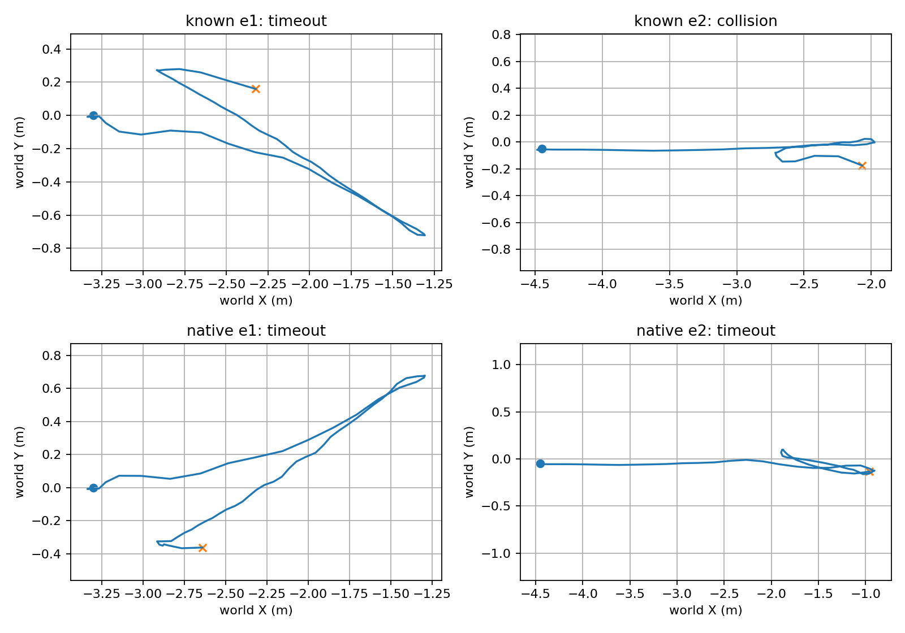

# 冻结滚动局部端点候选：完整覆盖结果

本次亲自执行同一候选的4条新增覆盖，每条只运行一次；已知位姿E0先前33.4秒实际到达，但并未推广到估计位姿或全部场景。原始35秒规则与真实接触判定保持不变。以下是真实位置评估，不读取候选索引制造进度。

|层/场景|结果|有效末时刻s|剩余距离m|真实轴向进度m|行程m|横向RMS/peak m|实际资格改动数|
|---|---|---:|---:|---:|---:|---:|---:|
|known_e1|timeout|35.00|5.626|0.976|4.770|0.335/0.721|14|
|known_e2|collision|26.68|6.485|2.416|4.063|0.038/0.142|14|
|native_e1|timeout|35.00|5.951|0.660|4.497|0.327/0.678|14|
|native_e2|timeout|35.00|5.413|3.488|5.715|0.056/0.150|15|

known E2实际接触26.68秒，仅评分到接触前26.6秒；其较小横向误差不能抵消真实碰撞。native E2没有接触，但35秒剩余5.413米，不能称成功。新候选合并先前E0结果，已知位姿1/3到达，估计位姿0/3；这是条件化TaskH覆盖，非严格cold-start视觉准入，非同期配对因果改善。原baseline两层0/3旧结果保留。

相机、光照、传统双目算法、显式记忆、规划与roll-PID未同步改动；同一冻结消费者只改变中间/最终局部端点资格。估计位姿仍含初始特权gauge、理想IMU/关节信息，不能称纯RGB导航。四条完整数据均退出0且封存、视频解码确认；作者尚未逐帧观看整段视频。来源空缺不等于自由，地面/安全起步先验单独标注。

剩余问题包括真实总行程不足、换向/重新对准时间以及正风险记忆的误插入。nativeE0首次5个地面点误成为风险，只在同帧离线teacher诊断中核实谓词变化，不证明整条导航反事实。已另行事前冻结唯一低阶学习记忆风险资格候选；不能重训被拒绝的未来流预测网络救分。fresh native E1/E2完整序列在启动前封存为该新目标held-out；普通导航统计不用于调整其门槛。尚未fit/评分该学习候选。

模型、接口、局部控制及正式导航层次分别保留，整体研究未完成。

