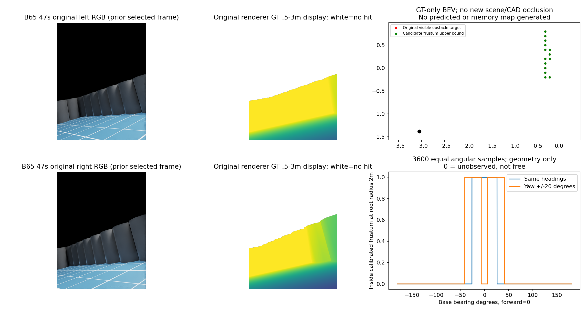

# 朝外展开双相机几何资格

保留原安装位置，只将左/右朝外各20°。固定95%原目标格保留门槛；七组已见开发数据，真值仅离线。完整1267帧，全像素原目标先按有限0.5–3m、静态CAD、根距离≥0.55m和真实bodyband确定，按0.1m格去重；格实例分母是各帧数量总和，不是永久地图格数或全场景召回。

|组|保留上界/原目标格实例|比例|
|---|---|---|
|H|3448/3681|93.67%|
|E0|6054/8963|67.54%|
|E1|4880/5553|87.88%|
|B54|4589/5278|86.95%|
|C54|3946/4775|82.64%|
|B65|5065/5690|89.02%|
|C65|4622/4923|93.89%|

全部失败，关闭physical0/2；fit0/recovery0。这里只把原场景可见点投进新标定视锥，未扣新机身/环境遮挡，上界失败足以拒绝，后续静态及运动CAD/新RGB渲染没有准入。没有生成新预测深度、误差图或长期图，不能把这些缺项冒充零误差；本阶段深度分位、模型地面误报与永久错误格均N/A。旧v77模型结果及长期错误保持封存。

2m根部半径、根相对高度0的3600等角样本：原519/3600，候选684/3600，保留原384/519；纯几何角覆盖51.9→68.4°，前向中心不可见。1m分别454→316，3m495→754；0.55m均0，这含固定轴向0.5m近距范围，不能归因于CAD。不是新联合场景目标或360度覆盖。

21首/中/末帧采用独立不等式投影复算exact，完整1267数量聚合exact；完整新视角独立渲染未执行。CPU原会话41777正常0，272.739秒，无运行。

## 同刻图

B65 47s沿用v75的事后帧选择，本候选并非最差或随机代表，本帧14/14保留。左原RGB与渲染GT（显示0.5–3m，超范围仅显示裁剪）；右红为原可见障碍目标格、绿为新视锥潜在保留，黑为机器人根；空白未知。下右前向0°，0=不可见而非自由。

原模型真实预测/误差与长期记忆只作已封存背景，非本候选新结果：

下一检验独立前向保护+后向补充安装布局，不调本角度救分。几何通过后仍须解决真实单目源的尺度/类别精度，不能把v77已拒绝模型接入导航。可靠导航与学习增量尚未成立。
