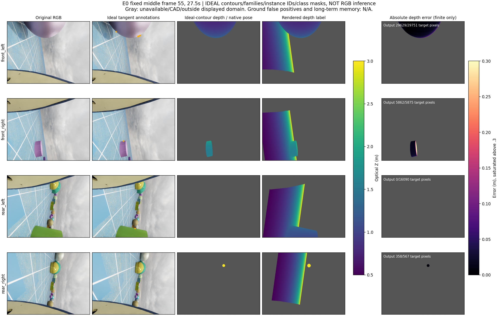
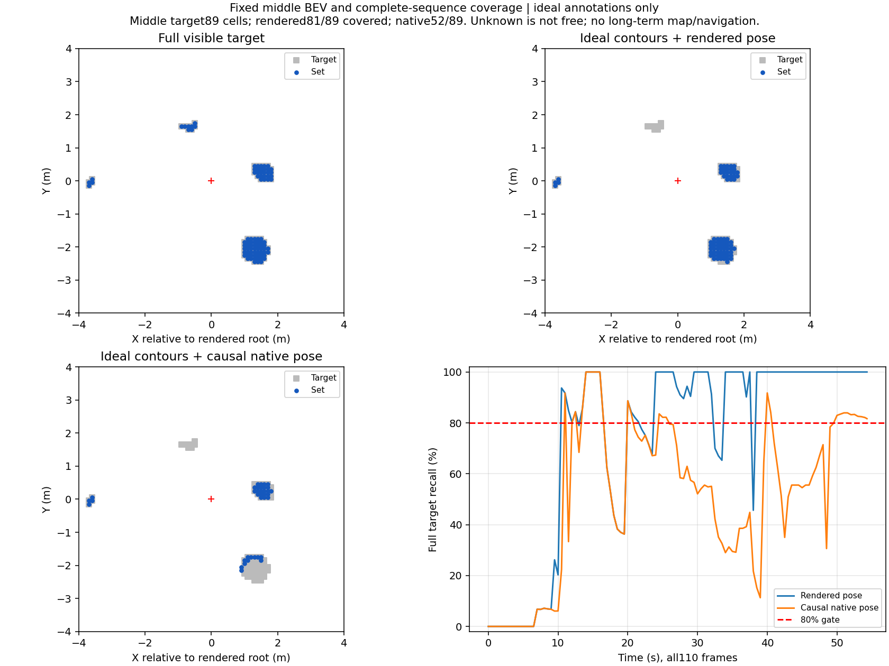

# 四路轮廓切线测距必要资格：覆盖失败，关闭候选

本轮在已认可相机配置的完整E0、110组440眼帧上实现了一个独立几何测量机制。对球面/竖直圆柱的二维轮廓切线反投影为平面，联合求未知位置与半径；圆柱端面高度由可见圆周图像射线求解。它生成米制几何，区别于旧逐点匹配、ZNCC平面扫描、正轮廓视锥投票和对已有米制点云的圆柱拟合。原始方法依据包括[圆柱轮廓三角化](https://arxiv.org/abs/2212.02319)、[二次曲面轮廓重建](https://www.robots.ox.ac.uk/~vgg/publications/1998/Cross98/)和[球体图像几何](https://i.cs.hku.hk/~kykwong/publications/kykwong_eccv2008.pdf)。本轮是这些原理在当前合同下的必要资格，不宣称算法原创。

**结论：拒绝before-RGB/训练/导航。** 即使授予理想轮廓、物体家族、跨时刻物体身份和目标类别，真实相机位姿下完整可见目标覆盖仍只有66.4349%，低于80%；因果IMU/编码器位姿下只有48.2921%。不能通过训练更好的RGB轮廓检测器就假定本结构合格。该结论限于冻结的轮廓见证、历史、几何求解和消费者，不证明所有轮廓方法或当前传感器的所有方法不可能。

## 输入和限制

- 固定相机 `experiments/user_fov_position_only_20261015_v1`，不改位置/FOV/朝向/640×480/场景/照明。数据来自v95的E0完整54.3秒，已见开发，非独立留出或新导航。
- 理想标签预处理使用真实深度/场景尺寸，仅生成二维切线、圆周射线、物体家族/关联及原目标像素掩码；几何预测函数不读取物体位置/半径/高度或像素深度。尺寸通过多视角方程估计，不把标注尺寸作为在线参照。
- 这些二维输入本身是强特权oracle，包含正确物体关联、内外朝向、理想目标掩码以及原域限制；没有真实RGB检测器，没有RGB类别/距离性能。理想球/竖直圆柱家族先验也不能泛化为任意形状认证。
- 真实位姿分支仅离线诊断；另一分支读取当前采集已有的因果IMU/编码器相机位姿。仅使用当前及过去10秒记录，基线≥.1m，条件数≤1000；不扫描参数。
- 继承原采集的约.4m已知球半径、特权初始规范/地面高度、理想低层bank反馈和原生packet一tick相位等限制；本轮没有校准真实硬件或解除这些特权。
- 后端沿用v76类别/距离分离、stride2、每对冲突≤.15m和四眼联合消费者。真目标保持原完整stride1、11652逐帧格实例及4476747像素，不排除悬空或无输出目标；未知不当自由，不清风险。

## 完整结果

| 理想输入分支 | 预测格/正确格 | 完整目标覆盖 | 条件深度P90 | 有输出目标像素/全部目标像素 |
| --- | --- | --- | --- | --- |
| 真实相机位姿 | 7171/7171，精确率100% | 7741/11652，66.4349% | .00484693m | 3288829/4476747，73.4647% |
| 因果IMU/编码器位姿 | 4539/4347，精确率95.7700% | 5627/11652，48.2921% | .09684974m | 3059361/4476747，68.3389% |

第一列计数顺序为预测/正确；条件深度误差仅计算有输出的原目标像素。像素覆盖不等于地图召回。两分支聚合最近集合格P90均为0，仅是0.1m格量化后的条件统计，不能解释为连续位置无误差。

因果位姿分支逐眼完整目标像素结果如下；它们也使用理想标签。前右眼条件误差明显高于聚合值，不能以聚合9.68cm掩盖。

| 眼 | 有输出像素/原目标像素 | 像素覆盖 | 条件深度P90 |
| --- | --- | --- | --- |
| 前左 | 902579/1087708 | 82.9799% | .0562934m |
| 前右 | 378889/676244 | 56.0284% | .2901911m |
| 后左 | 702188/997331 | 70.4067% | .0592372m |
| 后右 | 1075705/1715464 | 62.7064% | .1297940m |

真实位姿分支36/110帧覆盖<80%。因果位姿分支83/110帧覆盖<80%、11帧精确率<95%、7帧格定位P90>.3m，逐帧最大约1.208305m。首帧无满足多视角基线的同物体轮廓，159目标格全部保留为未覆盖，未删去起步段。完整曲线而非固定中帧决定拒绝。

悬空覆盖：真实位姿2149/2535=84.7732%，因果位姿2050/2535=80.8679%；地面相交目标分别5592/9117与3577/9117。类别可同格重叠，不能将类别分母当独立面积。当前域不存在额外unidentified格不代表以后可以排除未知。

类别与目标掩码理想，地面RGB误报N/A，不能用0宣称检测器通过；没有长期风险地图或导航。已发生几何最小二乘参数求解；“训练0”仅指没有ML拟合。物理/采集0、神经模型推理0、ML训练0、导航0。

## 同刻四路图像、深度与地图

固定序列中帧55、27.5秒，沿用事前中帧规则，非事后最优/最差选择。橙色是理想切线标签；第三列为理想轮廓加因果位姿得到的几何深度，第四列渲染深度，第五列仅有输出目标像素的绝对误差。灰色表示无输出/CAD/显示域外，不能当自由。深度色标.5–3m，误差>.3m饱和。

中帧真目标89格；真实位姿覆盖81/89，因果位姿52/89。蓝色是几何输出，灰色是真目标，红色为绘图参考根位置；绘图参考真位姿不进入在线估计。右下为110帧完整覆盖，红虚线80%。不是长期地图。

## 实际运行与复核

根目录 `experiments/contour_tangency_source_20261016_v1`，`protocol.json`及源码先冻结再派发。几何合同手算球/圆柱未知尺寸恢复、单视图与零基线拒绝、1.7m射线交点通过。全部理想标签输入和110预测先seal，再评价。

CPU预处理2026-10-16 06:17:17–06:17:28UTC正常0；预测06:17:28–06:17:36UTC正常0。首次评分在最终JSON写入遇到NumPy布尔值序列化错误，退出1，日志保留。唯一实现恢复修复文件序列化后，在06:18:56–06:19:01UTC完整写出result.json，随后控制台打印同类布尔值仍退出1。两次非零终态均保留，未冒称全部正常0，没有第二次恢复或重新生成预测。现有代码统一修复文件/控制台转换，未为此第三次执行科学评分。

独立复核正常0：逐帧采用整数格暴力最近距离，完整复算110帧两分支的全部格计数及4476747目标像素分母/条件深度分位，结果exact；全部110理想输入和110预测SHA一致。生成后的prepare/predict/几何合同/格评分函数AST保持不变。独立检查和绘图正常结束；无运行会话。必要失败结果按完整产物及独立复算确认，执行日志故障如实单列。

CPU资格cap1关闭、实现恢复1/1关闭，物理/训练/模型/导航cap0。旧所有预算保持关闭。停止该结构，不调整轮廓见证、历史、基线、条件数、对象家族或阈值救分。当前仍无准入的真实在线米制源；后续须提出实质不同且可实现的新测量机制，保持原automation每小时ACTIVE，有实质结果才通知，不重复本轮或旧oracle。
