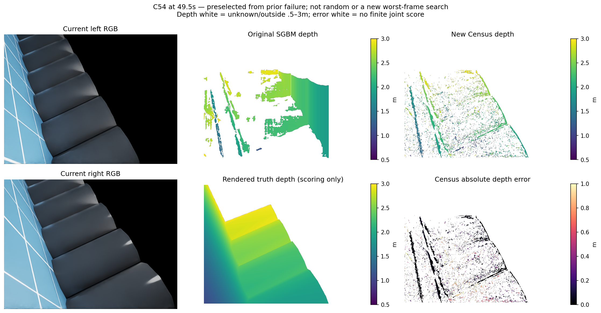
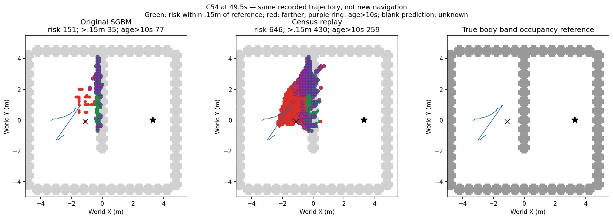
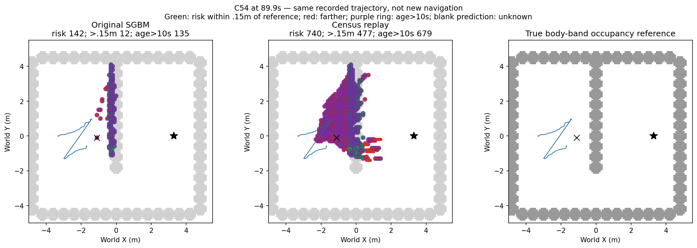
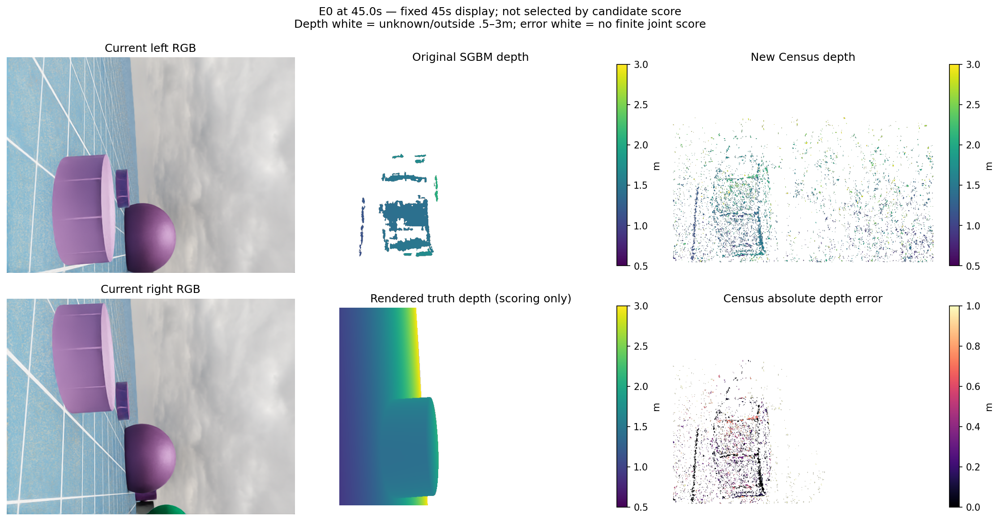
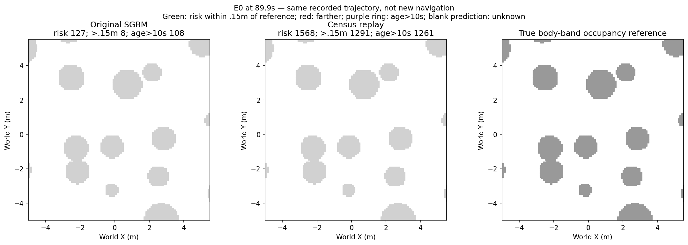

# 当前双目 Census 测距完整开发资格结果（2026-10-13）

## 结论

五条完整开发轨迹、905对当前双目与4500次原轨迹地图回放已经完成。原始投影/筛选和地图均用原输入复现。**候选不满足冻结源资格，拒绝接入导航。physical 0/4，未用4次关闭；fit 0。**

本次替换当前双目测量生成。7×7序数描述、3×3汉明代价、全可支持整数视差、固定唯一性和左右核对，没有读旧SGBM视差作种子。原方法依据 [Zabih与Woodfill 1994](https://www.cs.cornell.edu/~rdz/Papers/ZW-ECCV94.pdf) 的局部亮度次序与汉明比较；论文不能保证本场景表现。相机、照明、IMU、地图记忆规则、规划与控制没有调整。真值在全序列预测和选定地图封存后才读取。

## 完整序列测距（单位米）

|开发序列|原SGBM P90|Census P50/P90/P95|Census >0.3m|测量数量/原方法|原真实障碍查询保留|灾难帧数|
|---|---:|---|---:|---:|---:|---:|
|H|0.100471|0.064062 / 1.462862 / 2.437174|27.65%|46.50%|22.77%|181/181|
|E0|0.427207|0.228221 / 1.332935 / 2.046139|43.49%|122.93%|23.63%|181/181|
|E1|0.117708|0.081699 / 0.898882 / 1.182567|25.62%|46.14%|31.97%|181/181|
|B54|0.118129|0.094279 / 0.951318 / 1.231357|27.53%|51.03%|30.75%|181/181|
|C54|0.133587|0.128656 / 1.158500 / 1.473834|32.65%|58.96%|30.27%|181/181|

P90是有预测且渲染深度有限的条件误差；灾难帧预定义为至少1000个有效评分像素且P90>0.3m。不是整幅图、所有障碍或导航召回。障碍查询保留分母是原入图查询中真值高度0.05–1.5m的像素，不能替代可见场景召回。完整冻结门槛还要求每组P90≤0.15m、>0.3m比例≤10%、总测量保留≥70%、每个原预测≥1000的帧测量保留≥50%、障碍查询保留≥95%、零灾难帧。

## 覆盖与入图误差

|序列|有限评分/全部预测|评分/完整图像|有限入图点/所有入图点|地面误报/有限入图点|入图位置P90 m|
|---|---|---|---|---|---:|
|H|1922885/1947988 (98.71%)|3.46%|82322/88390|38053/82322 (46.225%)|4.018154|
|E0|1557280/2545490 (61.18%)|2.80%|98086/117705|35927/98086 (36.628%)|3.216015|
|E1|2930043/2987842 (98.07%)|5.27%|146022/160359|5707/146022 (3.908%)|1.023756|
|B54|2863356/2915079 (98.23%)|5.15%|144221/157010|5207/144221 (3.610%)|0.991192|
|C54|2393927/2432585 (98.41%)|4.31%|108253/117720|3941/108253 (3.641%)|1.174763|

每组完整图像分母181×480×640。入图点是固定CAD、双眼纹理、高度与不确定性流程之后的像素实例；地面误报按真值世界高度绝对值≤0.03m。渲染无命中仍单独报告，不当自由；有限像素、入图点和地图格是不同分母。理想原生IMU、滚动编码器估计、特权初始规范、固定0.4m机体高度先验沿用，不宣称纯视觉或无特权。

## 长期风险地图（89.9秒）

|序列|原风险/偏离/旧/旧偏离|Census风险/偏离/旧/旧偏离|
|---|---|---|
|H|138/21/138/21|913/725/679/491|
|E0|127/8/108/2|1568/1291/1261/1010|
|E1|175/30/115/20|896/567/663/436|
|B54|181/24/104/15|921/578/635/434|
|C54|142/12/135/12|740/477/679/444|

“偏离”表示格中心距机体高度带真值参照超过0.15m，“旧”表示最近支持超过10秒。地图空白为未知；风险变少不等于空间变为可通行。原轨迹固定，因此以上是**同轨迹离线地图反事实**，没有执行新导航；未知不能清除已经存在的在线风险。源评分含最后90秒采集，最终动作地图停在89.9秒，两者不是同一时刻。H沿用重复曝光记忆，其余四组沿用视角确认记忆，各组两方法内相同。

## 上次导致规划阻塞的像素

- 49.5s：原29点，新方法仍有测量22点、未知7点；误差≤0.15m 0点，>0.3m 22点。新方法误差P50/P90/P95=[0.9182601571083069, 0.938042676448822, 0.9459502160549164]m。
- 50.0s：原17点，新方法仍有测量9点、未知8点；误差≤0.15m 1点，>0.3m 8点。新方法误差P50/P90/P95=[0.8567667007446289, 0.9069736242294312, 0.9102352380752563]m。

原阻塞格(-1.1,-.1)在89.9秒的状态：[{'arm': 'baseline', 'risk': True, 'age_s': 39.8999991081655}, {'arm': 'candidate', 'risk': True, 'age_s': 39.39999911934137}]。
该像素集合根据上一次真实实验的错误格追溯事后选出，在本候选输出前已经固定；不是随机代表帧，也没有遍历本次结果挑最差帧。不能据此声称其他区域正确。

### C54同刻双目、深度与真值

### E0固定45秒展示

## 执行及适用范围

首次生成在90对后因为新增1微秒理想帧时钟检查触发退出；原日志全程累计约2.012微秒差，精确输入/原生位姿时钟相等。旧退出、代码和270个输出均保留。唯一恢复只将帧时刻合理性检查改为10微秒，并复用已封存前缀，匹配算法和资格门槛不变；recovery 1/1。该接口退出不计性能失败。

H/E0/E1/B54/C54均是已见开发轨迹。无独立新留出、无训练、无新导航，不宣称可靠导航或学习增量。当前研究交付、可靠导航、学习导航增量分别记录；本候选阶段结束不是整体完成。

完整数值：[result.json](../experiments/current_census_depth_20261013_v1/result.json)；因果输入输出封存：[prediction_seal.json](../experiments/current_census_depth_20261013_v1/prediction_seal.json)；运行与预算：[ledger.json](../experiments/current_census_depth_20261013_v1/ledger.json)。

## 本机只读复核

Python：`/home/an/miniconda3/envs/ball_wm/bin/python`。在工作区执行同目录 `verify_readonly.py`，只读核对输入/输出/源文件与封存身份，成功退出不代表源资格通过。新结果须另立目录，不能对封存目录重跑生成。GPU生成使用既有PyTorch/RTX3060与Isaac自带USD库；具体参数及环境路径在 `launch.py` 和 `launch_recovery.py`，不安装新环境。完整原始评分重算另见独立审查。

## 有限失败解释与下一问题

只检查上次阻塞格的46个已固定像素：真值重投影的右眼位置46/46在图内，左右当前CAD完整9×9支撑46/46未遮挡；45/46与右眼最近像素渲染深度在0.15m内相容。因此这一小集合不能简单解释为右眼完全看不到。46/46的真值对应整数位置Census代价都高于算法选出的错误对应，说明仅替换局部代价未解决这批错误。最近像素真值一致性不是全场可见性证明；真值仍只用于离线解释。

下一独立问题：当前扫描线的对应是否需要联合决定先后顺序、一对一分配与遮挡缺口，而非逐像素选最低代价。先有限核对原SGBM半全局优化和已拒绝right-partner过滤是否已经实现相同约束，再决定是否冻结一个不同的联合对应机制。不得调本候选窗口、唯一性、代价阈值或换描述子救分；这是尚未实现、尚未准入的研究问题，不承诺导航改进。旧模型和预算继续关闭。

绘图首轮因通用模块路径优先导入旧同名评分模块而退出，旧源码与日志保留。仅修正绘图依赖后重绘成功，没有重新生成预测或改动评分。这与先前唯一源生成接口恢复分别记录。

## 独立复核与阶段终态

独立复核全部905对、1810组逐帧方法评分和40份选定地图，25495个数值字段完全一致；14446份输入、2755份输出、15份源代码身份以及270份恢复前缀核对通过。另从保存表面点独立重放C54全900步，原地图全部标签与时钟、两方法逐步计数及8份选定完整地图一致。其余组全900步原地图相等由封存生成器断言支持，独立复核覆盖它们选定的地图，不扩大审查范围。

46点诊断另用直接布尔邻域计算复核，未复用候选Census编码函数；几何分类与代价关系一致。核验记录为本目录independent_closure.json与independent_visibility_review.json。源资格拒绝，physical 0/4且未尝试4次关闭，fit 0，源恢复1/1；已登记宿主进程全部退出。完成的是本候选完整源资格与失败解释阶段，可靠导航、学习导航增量和整体目标仍未完成。
