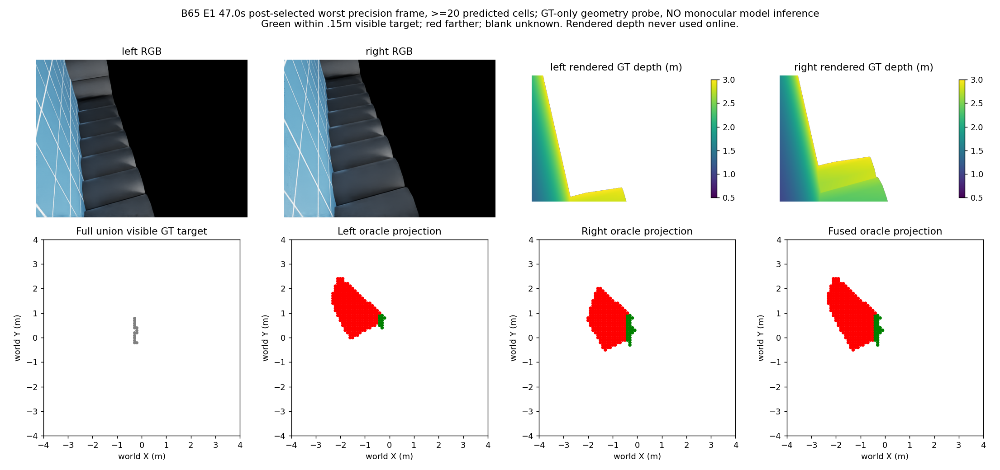

# 两路单目BEV：几何消费者资格结果（2026-10-15）

本轮实际完成两路独立米制投影/重叠冲突/BEV融合实现、七组1267对完整GT-only几何资格。现有两眼同朝向，不是环视。官方Depth Anything V2 Metric Hypersim Small权重99,222,290bytes已完整下载且239状态项strict加载通过；模型推理0、训练0、物理0。不能称单目模型性能失败；被否定的是仅由估计世界高度分类障碍的本次消费者。

冻结precision≥95%、联合可见目标recall≥80%、格定位P90≤.15m。目标使用完整像素、有限.5–3m、CAD未遮挡、root排除.55m、GT高度.05–1.5m；预测每2像素采样，左右和融合都以同一完整联合目标评分，非全场景召回。GT只诊断，绝不在线。

|组|融合正确/预测格实例|覆盖/联合目标格实例|精确率|召回|定位P90(m)|
|---|---:|---:|---:|---:|---:|
|H|4035/5240|3667/3681|77.00%|99.62%|0.510|
|E0|8774/9595|8958/8963|91.44%|99.94%|0.100|
|E1|6291/7305|5553/5553|86.12%|100.00%|0.407|
|B54|5945/6692|5278/5278|88.84%|100.00%|0.300|
|C54|5267/5960|4775/4775|88.37%|100.00%|0.361|
|B65|6504/7857|5690/5690|82.78%|100.00%|0.600|
|C65|5614/5717|4923/4923|98.20%|100.00%|0.100|

初始诊断目标误用了2像素采样，初版保留为sampled_target_initial；正式资格已修为完整像素并重跑1267对，门槛没有更改。没有模型运行重试。独立全部1267融合帧计数聚合核验通过；不夸称全几何第二实现复算。

## 同刻失败解释

B65 E1 47.0秒，事后选取本组≥20预测格帧中的最低精确率，不是随机代表。渲染真深度只用于离线oracle；网络预测深度、模型误差和长期记忆未生成，不能用GT伪装。红格距离完整可见GT目标>.15m，绿格≤.15m，空白未知。

该帧融合正确29/374格、覆盖14/14目标格，精确率7.75%但召回100%。左真实地面误报10075/12008点，右10339/19024点；左右点实例不能简单相加成去重格数。相同像素世界点位置误差P90约.0870/.0865m，小位置/高度误差可把地面送入固定高度分类。两路重叠检查冲突0，不能靠一致性证明正确。以上仅该失败帧解释，非全序列地面率。

结论：停止本次高度代理融合候选，physical0/4余4关闭，fit0，恢复0；单目权重保留未评估。需要独立验证像素地面/障碍/未知类别与距离分离消费者，不能调高度/冲突门槛救回当前候选。旧v62理想语义资格和模型拒绝保留；可复用既有几何代码，但新双视角域资格必须明确，不加载旧拒绝学习模型。只在完整资格支持后选择真实在线类别来源、冻结新消费者/预算，再实际单目推理/先seal后GT评分，合格才导航。可靠导航和学习导航增量仍未成立。
