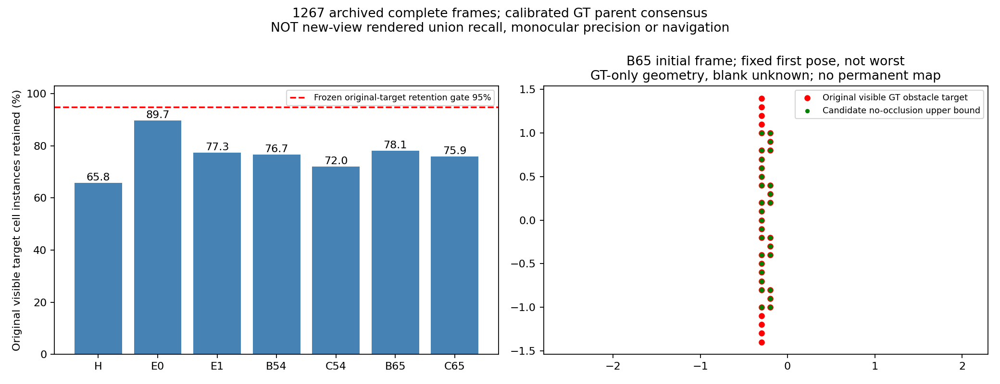
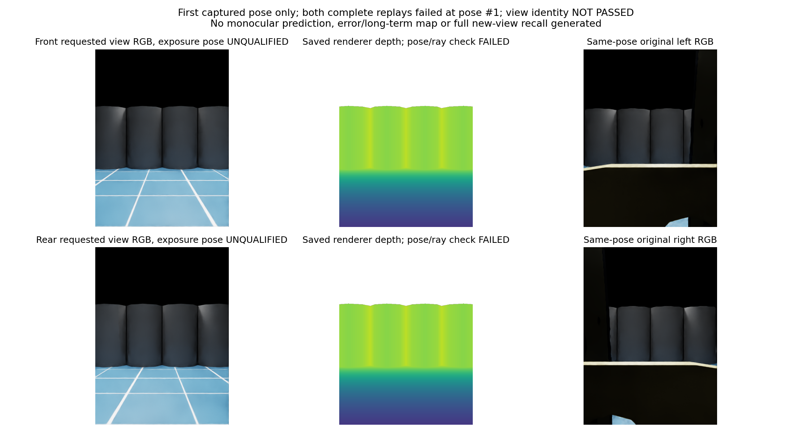

# 前向保护＋后向补充布局：几何拒绝，渲染输入未准入

布局只改变相机配置：前(.45,0,.05)m朝前，后(-.45,0,.05)m朝后。原640×480、focal584.888889px、.01–1000m裁剪、场景及固定照明不变，真实硬件未动。与v78原位置朝外±20度不同；没有修改或使用旧拒绝模型。

## 完整有效研究结论

七组已见开发1267帧，原双眼全像素有限.5–3m、静态CAD非遮挡、真实bodyband .05<z<=1.5m、距root≥.55m的当前可见目标，按.1m格去重。GT仅离线。两个原相机world×local inverse反推同一个base_link，最大矩阵差7.1e-15；本次不把物理Articulation root假定等于渲染base_link。固定候选投影只做无新增CAD/环境遮挡的上界。

|组|保留上界/原目标格实例|保留比例|
|---|---|---|
|H|2422/3681|65.80%|
|E0|8042/8963|89.72%|
|E1|4295/5553|77.35%|
|B54|4047/5278|76.68%|
|C54|3439/4775|72.02%|
|B65|4446/5690|78.14%|
|C65|3735/4923|75.87%|

全部<冻结95%原目标保留门槛，布局拒绝；不调位置/角度或改变原门槛救分。格实例是181帧各自去重后数量之和，不是永久格数量、全场景召回或新联合可见目标；不是模型精确率。21首/中/末帧采用独立基坐标直接不等式投影复算exact，1267计数聚合exact。

右图B65初始帧为固定第一帧，不是随机代表/最差选择；红原GT可见格，绿新视锥潜在保留，空白未知。不是新永久地图。

## CAD资格与真实运行限制

七组1267实际保存三关节状态全部满足所有CAD三角形顶点在两眼z=.01m近裁剪之后不可见（最前界.009897m）。这只是相同裁剪下的仿真遮挡证书，不能证明实体安装可行或硬件光路无阻挡。独立21完整XYZ顶点变换核对保守上界通过；初版转置计算、核验器把保守界误要求相等和独立投影初版切片错误均保留并修正，未用无效检查准入或改变数值门槛。

真实同E1场景重放原B65姿态：首轮21:31:43–21:32:03UTC异常1，唯一同步恢复21:34:14–21:34:31UTC异常1，均只完成首姿态。首轮异常被原关闭接口遮盖，恢复已保存traceback：第二姿态baseline相机world readback与物理root推算矩阵最大差.119732。此为矩阵元素口径，不能报成位置误差米或控制故障。

首帧额外有限核对：前/后中央(240,320)各1像素，按配置场景USD圆柱解析射线期望深度2.500007/.700000m，保存depth均2.743376m，差.243368/2.043376m。仅两像素和配置资产核对，未完整封存运行stage全部状态；不能证明所有根因。曝光/位姿身份没有通过，首帧也不能作可信后视观测或模型性能。

图只是请求的前后视图所保存RGB/depth；传感数据身份失败，不能标为可信新方向。depth色显示.5–3m裁剪，白无有限值。没有单目预测或新域真值资格，所以深度误差P90/有效源覆盖、地面误报、空间错风险格和长期正确/错误保留均N/A，不能填0，也不重用v77旧模型图冒充本候选输出。不存在90秒新导航终态、轨迹或视频。原nativeIMU来源保留于旧输入，本渲染没有新IMU导航链。

两次scene reset含唯一恢复used2/cap2、recovery1/1、fit0/model0/navigation0，全部关闭。host110905/110906/113883/113884均退出，两个user services inactive。

## 接续

有限离线核对相机初始化/原生pose API与USD直接修改、articulation root/base_link及曝光时钟合同，先修未来接口资格；不重开本实验。当前窄视锥与固定测量域损失分开，只有独立光学机制证据才冻结新候选。不用本失败布局或v77拒绝模型接入导航，不微调救分。可靠导航与学习增量未实现。
