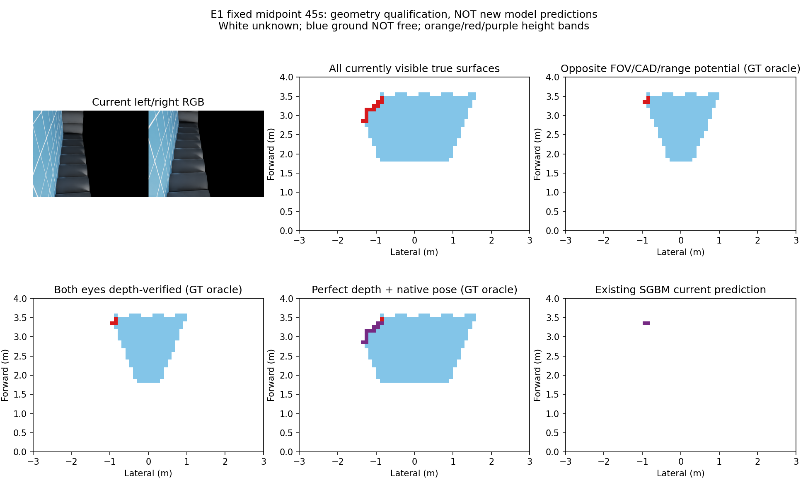
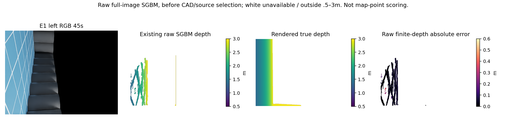
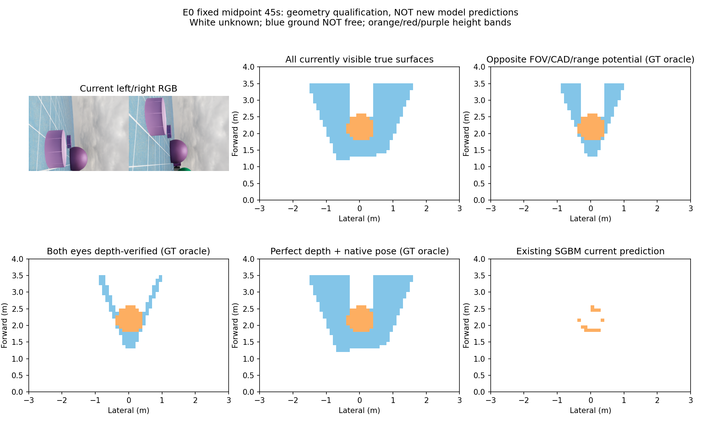

# 几何约束学习前的观测资格结果

2026-10-13T04:48:35.279034+00:00。**本阶段资格失败；未训练新模型，未接入导航。**

## 问题与实现

上一版直接图像到地图的学习失败后，实际实现固定双目几何、CAD遮挡、原生IMU姿态投影的完整序列资格工具。问题是当前严格双眼对应测量能否支持原先“全部当前可见障碍”的学习目标。H/E0/E1各181帧（0–90秒），均为已见开发数据。不是新鲜泛化测试。

四项CPU几何检查、543帧原目标逐格身份、实际标定/原生姿态来源及独立指标复算通过。本阶段所有带oracle标注的结果使用渲染真值，仅用于诊断/标签，**不是线上测距，也不是学习预测**。

## 定量结果

| 场景 | 可见真障碍格次 | 双眼几何条件覆盖召回 | 双眼深度核对召回 | 真深度+原生姿态精确率 | 地图位置P90 | 地面误报格次 |
|---|---:|---:|---:|---:|---:|---:|
| H | 3939 | 52.1706% | 51.0790% | 78.4292% | 0.500m | 1367/65331 |
| E0 | 8752 | 79.9017% | 78.8848% | 90.4088% | 0.000m | 942/68608 |
| E1 | 6415 | 62.8215% | 62.5565% | 87.6286% | 0.316m | 1166/39461 |

分母是181帧累计可见障碍格次，不是独立物体数或完整环境召回。0.1m网格、匹配容差一格切比雪夫；每高度格至少4个合格像素，保留原标签定义。双眼几何条件含对眼视场、当前CADmask、两眼0.5–3m距离、格计数；不能称纯相机FOV上限。深度核对采用对眼最近像素±0.03m，受到边缘采样影响，不代表精确可见性证明。E0的79.9017%严格小于80%，没有四舍五入判过或调门槛。

真深度+原生姿态这项诊断采用现有原生姿态投影、再用现有世界高度分层；H/E1分别未达90%风险精确率及0.15m定位P90门槛。说明只提高深度精度不足以使这一消费链合格，不能直接认定误差全部来自IMU。局部坐标以各自root/yaw重置，xy/航向规范偏移被抵消，不是长期世界图累计误差测量。原生估计含特权初始规范、理想仿真IMU和固定0.4m高度先验，不能外推实体传感器性能。

## 同刻输入与真实参照

以下均为事后选定固定序列中点45秒，不是预注册或最差帧。



上中是全部当前可见真表面，上右是双眼几何条件满足的真表面，左下再要求对眼深度核对，中下是真深度在原生姿态下的地图，右下才是**已有SGBM实际预测**。白色未知、浅蓝地面（不保证自由）、橙/红/紫为0.05–0.5/0.5–1/1–1.5m高度类别。中下颜色改变涉及高度分类，不应全部当作平面位置错误。



E1第45秒原始SGBM未经过CAD/源筛选的全图测距0.5–3m候选19304像素，其中18328可同域真值评分：候选条件覆盖94.944%、全图307200像素的5.966%。误差P50/P90/P95分别0.028602/0.068340/0.083227m。此处是**单帧原始像素深度误差**，不能与上表全序列地图位置误差混用，不能把94.944%称全图召回。白色为不可用或不在指定范围，非自由。



## 长期记忆保持原状态

本阶段没有合法新源输出，未更新或清除任何长期风险。沿用v48已核验的E1终态175风险格，其中30格距body-band参照超过0.15m；115格超过10秒，其中20格也超过该位置偏差。它们是历史同轨迹结果，不是这次修正成功。


历史图灰色真实body-band参照、绿色近参照风险、红色偏离参照>0.15m、紫圈年龄>10秒；空白未知。图对应最终89.9秒，不是上方45秒。

## 决策、复现与下一步

v50固定几何资格已实现并完成543帧全序列GT诊断与独立核验，全部原目标exact。H/E0/E1双眼FOV+CAD+范围+格计数条件潜在召回52.1706/79.9017/62.8215%，双眼最近像素深度核对51.0790/78.8848/62.5565%，均低于80%。不是所有学习方法的理论上限，仅当前明确双眼测量域。即使真深度配原生姿态，H/E1风险精确率78.4292/87.6286%、位置P90 .5/.316228m；地面误报H1367/65331、E0942/68608、E11166/39461。GT仅离线oracle；没有新预测源、fit0/physical0/recovery0。严格当前双眼共同观测覆盖完整可见目标无训练资格，未启动新拟合。当前局部重心/航向重置抵消xy漂移，不是世界累计配准审计；理想原生IMU、特权初始规范及固定.4m高度先验如实披露。durable CPU 04:40:42–04:44:49 UTC finished0，exec session10758已正常收回，无实验在运行。

这否定的是“严格当前双眼共同测量域直接承担完整可见目标”的准入，**不证明神经网络不能借单眼线索或历史信息推断其他区域**。任何这种补充必须标为推断并独立评价，不能当成实测自由或可靠障碍。

下一直接动作：先冻结新的像素表面类别（地面/障碍/未知）与距离分开输出、固定标定投影消费者；用理想像素类别/深度和实际原生姿态完整核验其目标身份、地面误报、位置精度与可见障碍覆盖，GT仅诊断监督。不用现有世界高度阈值重新分类预测语义，也不能把GT语义用于实际导航。资格通过才冻结一个像素级学习候选、训练整序列覆盖/一次拟合/新鲜验证；分别标注双眼匹配支持和单眼先验推断。该目标尚未实现，不能换网络救v49或放宽v50门槛。原H/E0/E1仍开发数据、旧所有预算封闭；合格源才进入新cap<=4真实90秒对照。

[冻结协议](../experiments/geometry_visible_qualification_20261013_v1/protocol.json)、[完整资格结果](../experiments/geometry_visible_qualification_20261013_v1/qualification.json)、[独立审查](../experiments/geometry_visible_qualification_20261013_v1/review.json)、[原生几何独立核验](../experiments/geometry_visible_qualification_20261013_v1/independent_geometry_checks.json)、[独立指标](../experiments/geometry_visible_qualification_20261013_v1/independent_metric_checks.json)。run_qualification.py执行，launch.py通过既有durable监督；主运行已finished0，禁止同输出目录重复派发。训练0/物理0，未扩大旧预算。

环境沿用Python3.10、NumPy/SciPy/OpenCV及原Isaac USD库，launch.py记录必要路径。只读封存核验：

```bash
PYTHONDONTWRITEBYTECODE=1 /home/an/miniconda3/envs/ball_wm/bin/python - <<'CHECK'
from pathlib import Path
import json,hashlib
p=Path('/home/an/Documents/ChatGPT/球型机器人导航/experiments/geometry_visible_qualification_20261013_v1/artifact_manifest_post_close.json')
r=json.loads(p.read_text())
assert all(hashlib.sha256(Path(f).read_bytes()).hexdigest()==h for f,h in r['artifact_sha256'].items())
print('geometry qualification sealed evidence verified')
CHECK
```

本轮停止原因是完整三序列观测资格否定并经独立验收；可靠导航、学习导航增量和整体目标仍未完成。
