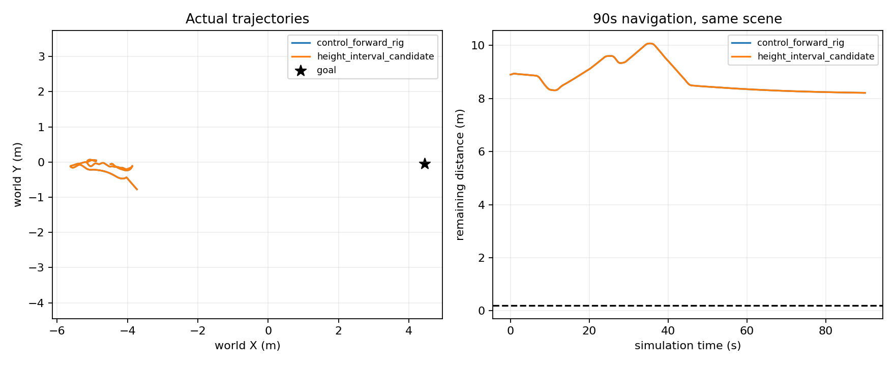

# 视觉高度不确定度候选：实际导航拒绝

更新时间：2026-10-12T13:57:35.126544+00:00

## 结果

本轮实际完成实现、8项CPU检查、181对保存输入回放、独立准入、一次90秒E2导航及独立原始闭合。候选未通过到达判据，预算使用1/3，其余2次关闭；无恢复、无训练，所有实验进程已退出。可靠导航与学习增量仍未成立。

| 条件 | 终止 | 目标余距 | 净进展 | 接触 | 控制请求 |
|---|---|---:|---:|---:|---:|
| 已封存前移60cm基线研究配置对照 | 90秒超时 | 8.212182m | 0.687817m | 0 | 900 |
| 新高度不确定度筛选 | 90秒超时 | 8.212182m | 0.687817m | 0 | 900 |

900条请求、轨迹及全部20个物理字段与对照逐值相同。两眼181对RGB均有差异，不能授予完整因果A/B或独立泛化。历史原相机90秒套件仍为E0成功、E1超时、E2碰撞（1/3），这张表不改写该成绩。

## 改动与证据

沿用已测前移60cm基线相机作为固定研究配置，仅修改**新障碍点的资格**：原双目、纹理、正高度筛选后要求`world_z - existing sigma_m > .05`。使用已存在的一像素视差敏感度及原地面高度先验；没有拟合倍数。模糊点归未知，不删除已有确认风险；规划安全距离、风险生命周期、IMU、控制器、场景、照明与90秒判据不变。该sigma并非标定置信区间，不能覆盖所有系统误匹配。

实际181对输入中76对点集改变，从78001点中剔3505，保留74496；在线输出逐项复算一致。离线同帧渲染深度评分显示，地面误检4145→1557，真实正高度表面57856→57104。因此筛选确实改变感知，也有丢弃真实表面的代价；没有形成导航增量。这里的相关像素/帧数不是独立样本数，渲染真值仅用于事后评分。

终态frame899中，原生估计位置到最近风险格中心为0.806226m，小于冻结规划门槛0.870711m。门槛内只有格[211,200]；其保存来源为23.0/23.5秒两帧119点，全部有效渲染评分为地面，预测中位高度约0.21m。它说明剩余地面误匹配足以阻断本次终态起点，不证明全程所有失败都由它造成，也不授权在运行中按真值清格。只读7px相关性诊断中111/119点仍达到旧0.9诊断线，故没有为此另开NCC阈值候选。

## 实际闭合

- durable正常退出0，墙钟约447秒；导航终态为90秒超时，二者分别报告。
- 901次采集、900请求、4500物理命令逐条对应；181次原生位姿注册与相机时钟通过。
- 5401个接触记录全部可用且无接触；两个视频分别完整解码901帧。
- 原双目条件测距门槛通过：p90绝对误差0.100471m，超过0.3m比例1.2315%；这是条件像素精度，不是完整可见性或安全保证。
- 5272个运行封存文件覆盖与SHA核验通过；增强监督器在源/执行审核通过后才评分和准许迁场景，审核失败不会被记成导航失败。

## 下一方向

关闭本高度筛选候选，不调sigma倍数、地面高度门槛或NCC门槛，也不复跑相机方案。下一独立机制针对“相近两帧的系统误匹配被确认成长期风险”：使用真实双目与IMU可得的视角/几何证据实现并验证更充分的确认资格。需要保留当前风险、未知身份与历史拒绝，不把缺观测当作清除依据；任何新机制仍须单变量、有界实际导航验收。

## 入口与原始证据

- [候选协议](../experiments/risk_height_navigation_20261012_v1/protocol.json)
- [实际评分](../experiments/risk_height_navigation_20261012_v1/candidate_e2_assessment.json)
- [独立闭合](../experiments/risk_height_navigation_20261012_v1/independent_closure.json)
- [终态阻塞点评分](../experiments/risk_height_navigation_20261012_v1/terminal_blocking_points.json)
- [点集变化的评分](../experiments/risk_height_navigation_20261012_v1/height_effect_assessment.json)
- [双目视频](/home/an/Documents/ChatGPT/球型机器人导航/experiments/risk_height_navigation_20261012_v1/candidate_e2_run/stereo_view.mp4)
- [第三视角视频](/home/an/Documents/ChatGPT/球型机器人导航/experiments/risk_height_navigation_20261012_v1/candidate_e2_run/third_person.mp4)

运行沿用`/home/an/miniconda3/envs/ball_wm/bin/python`与现有Isaac；确切源/输入绑定在`admission.json`和各arm协议中。实际启动入口为本目录`supervise.py`，它拒绝覆盖已有ledger/status，不能用它重开已关闭预算。只读重算可调用`score.py <candidate_e2_run绝对路径>`；原项目未修改、没有上传。
