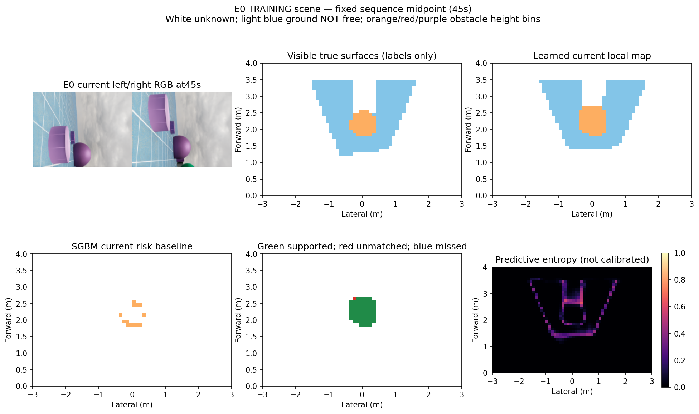
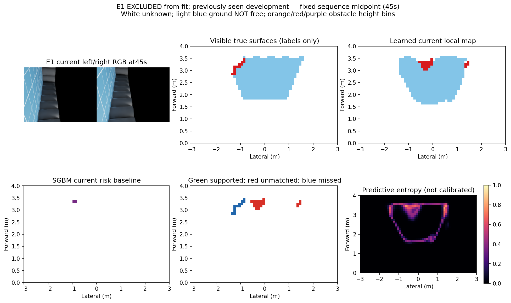

# 当前双目 + IMU 学习可见障碍：第一版实际结果

更新时间：2026-10-13T04:29:39.976596+00:00。结论：**唯一冻结拟合已完成，但E1源资格失败，拒绝接入导航。可靠导航与学习导航增量仍未成立。**

## 实际完成内容

以当前双RGB和原生IMU重力方向，输出前方0–4m、左右各3m、分辨率0.1m的局部表面类别图。双目原图640×480，网络输入160×120；标签只覆盖当前真实可见、测距0.5–3m的表面。未知、地面、三个障碍高度层分开；地面标签不构成可通行证明。

三条完整90秒轨迹，每条181次双目曝光，共543对。H/E2和E0的362对参与训练，E1的181对完全排除于拟合、类别权重与检查点选择。全部原序列均为研究中已见开发数据，**E1不是全新独立研究留出**。帧数不是独立场景数量。

数据资格检查通过后，在现有RTX3060 / Python3.10 / Torch2.5.1+cu121中仅拟合1次、固定30轮、使用末轮权重。预测先封存再评分。输入不含GT深度、GT位姿、场景编号、时间索引、原SGBM深度或旧记忆；GT仅生成监督标签与评分。重力来自现有仿真原生估计链路，未证明实体IMU噪声下泛化；监督标签采用平地世界高度、真实相机外参和CAD遮挡，均为仿真监督特权。

## 整序列定量结果

| 场景与用途 | 学习精确率 | 学习召回率 | 原双目精确率 | 原双目召回率 | 学习定位误差P90 |
|---|---:|---:|---:|---:|---:|
| H / training | 96.66% | 100.00% | 93.81% | 48.18% | 0.100m |
| E0 / training | 98.91% | 99.93% | 96.34% | 50.23% | 0.100m |
| E1 / fit_excluded_development | 27.74% | 33.55% | 95.34% | 58.52% | 1.265m |

精确率表示预测障碍格中有附近真值支持的比例，召回率表示可见真障碍格被检出的比例；匹配允许1格切比雪夫偏差（对角最大约0.141m）。定位误差为预测风险格中心到最近可见真风险格的欧氏距离，**不是双目深度误差**。统计按181帧的格次累计，同一实体可能重复计数。

E1：学习预测风险11476格次，真值可见风险6415格次；匹配预测3184、匹配真值2152。地面误报2780/39461=7.04%；缺少附近可见表面标签支持的预测6159/11476=53.67%，不能据此断言这些空间实际为空。原双目相应为预测3841、匹配3662，召回3754/6415；地面误报352/39461=0.89%；缺标签支持80/3841=2.08%，定位P90为0.10m。

学习E1可见表面召回95.84%由大量地面格主导，不能替代33.55%的障碍召回。高度正确率99.61%仅针对1025个精确重叠风险格；E1最高高度层没有真值，召回为N/A。原双目不输出地面，不能用全表面召回直接判其优劣。

冻结门槛为精确率≥90%、障碍召回≥80%、地面误报≤5%、无支持预测≤10%、定位P90≤0.15m、可见表面召回≥70%。E1前五项失败。训练场景拟合良好而E1失败，证据支持本次跨场景失败，不能仅凭两条训练轨迹确定原因就是某一网络结构或数据量。

## 直接可视化

以下均为固定序列中点45秒，图在训练和评分之后生成；不是预注册挑帧，也不是事后最差帧。

### E0：参与训练



### E1：未参与拟合，但研究中已见



每幅左上为同刻双RGB，中上为当前可见真值，右上为学习地图，左下为原双目当前风险，中下为学习误差，右下为未校准熵。主地图白色未知、浅蓝地面（非自由）、橙/红/紫依次对应0.05–0.5 / 0.5–1 / 1–1.5m障碍高度。误差图绿色为附近真值支持、红色为无附近风险标签匹配、蓝色为漏检。颜色含义必须按所在面板区分；熵低不保证正确。

本模型直接输出局部类别地图，没有预测深度图，不伪造深度误差。未准入长期记忆，所以本阶段没有学习长期地图、实际导航轨迹或新视频；原长期风险图保持原身份，不把本地回放图当导航结果。

## 核验、接口与复现

独立审查核对2751项身份绑定，以独立距离算法复现全部评分、543帧原双目格图；无二次拟合。CPU与原GPU推理E1有3/434400格差异，概率最大差0.000526，所有拒绝判定不变，因此不宣称跨设备逐位一致。单帧接口检查与最初概率容差断言失败保留；原双目比较器time_s字段错误在生成输出前修为acquisition_time_s，原始错误与源码保留。

权重为 [model_final.pt](/home/an/Documents/ChatGPT/球型机器人导航/experiments/learned_visible_obstacles_20261013_v1/model_final.pt)，参数与门槛见 [protocol.json](../experiments/learned_visible_obstacles_20261013_v1/protocol.json)，完整结果见 [result.json](../experiments/learned_visible_obstacles_20261013_v1/result.json)，审查见 [postfit_review.json](../experiments/learned_visible_obstacles_20261013_v1/postfit_review.json)。数据/预测/权重身份分别记录于coverage、inference_inputs与prediction_seal。

现有输出只读复核命令：

```bash
PYTHONDONTWRITEBYTECODE=1 /home/an/miniconda3/envs/ball_wm/bin/python - <<'CHECK'
import json,hashlib
from pathlib import Path
p=Path('/home/an/Documents/ChatGPT/球型机器人导航/experiments/learned_visible_obstacles_20261013_v1/artifact_manifest_post_close.json')
r=json.loads(p.read_text())
assert all(hashlib.sha256(Path(f).read_bytes()).hexdigest()==h for f,h in r['artifact_sha256'].items())
print('封存文件校验通过')
CHECK
```

诊断推理接口 [predict_local_map.py](../experiments/learned_visible_obstacles_20261013_v1/predict_local_map.py) 接受仅含left_rgb、right_rgb、gravity、time_s的NPZ，输入必须是原尺寸uint8双RGB与有限单位重力。输出强制标记rejected_development_only、allow_command_consumer=false、certified_free=false。输出路径须放在实验封存根外。该接口未证明时间同步，调用方需提供同刻输入。

```bash
PYTHONDONTWRITEBYTECODE=1 /home/an/miniconda3/envs/ball_wm/bin/python '/home/an/Documents/ChatGPT/球型机器人导航/experiments/learned_visible_obstacles_20261013_v1/predict_local_map.py' /tmp/current_pair.npz /tmp/diagnostic_map.npz
```

训练驱动保留完整命令和环境于launch_fit.py、fit_status.json；fit_started.json防止同版本重复拟合。禁止为了提高本结果而删receipt重跑、换网络、调阈值或扩旧库。

## 决策与下一问题

本候选fit1/1，物理0/4，未用4次关闭，环境恢复0；宿主1712265/1712266已退出。关闭的是这版候选，不能据此推断学习障碍总体不可行。

下一研究问题为：固定标定和重力补偿的显式几何投影，能否约束图像特征落在正确局部坐标。先完成不训练的射线/投影资格，结合已有失败机制有限核对；有依据才新立“几何约束可见表面重建”候选与一次拟合资格，冻结输入、分组覆盖和新鲜验证。该机制尚未实现或验证，不恢复本次模型或旧SGBM置信度预算，也不把换网络作为救分。v48的Census仍为未实现且暂缓的假设。
