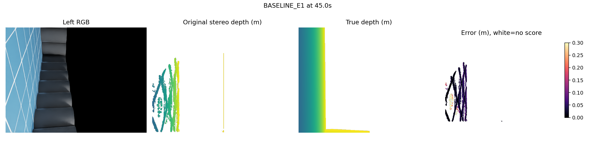
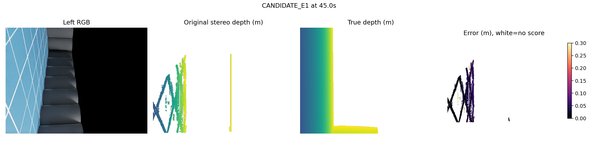
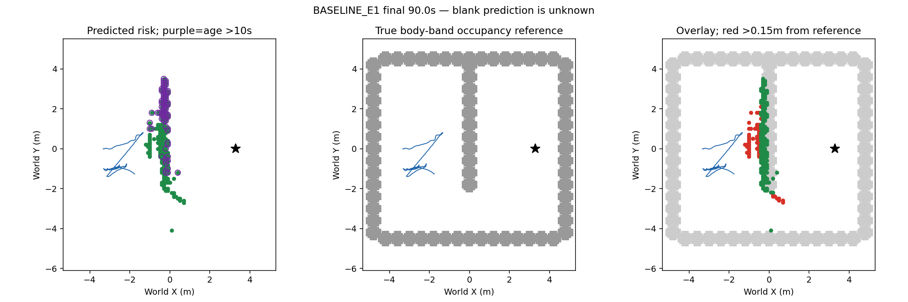
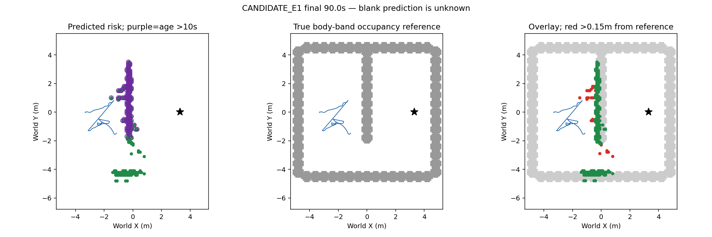

# E1记忆反证与当前速度目标：实际结果

本轮完成完整回放及两臂真实90秒视觉+IMU导航。两个候选均拒绝；可靠导航、学习导航增量仍未成立。

## 1. 记忆反证消费者

双眼当前有限测量检验历史观测支持包络；保留近期10秒风险，反证只能降为未知。完整900幅同输入E1回放：175风险格不变，0格降级，0近期风险改变。无法改正已知参照错误，准入拒绝；physical0/fit0，余4关闭。初版准入缺陷记录保留，仅最终修正版计结果。

## 2. 当前速度目标实际对照

|指标|基线|候选|
|---|---:|---:|
|90秒剩余距离(m)|5.214377|4.688895|
|净推进(m)|1.385624|1.911106|
|到达/接触|未到达/0|未到达/0|
|深度误差p50/p90/p95(cm)|2.96/11.35/14.39|2.55/12.29/14.89|
|有限可评分/置信预测像素|5,182,026/7,035,223 (73.66%)|4,008,134/5,475,587 (73.20%)|
|可评分/完整源图像像素55,603,200|9.32%|7.21%|
|最终风险格 / >10秒保留格|216 /76|235 /147|
|距body-band真值参照>15cm格|58/216|24/235|
|其中>10秒保留错误参照格|8/76|18/147|
|入图点GT有效/入图实例|256,556/295,641 (86.78%)|200,353/235,338 (85.13%)|
|有效入图点中GT地面误报|2251/256556 (.877%)|579/200353 (.289%)|
|入图点3D误差p90(cm)|6.46|10.03|

候选额外净推进0.525482m，但仍未到达，按冻结判据拒绝，不调参复跑。所有900请求、4500物理命令、181原生注册、900地图、5401接触记录和双901帧视频已核验。两臂RGB源181对全部不同，没有完整因果复制，也非独立泛化。

649个实际跟踪请求的当前源算术核验通过。低速修正586次；最终发出的409个低速请求块与同状态旧公式不同。另63次数值精度差异<=2.186e-9rad，其中1块在float32输出上不同。原控制速度范数float32、诊断范数float64差异如实保留，初始严格检查错误记录不删除。counterfactual仅候选同状态，不是另一条实际轨迹。

## 3. 同刻深度与终态地图

以下深度为预先选定中点45秒，非事后最差帧。深度图0.5–3m，紫/蓝近、黄远；误差0–.3m，暗色小、亮色大，白色不可评分；置信预测不依赖GT掩码。原图黑色区域是实际图像内容，不能当可通行区。

地图单位米：绿=预测风险，紫圈=超过10秒保留风险，灰=既有body-band真实占据参照，红=预测格中心距参照>15cm，蓝=实际轨迹，星=目标。预测空白是未知；真实参照是身高带占据，不是精确3D真值，不能用此分母声称全图召回。

## 4. 输入、预算与后续限制

真实双RGB/SGBM；原生IMU+编码器估计位姿，初始规范与平地高度先验、低层理想IMU特权沿用并披露；渲染真值仅评分。仅改变目标角速度的最低速度项；相机、源、记忆、规划、PID保持同版。fit0、physical2/2、recovery0，全部退出；旧预算不重开。

实际磁盘剩余1,474,936,832字节，工作区、原项目和/tmp为同一文件系统，无其他挂载卷。保留证据后不足以启动新的完整两臂实验；需要至少6GiB可用空间（约两套2.5GB证据加余量）或外部可写存储。下一物理实验先解决此真实资源限制，不自动删旧证据或放宽记录。技术上下一应针对未完成绕障路线的实际轨迹/参考跟踪与源地图误差分开冻结新单环节机制，不能复跑本轮或旧拒绝机制。
