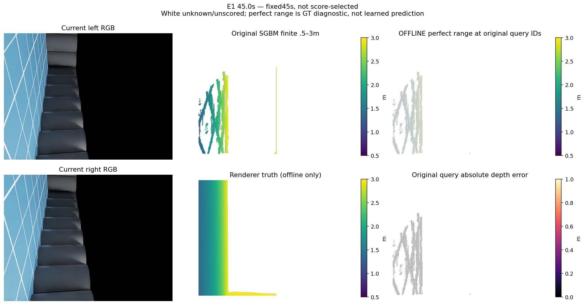
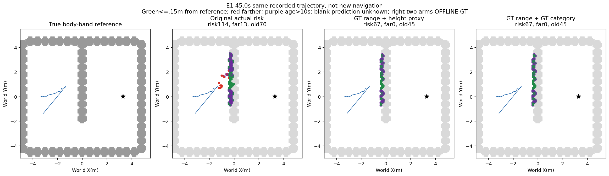
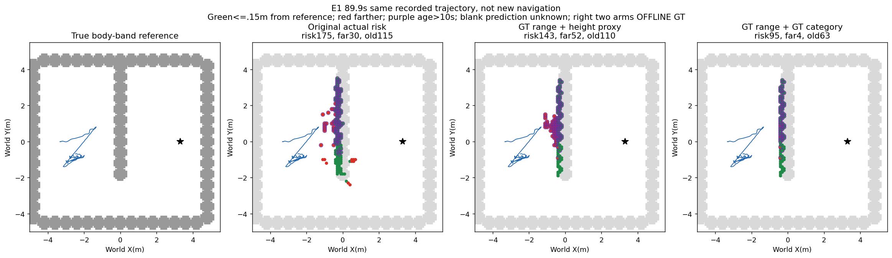
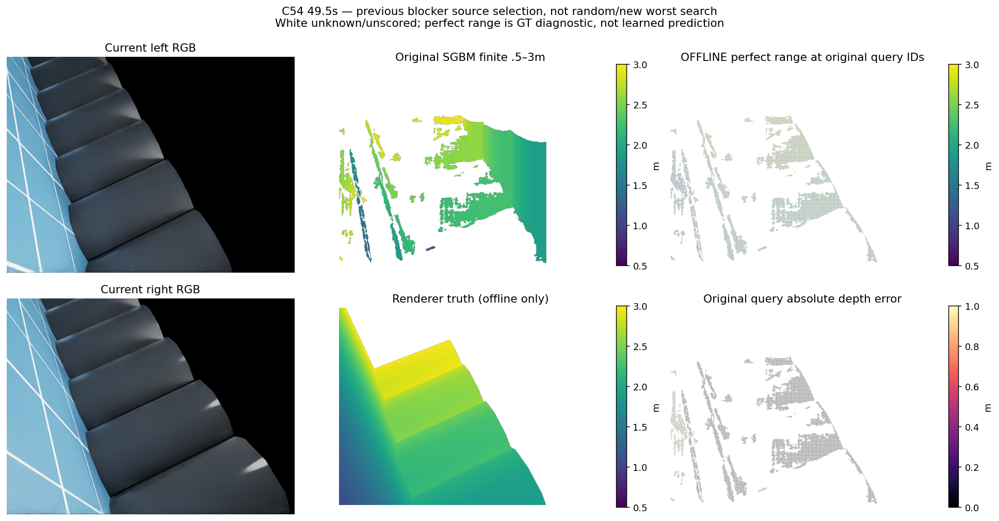
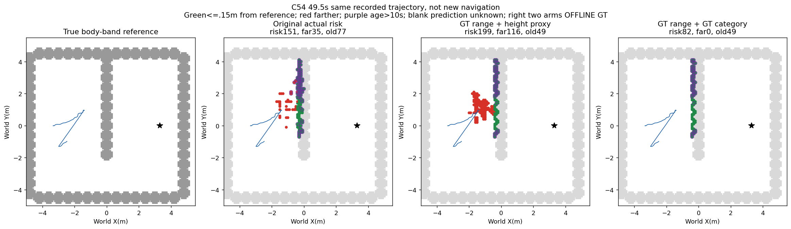
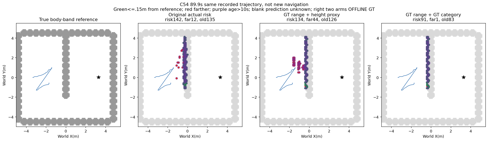

# 固定双目查询域的度量残差资格（2026-10-13）

**完整五组905对与4500地图时钟资格失败：关闭固定查询残差目标，fit0、physical0，不拟合。**

历史标量+3.455px残差、二元误差>15cm置信过滤、地面锚点/竞争测距与RGB类别距离先验均保持拒绝。本次不重新拟合它们，仅检验任意逐查询完美距离校正的原查询域是否值得新的独立学习。

冻结原sensor_packets左眼query IDs，不新增对应或补空洞。只在渲染有限.5–3m时给出完美距离；无命中/域外未知，不能当自由。原生理想IMU与标定保留，双眼可见语义目标取v62冻结作者兼容类别。两臂：完美距离+原.05–1.5m高度的零不确定性代理；额外完美类别的更宽松诊断。均GT_ONLY，未作为在线源。

|已见开发组|有限可校正/原查询|高度代理精确率/覆盖|理想类别精确率/覆盖|原生投影点误差P90 m|
|---|---|---|---|---:|
|H|802994/1047726 (76.64%)|90.58% / 44.02%|100.00% / 44.15%|0.041555|
|E0|507492/517800 (98.01%)|95.82% / 57.12%|100.00% / 57.13%|0.035524|
|E1|1206594/1619230 (74.52%)|95.25% / 58.91%|100.00% / 59.21%|0.034367|
|B54|1099241/1428695 (76.94%)|95.75% / 56.76%|100.00% / 57.07%|0.030803|
|C54|758557/1031409 (73.55%)|94.47% / 54.27%|100.00% / 54.38%|0.028742|

五组均因可见目标障碍格覆盖低于80%失败；精确率>=90%、地面误报<=5%、无支持<=10%、定位P90<=.15m的固定门槛未放宽。覆盖是冻结可见目标格、允许相邻1格匹配的指标，不是场景全障碍召回。完美距离的条件光轴误差为0，点位置仍受原生姿态/高度先验影响。

查询分母、有限标签分母与机体排除后的入图分母分别核验，当前数据额外机体排除数量0；未知作者标签另计。局部地图>=4点，永久记忆任一点入格，二者口径不同。高度代理未重跑原纹理/不确定性全部筛选，不是原完整流水线或所有学习方法的理论上界。它不能证明校正距离毫无导航价值；结论限本次完整可见目标资格不成立。

|组/诊断|地面误报格/目标地面格|无支持/预测风险格|最终风险/偏离>.15m/旧10s/旧偏离|
|---|---|---|---|
|H/range_height|186/65303|0/1507|128/58/128/58|
|H/range_category|17/65303|0/1339|73/3/73/3|
|E0/range_height|127/68603|0/2895|161/38/119/11|
|E0/range_category|4/68603|0/2774|123/3/108/3|
|E1/range_height|226/39412|0/3203|143/52/110/52|
|E1/range_category|22/39412|0/3008|95/4/63/4|
|B54/range_height|156/34770|0/2871|140/47/81/28|
|B54/range_category|10/34770|0/2749|97/4/54/1|
|C54/range_height|166/28652|0/2407|134/44/126/43|
|C54/range_category|6/28652|0/2254|91/1/83/0|

同轨迹重新构建的离线图不是对真实历史风险在线删除，未认证自由/完整安全或新增导航。理想类别能减少长期偏离，但覆盖仍不成立；GT不得用于消费者救分。

## 同刻直接图

### E1 45.0s

选择fixed45s, not score-selected；原查询4898、有限校正4637（全图分母307200）。原查询深度误差P50/P90/P95 0.028991 / 0.070285 / 0.083219m；oracle光轴距离误差0仅理想诊断。

### C54 49.5s

选择previous blocker source selection, not random/new worst search；原查询14969、有限校正7712（全图分母307200）。原查询深度误差P50/P90/P95 0.019124 / 0.908537 / 1.208671m；oracle光轴距离误差0仅理想诊断。

## 执行边界

durable qualify finished0，905源/1810局部图/4500时钟/40记忆快照独立重算一致；预审后仅补occupancy SHA，原审查版本保留。fit0、physical0、recovery0。原v62模型与全部旧预算不重开。可靠导航、学习导航增量和整体均未完成。

