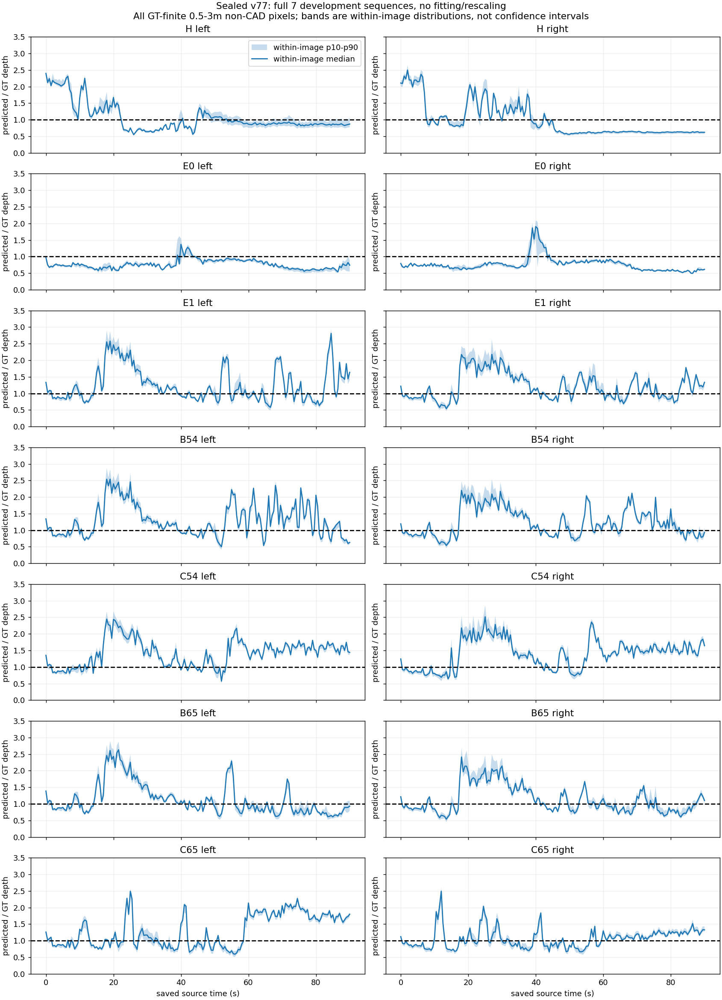
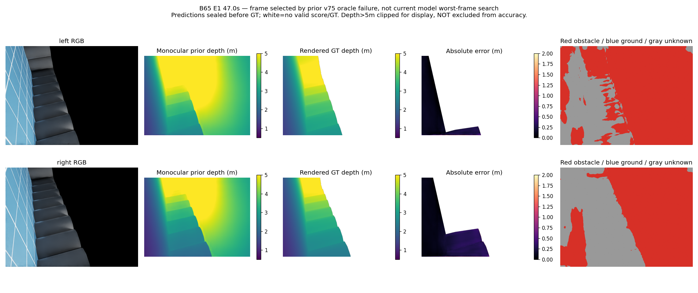
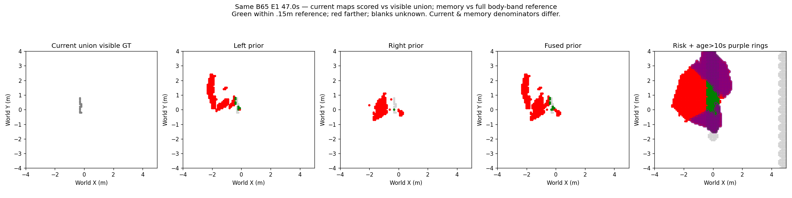

# 单目误差形态：封存全序列诊断（v87）

完整7组1267对2534眼帧，仅读取已封存预测与评分GT。无重新推理、拟合、校正或物理运行。当前原四相机接口已另在v86通过8曝光检查；本诊断是旧两前眼数据，不能称四路性能。

## 决策

不采纳“直接乘一个固定倍率即可修复”的下一实现：误差有显著序列内和组间变化，方向既有低估也有高估。此诊断未求最优倍率，也不证明任何动态尺度方法都不可能；没有得到可在线使用的尺度观测，故不拟合校正、不复活v77模型。

## 完整分母与统计

每组每眼181×307200=55,603,200全图像素；评分域固定GT有限.5–3m且排除CAD，预测超域仍评分。以下比例分母为评分域；全部评分像素预测有限且为正，不代表全图覆盖或准确率。比值为预测/GT；帧中位数范围与逐像素误差比例是不同口径。

|组/眼|评分像素|全图评分覆盖|低估>.15m|高估>.15m|帧中位比值最小–最大|深度误差P90(m)|地面误报/GT地面像素|
|---|---:|---:|---:|---:|---:|---:|---:|
|H/左|22664978|40.76%|40.74%|31.89%|0.549–2.396|1.465|1163367/11592306|
|H/右|20387718|36.67%|48.47%|33.98%|0.562–2.498|1.779|961034/13574011|
|E0/左|19325640|34.76%|85.29%|2.27%|0.537–1.368|0.782|14112/10442059|
|E0/右|20285194|36.48%|89.59%|4.27%|0.496–1.905|0.876|33350/12352659|
|E1/左|31082866|55.90%|30.22%|53.14%|0.579–2.810|1.792|5037998/10583681|
|E1/右|34793122|62.57%|28.48%|53.35%|0.539–2.177|1.224|3663318/10424947|
|B54/左|32897231|59.16%|24.01%|61.51%|0.500–2.540|1.625|4449279/9146510|
|B54/右|35379399|63.63%|26.30%|55.48%|0.540–2.200|1.266|3258956/9334655|
|C54/左|35736270|64.27%|10.94%|78.75%|0.573–2.446|1.394|4339857/7175122|
|C54/右|37798230|67.98%|19.68%|74.80%|0.644–2.515|1.372|2505158/6183366|
|B65/左|29646162|53.32%|44.83%|39.40%|0.609–2.630|1.676|5276269/10664142|
|B65/右|33763656|60.72%|40.70%|41.79%|0.538–2.412|1.211|4052003/10828629|
|C65/左|30675534|55.17%|38.40%|46.70%|0.592–2.490|1.578|3680564/10645021|
|C65/右|28206344|50.73%|43.15%|36.38%|0.662–2.492|0.901|6884728/12604257|

左右图中位比值差没有匹配到相同表面，不解释成严格的左右尺度一致性。阴影是同帧像素p10–p90分布，不是置信区间；图包含全部181帧，无挑选。

## 同刻原始证据及地图后果

B65 47s沿用v75选择，非本次最差搜索。旧模型结果原样展示，没有新运行。白色无GT；类别红障碍/蓝地面/灰未知，地图颜色以图例为准。

该帧当前9/247预测格正确、联合可见目标覆盖11/14；47s长期1446风险/969偏离参照/656旧10s/326旧偏离。全B65最终风险212→2151、偏离57→1603、旧偏离7→643；本次没有生成新地图。完整像素、可见格与永久记忆分母分开；未见与缺失均未知。

## 核验与限制

2534眼帧与旧独立评分器的有限标签域和预测计数exact；深度P90最大差2.38419e-7m（本次float64差值，旧float32），所有误差计数分区相加exact。完整预测/GT逐文件SHA按旧seal/result核对。CPU分析57.40秒正常0；会话80948、绘图核验44513正常0。新fit0/model0/physical0，旧预算不改写。

## 下一可执行问题

保持原四相机位置、朝向与光学。有限核对“障碍与地面的接触边界+标定射线/IMU重力+已披露地面/高度先验”的直接平面定位是否与旧ground-anchor、世界高度代理和像素距离学习实质不同。只在存在区别时冻结独立接触边界目标，先用已封存四路8帧及完整旧开发序列作GT-only几何覆盖资格，分开落地/悬空/不可见底部，不能假定所有障碍接地或把缺边界当自由。它尚未实现/准入，不是旧模型换消费者；不读取v77预测作在线输入、不恢复旧训练/物理预算。理想接触边界不满足原精确/覆盖/位置门槛则停止；合格才明确真实RGB边界来源、完整新数据/留出资格与独立有界预算。当前仍无可靠四路米制源或导航增量。
