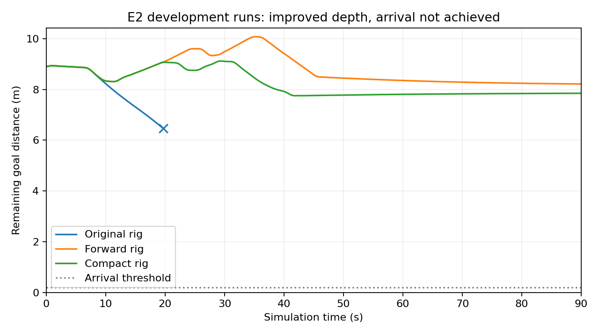

# 近场相机改动：实际导航阶段结果

本轮完成三个真实E2运行：原配置对照、相机前移、前移后缩短基线。三次均正常退出；两个候选测距门槛通过，但导航均未到达，不能交付为可靠导航。

| 配置 | 终态 | 接触 | 剩余距离 | 测距误差90分位 |
|---|---|---|---:|---:|
| 原配置 | 碰撞终止 | 19.64秒 | 6.459米 | 2.526米 |
| 前移20厘米，保留60厘米基线 | 90秒超时 | 无 | 8.212米 | 0.102米 |
| 前移20厘米，缩短至20厘米基线 | 90秒超时 | 无 | 7.845米 | 0.143米 |

测距门槛在实验前冻结：0.5–3米内至少1000个可评分像素、绝对误差90分位≤0.15米、误差>0.3米比例≤10%。两个候选终态误差比例分别约1.27%、1.79%；是已有置信像素的条件精度，不代表全视野覆盖或安全保证。原配置这次测距未通过。

## 变更与验证

只改变相机安装几何及其必要的外参、CAD遮挡、深度换算和误差计算；SGBM参数、IMU、风险记忆、规划、控制、照明及90秒规则固定。原项目只读。两次候选各完成5项CPU检查和独立启动审查；实际原始请求/物理命令、相机与当前估计位姿、全部有效接触、两路完整视频和封存身份均独立闭合。原配置两路198帧，两个候选各901帧。

已保留的初始位姿规范、平面高度/地面先验、安全起步和低层理想IMU等特权仍适用；不是纯RGB导航或已成立的视觉惯性里程计。渲染真值仅用于输出后评分。相机为仿真传感器，没有新增实体安装支架或碰撞外形，未证明硬件安装可行。三个运行复用E2开发场景，输入图像不同，不声称独立泛化或完整因果。

## 结论与下一步

相机前移改善了测距；缩短基线增加了1米以内的有效测距像素（此处距离是相机光轴深度，不是机器人外壳净空）。这些改进不足以产生到达。前移运行有595/900次零主驱动请求、98个局部参考版本；终态规划报告observed_obstacle_blocks_route。这是下一闭环实现的具体输入，不足以直接判定风险是假阳性，也不能直接清除记忆风险。

本轮两种相机候选均以导航拒绝封存，停止这一相机方案系列：前移预算2/4、剩2关闭；紧凑预算1/3、剩2关闭；不迁入E0/E1。下一执行阶段需沿“已测点→风险栅格→可行路径→执行请求”确定一个尚未拒绝的机制，完成实现与实际对照，不继续相机扫参，不以诊断或报告作为成果停点。可靠导航与学习增量仍未成立，自动任务继续。

## 单一证据入口

- 汇总数据：[campaign_summary.json](../experiments/nearfield_compact_navigation_20261012_v1/campaign_summary.json)
- 前移实现、协议、运行账本及独立闭合：[nearfield_rig_navigation_20261012_v1](../experiments/nearfield_rig_navigation_20261012_v1/ledger.json)
- 紧凑实现、协议、运行账本及独立闭合：[nearfield_compact_navigation_20261012_v1](../experiments/nearfield_compact_navigation_20261012_v1/ledger.json)
- 紧凑第三人称录像：[视频](/home/an/Documents/ChatGPT/球型机器人导航/experiments/nearfield_compact_navigation_20261012_v1/candidate_e2_run/third_person.mp4)
- 只读复算：`/home/an/miniconda3/envs/ball_wm/bin/python /home/an/Documents/ChatGPT/球型机器人导航/experiments/nearfield_compact_navigation_20261012_v1/score.py /home/an/Documents/ChatGPT/球型机器人导航/experiments/nearfield_compact_navigation_20261012_v1/candidate_e2_run`

实际启动命令保存在各目录supervise.py及durable状态/日志中。旧输出目录独占创建、旧预算已关闭；不得删除账本重跑。新研究协议另立命名空间并先登记有限预算。
