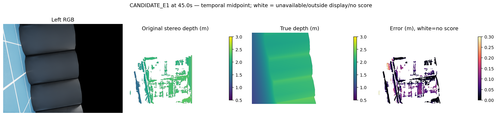
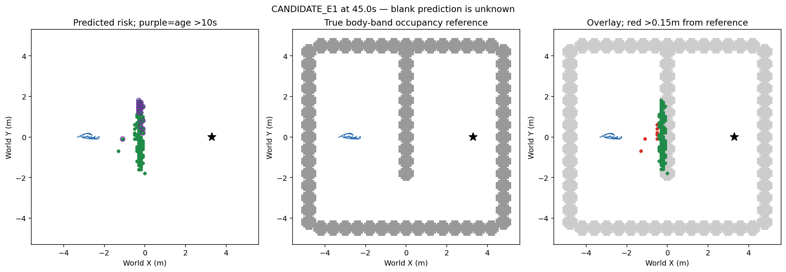

# 无路执行合同资格（2026-10-13）

v66完整无路执行合同9000物理tick按冻结clip/BankPID/smoother和实际当前反馈逐步exact，否定零请求翻译错误beforephysics，physical0fit0recovery0。候选320无路块1600ticks原请求全部0，main仍非零49ticks至58.98s，59s起1551ticks main完全0但仍走.483246m；aux1600ticks持续补偿范围-.081239至.459332rad。完整物理采样走.626972m与10Hz轨迹.626826m分母不同。现有.5rad/s2主轴坡度导致约.98s消退，零期望bank保留姿态PID，不能当bug或安全停止证明。

**结论：没有执行翻译错误证据，不实现旁路或更换旧制动器。**两条完整轨迹的请求→clip→PID→平滑→应用一致；这是保存实际反馈重放，不是预测动力学，使用底层实际特权四元数/encoder，不冒称纯视觉。主轴零后运动可能包含惯性、机体姿态与副轴补偿，尚未因果分解。没有新导航或学习增量。

## 已有同刻输入背景（非本轮新物理）

以下复用v65候选45秒时间中点，非最差选择。RGB/预测/真深度/误差；预测白色未知或无有效评分，米制深度色条.5–3，误差0–.3m。P50/P90/P95 .03514/.10751/.12352m，35203/40811评分，占整图11.46%；入图地面0/1709有效GT点。

地图绿色风险、紫圈>10秒、红色距bodyband参照>.15m、空白未知；45秒风险100/偏离7/旧19/旧偏离1，89.9秒103/3/94/3。点、像素、地图格分母分开，条件覆盖不是全图召回。新执行合同未改变任何地图。

## 接续

下一限定世界累计配准与源测距误差分离资格：v50只做局部中心/航向重置，未证明长期世界配准。先有限核对原native encoder/IMU pose与旧pose候选，完整当前E1两臂原生位姿/同刻渲染相机GT仅评分，分解入图点世界位置误差为相机测距、世界配准及量化；检查长记忆偏离是否来自可修复累计配准。不训练/派物理/在线GT；只有存在新机制和完整证据才冻结当前在线RGB+IMU修正消费者及有界验证，不复活旧ORB/时序/位姿候选或调整封闭门槛。
