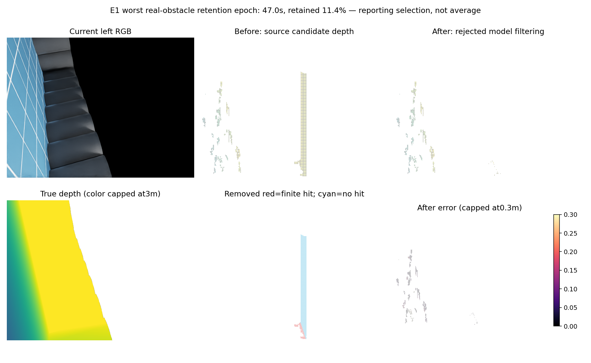
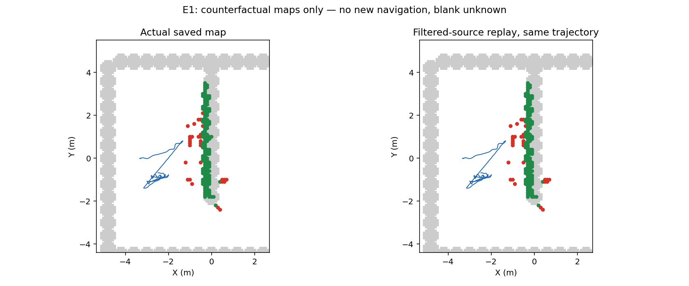
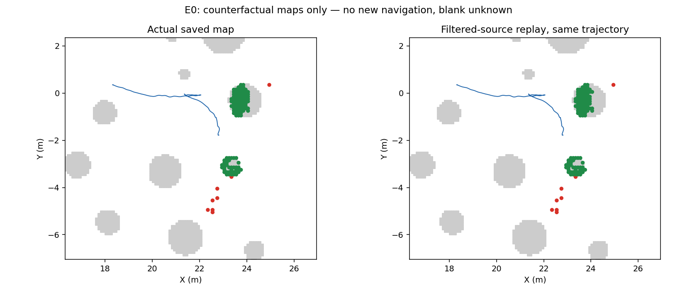

# 无命中语义、有效表面学习与地面锚点校准

本轮连续完成：一次安装版GPU相机语义校验、一个独立有效表面目标的资格与唯一拟合、E0/E1源过滤地图回放，以及另一种不训练的安全起点地面锚点校准。两候选均拒绝，未启动新90秒导航；不能把回放当作导航增量。

## 实际深度语义校验

静态方块前表面设在1.75米，安装版`distance_to_image_plane`实测1.750000119米。空视线7100像素为+inf；方块移至15米而相机远裁剪10米，19200像素全部+inf；无NaN或零。原导航runtime创建相机的裁剪范围0.01–1000米，覆盖原预测0.5–3米。

因此保存的+inf应与“没有可用标注”区分：它是未渲染命中，包括裁剪，不等于真实物理自由。旧有限深度误差资格、拒绝与79%左右可评分位置分母保持历史身份；新目标单独命名为当前渲染有限表面有效性，不用它救回旧模型。

## 新独立有效表面模型：拒绝

输入仍为当前双RGB、视差、局部图块和原生IMU注册特征。GT只用于资格/标签/评分；H/E2训练，已查看过的E0/E1作为开发评价，不能称新独立留出。完整181对×3序列覆盖100%的有限或+inf标签。一次class-balanced ridge-logistic，train-only标准化、固定0.5分数门槛、16次优化迭代；分数不是经过概率校准的真实概率。未调参重试。

|开发序列|无命中假测距排除|真实正高度障碍点保留|有限深度点保留|有限测距误差90分位，前→后|
|---|---:|---:|---:|---:|
|H/E2训练|97.71%|86.67%|95.94%|10.053→10.128厘米|
|E0开发|17.73%|84.48%|89.05%|42.673→30.800厘米|
|E1开发|95.52%|75.56%|84.87%|11.759→11.181厘米|

冻结门槛要求真实障碍保留≥95%、有限点保留≥95%、无命中排除≥80%、候选保留≥70%、有限误差不恶化。三组全部失败。E1删掉24.44%的真实障碍点，不能把误差略降和假点减少当作可用改进；E0仍远超15厘米。

上排：当前RGB、原始候选测距、过滤后。下排：渲染真值、被删除点、过滤后有限误差。删除图红色为实际有渲染表面的点，青色为无命中点；白色无候选/无评分。此图事后选择了真实障碍保留最差且至少100个真值障碍候选的47秒帧，保留11.4%，不是全序列平均。真值颜色截断3米，误差颜色截断30厘米，超过上限并非被忽略。

## 地图回放与真实参照

左是实际保存地图，右是过滤源后从头重建的反事实地图；共享原生位姿、曝光视角和真实轨迹，GT没有进入地图更新。灰色是已有body-band真值参照，红色风险格距参照格中心超过15厘米，绿色空间接近，蓝线原轨迹；空白未知。

|同轨迹终态回放|实际风险格→回放风险格|偏离参照>15厘米格，前→后|
|---|---:|---:|
|E0|127→121|8→8|
|E1|175→173|30→29|

虽然排除了很多无命中点，终态地图只改变少量格，不能称地图已修好，也不能单凭这些终态数字证明永久记忆是全部根因。该参照不是完整3D表面；分母不是全图召回。没有新物理轨迹或到达成绩。

## 同轮尝试：安全起点地面锚点校准

另一独立机制，不训练模型：利用已有TaskH地面z=0和初始安全起点半径0.7米先验，当前CAD未遮挡的原生相机射线若落在该地面区域，可形成几何视差锚点。首次≥30锚点且残差IQR≤现有左右一致性容差1.5像素时才建立中位偏差，之后因果应用，不回改早期数据。不扩大地面先验，不把模型无命中分数用于校正。

H/E2最多100锚点，但唯一数量合格帧IQR为2.279像素，不达标；E0/E1锚点数均为0。三序列没有成立的校准，输出与原源相同。候选拒绝、fit0/physical0；不降低数量门槛、扩大起点区域或改IQR救分。它使用特权初始规范和地面先验，不能称纯视觉标定。

## 预算、核验与下一方向

有效表面目标：cap4实际场景运行，语义校验used1、导航0，余3关闭；唯一fit1、GPU环境恢复0。锚点候选：physical0、fit0，余4关闭。旧30数据/153执行库、相机、控制、有限误差模型和竞争匹配等预算没有重开。

GPU语义probe durable正常退出；第一次拟合前因NumPy布尔值JSON序列化失败，日志保留且fit0；修复接口后仅一次实际拟合。两方法预测/回放不使用评分真值，锚点预测先封存后评分。独立审查核对模型因果输入、语义/裁剪收据、源组、门槛、最差图选择和回放限制。

下一阶段将转向已有框架的**明确新测量与过期风险的矛盾处理**：先检查与旧关闭再观测/记忆机制是否重复；新的机制必须使用当前可用双目测量与原生位姿、当前CAD支持，保留当前及近期风险，不因缺失/兼容/无命中直接清图，矛盾只可降为待确认/未知。先同输入回放核验真实风险保留，只有合格才新预算内实际E1对照；不能把已拒绝模型换消费者救分。可靠导航、学习导航增量与整体目标仍未完成。

[模型数值](../experiments/nohit_surface_validity_20261013_v1/result.json) · [地图回放数值](../experiments/nohit_surface_validity_20261013_v1/map_replay_results.json) · [锚点结果](../experiments/safe_start_disparity_anchor_20261013_v1/result.json)
