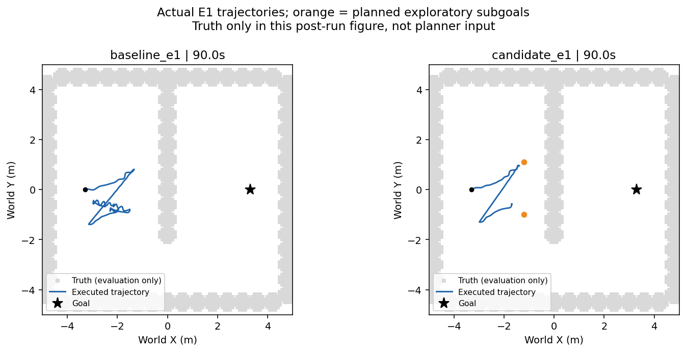
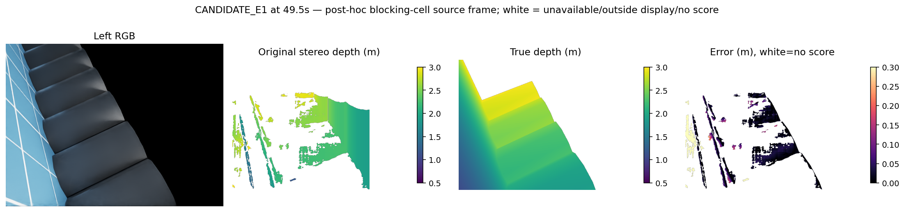
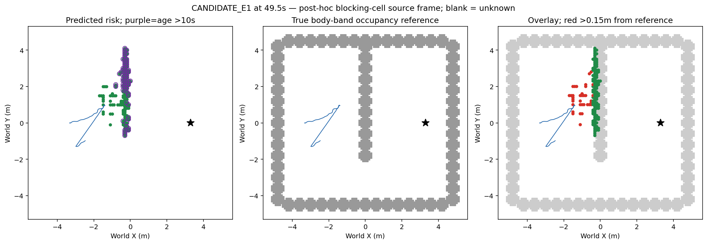
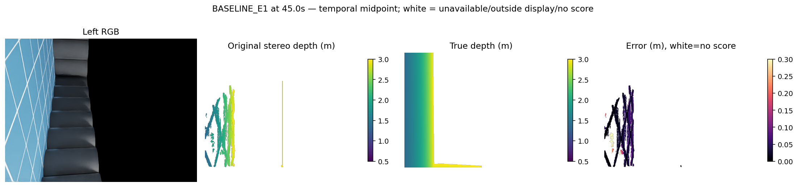
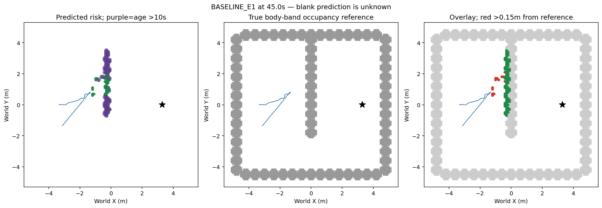
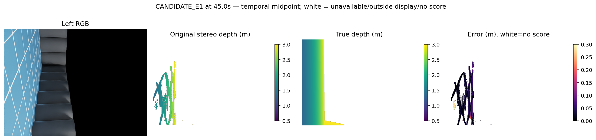
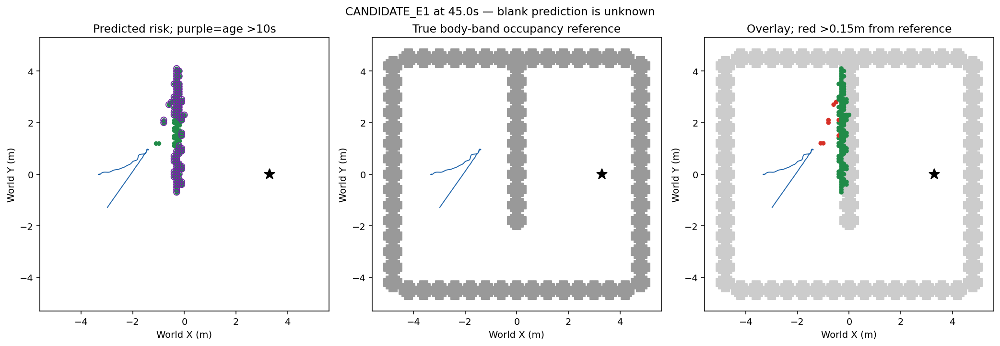

# 当前观测端部子目标：真实 E1 90 秒对照

## 结论

已完成新规划机制的实现、保存输入资格、独立预审、同版两臂实际 Isaac 导航、原始数据与实际作用核验。候选 **拒绝**：90 秒未到达，不能交付为可靠导航。新预算 actual 2/2 关闭，fit 0、环境恢复 0。旧候选和旧预算未重开。

这次发现了明确的地图到规划失效链：一个位置错误的风险格使起点落入安全膨胀区，54.5–89.5 秒的 71 次规划查询因此失败。不能用全程深度 P90 较小推断地图足够可靠，也不能把减少行走距离当成成功。

## 改动与预先冻结的准入

仅改变原有重规划时的局部目标选取。用当前实际风险格形成的细长分量，选取原路线指向的已观测端部；沿观测轴前移一个原有 0.3 米运动原语，并向机器人一侧保持原 0.870711 米规划净空。未知标签保持未知，目标只是受控探索，不保证端部之外自由或未来可见。

只作一次原有运动约束查询。缺少足够观测、形状不合格、目标超出原视距、目标不可用或查询无解时，精确回退原方法。感知、双目位置与照明、IMU、地图保留规则、跟踪器、控制和安全间距均固定。没有扩大真实障碍，也没有用真值清图。

保存的完整 E1 十个安装输入中，4 次得到新可行目标，6 次精确回退。预先指定的 71 秒输入完整路径沿观测端部方向推进 1.123977 米；没有用截短后的路径隐藏初始倒车。独立检查全部 20 条完整路径、原语和净空，完成 5 项几何及 6 项实际继承链核验后才启动两臂。

实际运行使用 forward 双目几何 x=0.4 米、基线 0.6 米，原生 IMU 与编码器位姿输入；沿用既有初始规范、理想传感器、固定高度与 TaskH 平地/安全起步/受控未知探索假设。底层控制的仿真真实速度等已有特权未移除。这是有明确特权披露的研究配置，不能称无特权实机视觉惯性导航。

## 实际导航结果

| 指标 | 同版对照 | 新局部子目标 |
|---|---:|---:|
| 实际时限 / 终态 | 90 秒 / 超时 | 90 秒 / 超时 |
| 到达 / 接触 | 否 / 无 | 否 / 无 |
| 初始距离 | 6.600001 m | 6.600001 m |
| 净接近目标 | 0.762636 m | 1.586684 m |
| 最后剩余距离 | 5.837365 m | 5.013316 m |
| 实际累计行走 | 11.318547 m | 6.776275 m |
| 重规划尝试 | 11 | 76 |
| 成功安装路径 | 11 | 4 |
| 失败查询 | 0 | 72 |
| 全序列有限深度误差 P90 | 0.118129 m | 0.133587 m |

候选多出的 0.824048 米净进展是此次结果的描述。两臂全部 181 对 RGB 都不同，连首帧输入也不同，不能将差值授予完整因果结论。同一 E1 反复开发也不是独立泛化。

蓝线为实际轨迹、黑星为目标、橙点为成功生成的探索子目标；灰色真实障碍仅用于事后评价。

全 87 次实际查询已用当时原生浮点位姿、保存地图重新计算全局路线和局部路径。候选只在 6 秒、18 秒实际改变安装路径；53 秒和 53.5 秒使用原路径回退。17.5 秒不可达，54.5–89.5 秒每 0.5 秒起点被风险膨胀区覆盖。没有把失败版本号统计为安装路径。

## 停滞的直接证据

71 次失败均为起点被阻塞，目标格没有被阻塞。唯一覆盖起点规划净空的风险格中心为 **(-1.1, -0.1) 米**：到真实机体高度带障碍参照约 **0.8 米**，起点格对该风险格的距离 **0.781025 米**，小于原定 **0.870711 米**。这里距离按实际栅格规划判据计算；不是机器人碰撞距离。

扫描全部 181 对原始输入，该格只由 49.5 秒和 50 秒的 29+17=46 个点贡献。46 个点全部有有限真值标签，地面误报为 **0/46**。它们把实际深度 **1.9709–2.1485 米**估成 **1.1466–1.1952 米**；逐点深度误差 **0.8208–0.9594 米**，世界三维定位误差 **0.8775–1.0419 米**。因此这里是错误测距形成的假近障碍，不能以地面误分类解释。

该格在 54.5 秒的最新来源年龄约 4.5 秒，89.5 秒仍保留、年龄约 39.5 秒。旧两曝光与位移确认并没有排除此错误。此处仅追溯实际来源，未修改任何阈值、风险历史或在线输入。不能据此用真值直接删除该格，也未证明所有失败都由这一格导致。

## 同刻 RGB、深度与地图

以下选 **候选 E1 49.5 秒**，是事后追溯上述错误格的首个来源帧，**不是随机代表帧，也不是全序列最差帧筛选**。另保留两臂时间中点 45 秒图作非最差选择参照。

从左到右为 RGB、原双目预测深度、渲染真值深度、绝对误差。深度颜色单位米、显示 0.5–3 米；误差色条 0–0.3 米，大于 0.3 米同为顶端颜色。白色代表不可用、显示范围之外或无评分，不代表自由。

- 此帧深度误差 P50/P90/P95：**1.93 / 91.77 / 120.84 厘米**。
- 有限真值评分 **30,903/60,015=51.49%**（分母是有置信度且预测在 0.5–3 米内的像素）；占完整 307,200 像素 **10.06%**，不是全图障碍召回。
- 实际入图点 2,406，其中真值有效 2,013；地面误报 **0/2,013**。点与完整像素是不同分母。

下图左为预测风险与长期记忆，中为真实机体高度带障碍参照，右为叠加。绿色是风险格；紫圈是最新支持年龄超过 10 秒仍保留的风险；红点是距离真实参照超过 15 厘米的风险格。蓝色是此前实际轨迹，黑星是目标。预测空白为未知。

此帧风险 **151 格**，其中偏离参照 **35 格**；超过 10 秒仍保留 **77 格**，其中 **5 格**偏离参照。终态地图时间 **89.9 秒**，候选风险 **142 格**、偏离参照 **12 格**；长期保留 **135 格**、其中偏离参照 **12 格**。导航终态是 90 秒，不能混用时间标签。

## 全序列测距和地图口径

每臂 181 张 640×480 源图，共 55,603,200 个像素实例。以下不是独立像素或唯一空间覆盖。

| 指标 | 对照 | 候选 |
|---|---:|---:|
| 有限深度评分 / 有置信度范围内像素 | 4,404,338 / 5,712,462 | 3,047,249 / 4,125,580 |
| 条件评分覆盖 / 完整图像占比 | 77.10% / 7.92% | 73.86% / 5.48% |
| 深度 P50/P90/P95（cm） | 2.57 / 11.81 / 14.16 | 2.88 / 13.36 / 15.29 |
| 入图点真值有效 / 全部入图点 | 228,157 / 262,072 | 157,644 / 183,060 |
| 入图点地面误报 / 有效点 | 712 / 228,157（0.312%） | 569 / 157,644（0.361%） |
| 入图点三维误差 P50/P90（cm） | 2.41 / 6.60 | 2.73 / 14.63 |
| 89.9 秒风险 / 偏离参照格 | 181 / 24 | 142 / 12 |
| 89.9 秒长期风险 / 长期偏离格 | 104 / 15 | 135 / 12 |

真值无渲染命中不等于真实自由。地图参照是机体高度带占据投影，15 厘米阈值是事后二维格中心评价，不等同精确三维表面真值或在线安全证书。两臂观测轨迹不同，地图格数量差也不是单变量地图改进的因果证据。

45 秒时间中点原始对照图：

## 复现与核验

研究代码、输入身份、冻结协议、启动命令、真实执行日志、数据、视频及分析脚本位于 [实验根目录](/home/an/Documents/ChatGPT/球型机器人导航/experiments/observed_end_subgoal_20261013_v1)。运行环境沿用 `/home/an/miniconda3/envs/ball_wm/bin/python` 与既有宿主 Isaac，不安装新环境；原项目只读。`supervise.py` 与两臂协议保存实际启动方法，**已关闭预算不允许原位再次运行**。

两臂均有 900 请求、4,500 实际物理命令、181 对原生相机注册、900 幅精确重建地图、5,401 条可用无接触记录及两路各 901 帧视频。独立核验全部原始封存字节和实际作用链；原生 IMU 动力学本身不是本次重新独立标定的内容。

初版后处理错误地把每个版本号当成成功安装，在缺少 17.5 秒路径文件时失败；原脚本、日志与结果已保留。修正后覆盖全部成功/失败查询，独立重算通过；未修改实际运行、准入或失败结论。首次生成 driver 括号与协议旧身份文字也均在启动前修正并保留，不是物理失败或环境恢复。

## 下一执行方向

本候选停止，不调端部偏移、PCA 比例或视距重跑，不迁 E0/E2。此次真实失败说明即使规划候选有作用，少量大误距仍可使原本可通行区域形成长期阻塞，不能通过缩小安全间距处理。

下一优先执行此前尚未实现的**当前双目序数/Census 匹配代价测距**有限研究，改变测量生成而非给旧拒绝的 SGBM 置信度换阈值。先有限核对旧 ORB/时序/竞争匹配的区别，再冻结一个固定对应域、歧义规则与完整序列精度、真实障碍覆盖门槛；加入这次两条轨迹只作已见开发诊断，不能冒称新留出。特别报告逐帧灾难误差及其入图后果，不能只报告汇总 P90。源资格满足才冻结新预算、fresh 对照和实际导航。不是旧执行库扩库，不重新训练 v49，也不是已准入方案。

本次结束于完整实际对照与失败解释阶段验收；没有资源或许可阻塞。可靠三场景导航、学习导航增量及整体项目仍未完成，自动任务保持 ACTIVE。
