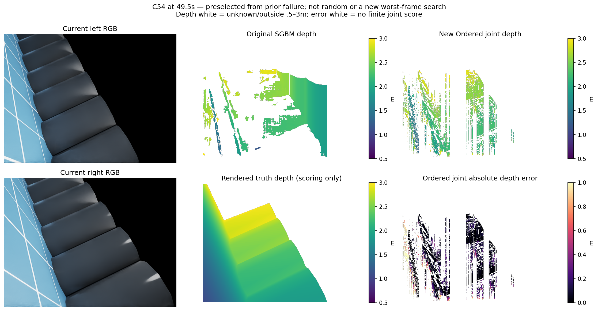
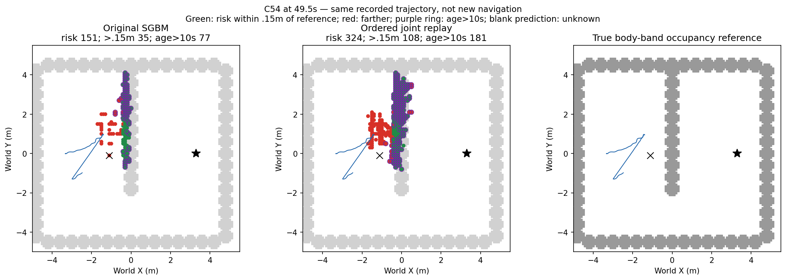
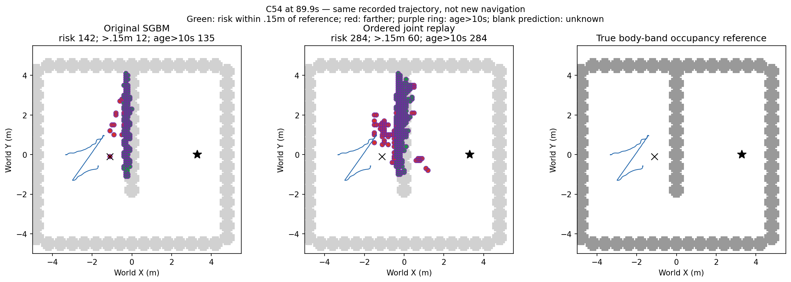
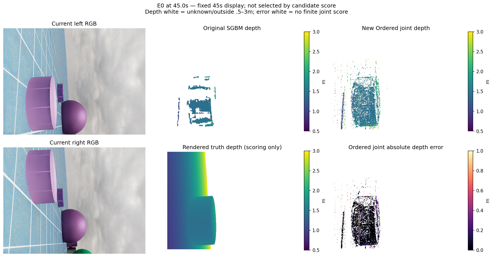
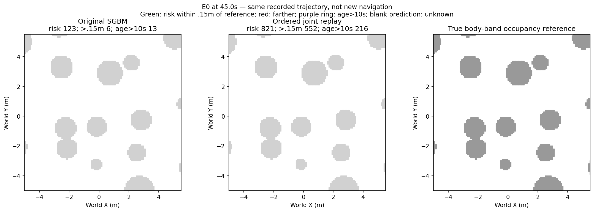

# 双目扫描线联合对应完整开发资格（2026-10-13）

五条完整开发轨迹905对当前双RGB与4500步原轨迹地图更新完成。**源资格失败，拒绝接入导航，physical0/4未用4次关闭、fit0。**

该机制保持v56的7×7 Census48与3×3汉明代价、完整9×9双眼CAD支持及108代价上限，只把独立逐像素最低代价选择替换为整条扫描线顺序、一对一匹配和显式未匹配缺口的联合优化。支持像素缺口成本54（继承108上限的一半），不支持像素缺口0；完整前缀与后缀动态规划求解，只接受所有全局最优路径必须包含的同一对应。整数视差，不在求解后移动亚像素位置。算法与参数运行前冻结，无调窗、扫参、训练或GT在线输入。

项目区别：原SGBM使用视差跳变惩罚及LR/局部唯一性；已关闭归属候选在原抽样源中拒绝重复右眼声明。此次生成新的全图联合对应。不是文献原创方法。参考：[OpenCV StereoSGBM](https://docs.opencv.org/4.10.0/d2/d85/classcv_1_1StereoSGBM.html)、[Cox等扫描线对应研究](https://scholars.duke.edu/individual/pub785998)。两者不保证本场景有效。

## 五完整序列测距

|开发组|原深度P50/P90/P95 m|新深度P50/P90/P95 m|新误差>.3m|新测量数/原测量数|原真实障碍查询保留|灾难帧|
|---|---|---|---:|---:|---:|---:|
|H|0.023536 / 0.100471 / 0.178972|0.086494 / 0.555362 / 0.881547|20.28%|100.83%|45.75%|168/181|
|E0|0.047808 / 0.427207 / 0.583675|0.235579 / 1.018843 / 1.296788|42.40%|226.20%|65.14%|152/181|
|E1|0.027339 / 0.117708 / 0.144959|0.066971 / 0.486009 / 0.888044|15.17%|71.71%|42.39%|145/181|
|B54|0.025713 / 0.118129 / 0.141617|0.071916 / 0.500457 / 0.926883|15.78%|72.58%|40.53%|144/181|
|C54|0.028763 / 0.133587 / 0.152915|0.066465 / 0.533280 / 0.978639|16.01%|60.96%|30.86%|91/181|

所有组均需有限评分>=1000、深度P90<=.15m、>.3m比例<=10%、总测量保留>=70%、每帧原测量>=1000时保留>=50%、新有限评分>=1000帧P90<=.3m、原真实障碍查询保留>=95%。最后一项是原入图查询像素的保留率，不是整幅图/所有可见障碍召回；即使保留也不认证深度正确。未知和无渲染命中不当自由。

## 像素评分与入图点

|组/方法|有限评分/预测像素|评分/整图|有限入图点/全部入图点|地面误报/有限入图点|入图位置P50/P90/P95 m|
|---|---|---:|---|---|---|
|H/baseline|3237900/4189009 (77.30%)|5.82%|58781/74496|1557/58781 (2.649%)|0.049013 / 0.190620 / 0.296328|
|H/joint|4065291/4223632 (96.25%)|7.31%|48816/53107|4235/48816 (8.675%)|0.082468 / 0.340774 / 0.680659|
|E0/baseline|2053180/2070622 (99.16%)|3.69%|143261/147261|14213/143261 (9.921%)|0.082279 / 0.538029 / 0.980341|
|E0/joint|4639328/4683705 (99.05%)|8.34%|216080/218119|23225/216080 (10.748%)|0.244867 / 1.060815 / 1.360033|
|E1/baseline|4837237/6475844 (74.70%)|8.70%|225334/262774|771/225334 (0.342%)|0.024322 / 0.061996 / 0.111266|
|E1/joint|4576762/4644139 (98.55%)|8.23%|145654/161192|1686/145654 (1.158%)|0.032970 / 0.149474 / 0.187210|
|B54/baseline|4404338/5712462 (77.10%)|7.92%|228157/262072|712/228157 (0.312%)|0.024083 / 0.066024 / 0.131569|
|B54/joint|4087609/4146270 (98.59%)|7.35%|140798/153931|1437/140798 (1.021%)|0.035170 / 0.158770 / 0.206079|
|C54/baseline|3047249/4125580 (73.86%)|5.48%|157644/183060|569/157644 (0.361%)|0.027297 / 0.146290 / 0.169727|
|C54/joint|2480939/2514943 (98.65%)|4.46%|75414/83357|1268/75414 (1.681%)|0.037450 / 0.160847 / 0.226430|

整图分母各181×640×480。深度指标只对有输出且渲染有限正深度的像素评分，无命中预测数量在result.json单列。入图点使用原CAD/双眼纹理/高度与不确定性筛选，地面误报按GT世界高度绝对值<=.03m。像素、点和格分母不可互换。

## 同轨迹长期地图（89.9秒）

|组|原风险/偏离>.15m/旧10s/旧偏离|新风险/偏离>.15m/旧10s/旧偏离|
|---|---|---|
|H|138/21/138/21|445/270/396/221|
|E0|127/8/108/2|888/614/678/424|
|E1|175/30/115/20|430/124/300/84|
|B54|181/24/104/15|433/108/268/69|
|C54|142/12/135/12|284/60/284/60|

灰色参照为机体高度带实际障碍；绿色是风险格中心距参照<=.15m，红色>.15m，紫圈为最近支持超过10秒，白色预测为未知。固定原轨迹的离线反事实地图，不是新物理运行或新到达证据。源评分包括90s末帧，动作地图最后89.9s；H用原重复曝光记忆，其余组原视角确认记忆，两方法各组保持一致。

## 已固定阻塞像素集合

- 49.5s原29点：新有测量0、未知29；误差<=.15m 0、>.3m 0。新点深度P50/P90/P95 N/A / N/A / N/Am。
- 50.0s原17点：新有测量2、未知15；误差<=.15m 1、>.3m 0。新点深度P50/P90/P95 0.114074 / 0.204027 / 0.215272m。

原阻塞格(-1.1,-.1)最终状态：[{"arm": "baseline", "risk": true, "age_s": 39.8999991081655}, {"arm": "candidate", "risk": false, "age_s": null}]。此集合和49.5s图因上次已知阻塞来源事后选定，并在本候选输出前固定；不是随机代表或本次搜索最差帧。

## 同刻直接图

### C54 49.5s

新深度P50/P90/P95 0.052236 / 0.554260 / 0.987247m；有限32299/32552，占整图10.51%；有限入图1429/1497，地面误报1；点位置P50/P90/P95 0.025096 / 0.114346 / 0.155395m。

### E0 45.0s

新深度P50/P90/P95 0.023099 / 0.251150 / 0.783928m；有限23431/23431，占整图7.63%；有限入图1610/1610，地面误报149；点位置P50/P90/P95 0.034862 / 0.328239 / 1.333662m。

## 范围、执行与核验

五组H/E0/E1/B54/C54全部是已见开发，未作为新独立留出。理想原生IMU、编码器估计、特权初始规范、固定.4m高度先验沿用并披露；当前双RGB/原生标定与静态CAD输入生成源，动态CAD和位姿只在原投影消费者。GT在所有输出封存后才评分，未知/缺失不能在线清旧风险。

启动前独立审查发现旧文件路径引用会造成空ledger的问题，派发前修复并保存旧脚本和审查。首次CPU用例dtype不符属于测试接口，旧测试保留，实际估计器未因此改变。durable记录在generation_status.json、score_status.json和visuals_status.json，预算ledger.json；中断/接口失败不记性能失败。

只读身份命令：使用既有 `/home/an/miniconda3/envs/ball_wm/bin/python` 执行本目录 `verify_readonly.py`。该核对只确认封存身份和判据聚合，科学复算另见独立审查；不对封存目录再生成。

## 独立闭合

{"decision": "CONFIRMED_SOURCE_REJECTION_AND_CLOSED_UNUSED_PHYSICAL_BUDGET", "hash_checks": {"inputs": 14446, "outputs": 2755, "sources": 16, "preserved_prefix": 1653, "recovery_scientific_sources": 5, "scoring_truth": 908}, "numerical_fields_compared": 25049, "max_float_difference": 4.440892098500626e-16, "independently_scored_pairs": 905, "selected_map_metric_sets": 40}

具体独立回放范围及局限见independent_closure.json。完成的是这一候选的源资格阶段；可靠导航、学习导航增量和整体目标仍未完成。

## 局部作用与下一研究方向

旧46个阻塞来源像素中，44个变为未知，2个仍有测量：1个误差<=.15m，另1个在.15–.3m。新地图从原轨迹起点重放时未形成旧阻塞格，未用真值在线删除它，也未证明该区域自由。完整C54深度P90从原.133587m升至.533280m；虽低于已拒绝的独立局部Census 1.158500m，仍不满足.15m准入。原真实障碍查询仅保留30.86%，最终新增地图偏离参照60/284，旧错误60，不能因单个阻塞格不再出现保留整个源。

这条联合机制闭合：不调缺口成本、歧义条件、视差域、窗口或描述子复跑。下一优先接续此前因规划研究暂缓的像素表面类别与距离分开重建资格：先有限核对旧高度/地面竞争/BEV模型与新类别消费者的实质区别；用理想像素类别及深度、实际原生位姿完成整序列投影诊断，检查地面误报、位置误差和可见障碍覆盖。GT仅离线诊断/监督，不作在线语义；资格通过才冻结独立像素学习目标、完整分组数据与一次拟合/fresh验证，分别标注双眼测量与单眼先验。不能换网络救旧v49模型或恢复旧预算。该下一目标尚未实现、尚未准入，也不承诺导航增量。

## 编码执行故障及唯一恢复

首次生成在H/E0/E1三组完成后，宿主Python默认ASCII无法解码B54的UTF8配置，于08:58:09.985579 UTC结束；原runtime_failed/child1与1653份已生成输出均保留。唯一恢复设置PYTHONUTF8=1，五个科学源文件及协议哈希不变，前三组输出复用且packet/地图重新比对不覆盖。恢复09:07:45–09:29:50 UTC finished0；physical0、fit0、recovery1/1。该编码接口退出不是性能失败；源拒绝来自随后完整评分。详细身份见recovery_registration.json/recovery_review.json与两个durable状态。
