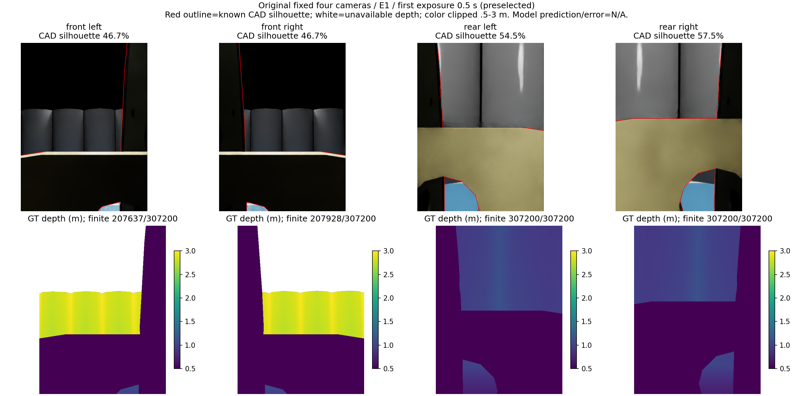
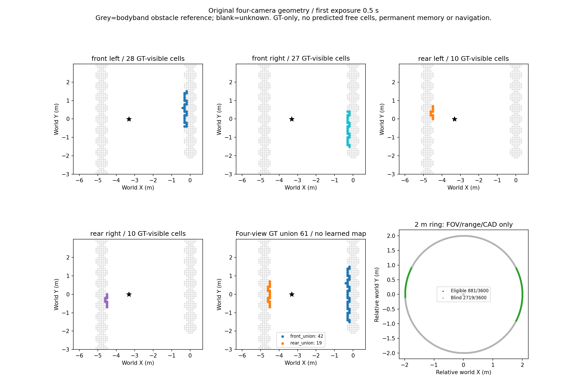

# 原安装四相机采集与可见域验证（v86）

## 结论

按用户确认的“前两台、后两台对称放置”关系，已在工作区实现四路采集并完成一次原生仿真：8组×4路=32幅真实RGB及同刻渲染深度标签，8/8原生IMU区间、六对相对外参和原前相机光学检查通过。四路统一BEV的GT几何检查完成；后两路贡献152/483=31.47%的本批可见格实例。

**保留四路采集接口，未准入任何模型或导航。** 本轮没有单目预测、训练、长期风险图或90秒导航；不能用GT几何结果声称在线识别准确。v77两路模型拒绝保持，不把四路接通当作测距问题解决。

## 原安装身份与范围

原只读项目`scripts/camera_rig.py`当前配置：base_link +X前、+Y左、+Z上，前左/右为(.20,±.30,.05)m，focal16.45mm、aperture18×13.5mm、640×480、光轴焦距584.888889px、近远裁剪.01–1000m。本次未写入或重设前置相机参数；SDK内部浮点读回相对名义值最大约1.91e-7，门槛2e-6。原项目相关源码SHA运行前后不变。

后左/右(-.20,±.30,.05)m、朝后，保持前置光学；左右名称以机器人身体+Y/-Y定义，不依后视图像左右。后置外参由用户明确对称关系推导，属于**仿真名义外参，不是实测硬件标定**。原前置采集模块只有两路，此次补上缺失两路。

此前部分开发轨迹用了.40m前置，v79/v81改布局又用了.45m，均保留历史身份；本轮不能与其跨轨迹数值当作同版因果增量，也未继续改布局。此处“原安装”指所读原项目配置＋用户对称关系，不能替代真实硬件尺寸测量。

## 实际运行与预算

北京时间2026-10-15 14:03:57–14:04:24正常退出0；durable宿主659318/659350均已退出，systemd `ball-original-four-camera-v86` inactive、ExecMainStatus0。E1同一场景、固定照明，零策略请求的原生4秒运动，200物理tick、8次.5秒间隔曝光；零请求不等于物体绝对静止。241条接触样本均无接触，但不是导航安全性能测试。

新四路采集预算physical1/2、恢复0/1，余1关闭；fit0/model0/navigation0。旧所有预算不恢复。后相机创建/初始化在SDK启动后、最后一次scene reset前完成；运行中没有瞬移机器人或修改已初始化相机姿态。

全32幅曝光形状/时钟/输入SHA通过；最大六对相对标定矩阵差1.87904e-7。四相机各自反推出的body矩阵最大差1.90506e-7；这是矩阵口径，不是米制定位误差。完整像素投影再逆投影最大6.83e-13pixel，属于同一标定算术自洽，不证明真实测距精度。

曝光与IMU区间末端差0；传感器区间起点早约20ms，raw相对逻辑epoch+.22s。IMU保留原生陀螺/含重力加速度与1点滤波，不读orientation。以下地图使用renderer位姿GT离线诊断，不能冒称IMU估计位姿导航。

## 完整8帧像素与可见格

每路整图分母8×307200=2,457,600。已知CAD按每次实际关节状态投影，无扩大安全距或调整相机。CAD投影遮罩比例前左46.66%、前右46.65%、后左54.46%、后右57.56%；是机体几何投影口径，不是所有像素的精确物体语义。

|口径|前左|前右|后左|后右|
|---|---:|---:|---:|---:|
|有限渲染深度像素|1606950|1623427|2457600|2457600|
|有限.5–3m像素|461842|477290|1124012|1045929|
|另扣已知CAD后像素|460208|475693|1118865|1042876|
|GT世界bodyband(.05,1.5]m点|445120|460770|1014460|911907|
|GT近地面高度带[-.05,.05]m点|15088|14923|104405|130969|
|各路可见bodyband格实例|220|219|80|73|

距root小于.55m点另排除；本批扣CAD后root排除计数为0。近地面高度带是GT几何统计，不是预测语义或地面误报率；有限深度像素含机体，不能当有效障碍覆盖率。

前两路联合331格实例，后两路联合152格实例，前后交集0，四路联合483格实例。以相同0.1m格、完整bodyband场景参照、.15m最近距离核对，483/483在门槛内，各路每帧格位置分位P90均.1m，偏离参照格0。这个分母是**已渲染可见且满足域/CAD的GT点投影格**，不是全场景召回，也不是学习精确率；未见处保持未知，不当自由。

2m身体平面等角3600点，在FOV/.5–3光轴范围/CAD条件下每帧881–882点可用，几何可用率约24.47%–24.50%；不扣场景遮挡，不表示场景障碍召回。四台相机仍有侧向盲区，不能声称360度覆盖。

单目预测深度P90、预测误差图、地面误报、在线风险/长期错误保留：**N/A，未生成**。本轮只完成真实四路输入及GT可见域检查。

## 直接图像

固定第一帧E1 0.5s，不搜最好或最差。上排真实四路RGB，红线为已知CAD投影轮廓；下排渲染GT深度，白色不可用，颜色.5–3m，超范围只颜色截断。后两台能看到障碍，但机体占据了较大画幅。

该帧四路分别28/27/10/10格；前联合42、后联合19、四路联合61，前后不重叠。灰色为bodyband场景参照；空白未知。没有学习预测BEV或长期记忆图。

## 必要修正与独立核验

- 采集前审查发现封存可能早于最终物理文件导出。新增回归检查先失败，修正后9项通过：封存在终态/物理文件成功导出后生成，异常明确退出1；完成守卫要求完整四路深度/变换、physics、terminal、stage。没有消耗物理恢复。
- 初版离线评分把地图的[x,y]当成图像[y,x]，虚构242/483偏离参照格。初版代码/结果保留；依据原项目地图约定修正，原始采集、CAD、入图点和门槛不变，修正后为0/483。独立用标量双循环构造全部参照格并逐帧核对，避免重复同一转置错误。
- 32幅原始图输入SHA、8组集合计数/最近距离、所有有效像素独立齐次坐标回投、renderer view矩阵独立求逆均通过。原前置源码SHA不变。

实现、协议、预算、原始数据和核验位于`experiments/original_four_camera_20261015_v1`。环境沿用ball_wm Python、Isaac4.5及现有USD/NumPy/SciPy/Matplotlib，无新安装；启动`launch.py`会执行预算守卫，预算关闭后不得重跑。离线复算为`score.py native_run`、`check_and_plot.py`，USD路径同已有环境。使用的源码与原始文件SHA见`result_seal.json`。

下一重点回到可靠米制深度：先利用既有v77封存输出有限区分整体尺度偏差、局部形变及两眼不一致，记录旧数据.40m安装与当前.20m原配置的区别；诊断不训练、不校正预测、不重推理或把拒绝模型接到四路。只有独立在线尺度约束与完整目标资格成立，才冻结新源候选；新原装四路完整序列与独立场景留出仍未收集，不能用本次8帧代替训练/泛化或90秒导航准入。相机保持固定。
