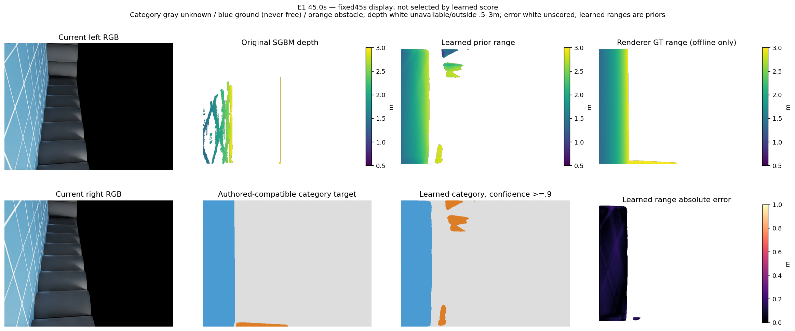
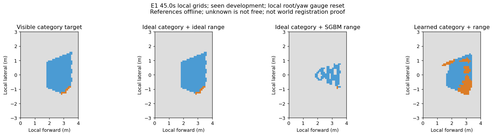
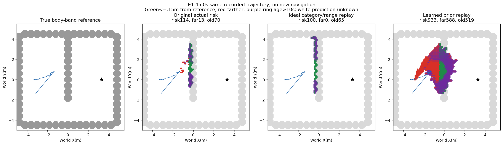
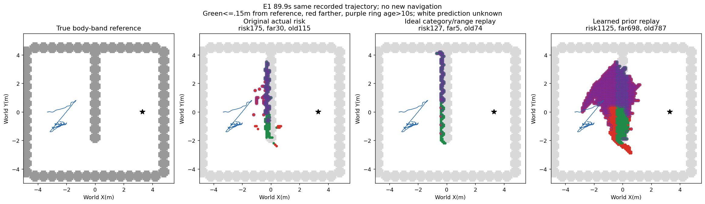
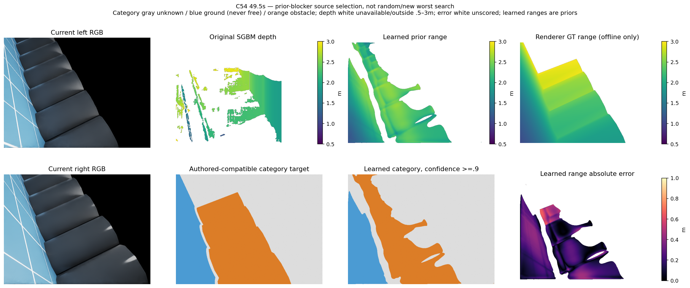
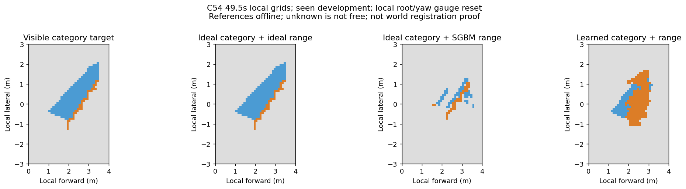
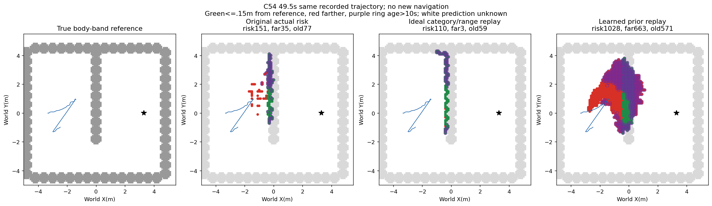
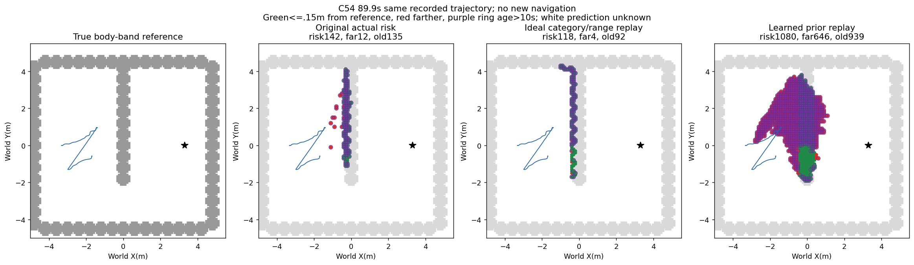

# 像素表面类别与独立距离学习结果（2026-10-13）

完成独立像素类别/距离目标的905对五完整开发序列oracle资格、一次30轮拟合及全部输出先封存后评分。**学习源未达到冻结门槛，拒绝接入导航和永久记忆；fit1/1、physical0/4未用4次关闭。**

## 标签与理想投影资格

保存输入没有renderer实例ID，离线标签使用冻结实际场景Sphere/Cylinder/地面与渲染有限深度的唯一3cm表面兼容：地面/障碍/未知。父体解析表面近似细分视觉mesh，接触歧义、无命中、超出.5–3m及不支持像素均未知。类别不由预测世界高度重新判定；这不是完美渲染语义。GT类别/深度仅诊断与监督。

|开发组|唯一标签/可用有限像素|标签覆盖|理想局部精确/召回|理想地面误报格/地面格|原生投影点位置P50/P90/P95 m|
|---|---|---:|---|---|---|
|H|42228639/43052696|98.09%|100.00% / 100.00%|64/65303|0.016762 / 0.035885 / 0.046082|
|E0|38730067/39610834|97.78%|100.00% / 100.00%|14/68603|0.026062 / 0.041910 / 0.047552|
|E1|63931576/65875988|97.05%|100.00% / 100.00%|85/39412|0.016686 / 0.034689 / 0.042692|
|B54|66296605/68276630|97.10%|100.00% / 100.00%|80/34770|0.015410 / 0.030205 / 0.037251|
|C54|72526245/73534500|98.63%|100.00% / 100.00%|37/28652|0.019282 / 0.026783 / 0.030652|

理想局部格定位P90均0m是0.1m格尺度及局部重心/航向重置下的结果；上述世界点误差单独报告，不能当全局配准通过。精确/召回匹配容许邻接1格，不是像素身份全图召回。两眼最近深度相容域的障碍覆盖仍有限；本模型输出全部是学习先验，不认证双目对应测量。

## 唯一冻结学习

当前双RGB、固定标定射线XY与理想原生IMU相机方向构成10通道输入；没有GT深度、场景布局、根平移、时间编号、原SGBM或旧模型输入。H/E0完整362对训练，其余E1/B54/C54完整543对不参与拟合，但五组都是已见开发数据，无独立新鲜泛化主张。训练特征均值/标准差与类别权重仅H/E0计算。

像素编码解码16/32/64通道，分别输出两眼三类与光轴距离；240×320固定偶数采样训练，再双线性480×640输出。Adam .001、seed20261013、batch4、固定30epoch最终模型；类别加权CE+地面/障碍等权SmoothL1距离beta.1，一次拟合无早停、无超参扫描、无旧BEV检查点复用。类别maxprob>=.9才提供类别，动态CAD/机体排除.55m与原生标定固定；地面/未知不能清风险或当观测自由。

## 实际预测源资格

|组/角色|局部风险精确率|召回|地图位置P90 m|测距P50/P90/P95 m|真实障碍像素测距P90 m|有效标签像素保留|障碍类别像素保留|灾难帧/181|
|---|---:|---:|---:|---|---:|---:|---:|---:|
|H/训练|80.72%|90.50%|0.223607|0.055438 / 0.172540 / 0.225663|0.204339|39830043/42228639 (94.32%)|16990778/17886379 (94.99%)|10/181|
|E0/训练|84.63%|97.12%|0.223607|0.046367 / 0.143076 / 0.190131|0.147497|37292423/38730067 (96.29%)|16175375/16816116 (96.19%)|1/181|
|E1/未拟合已见开发|36.06%|83.23%|0.806226|0.173303 / 0.500646 / 0.648649|0.624460|39200404/63931576 (61.32%)|20687016/44867360 (46.11%)|159/181|
|B54/未拟合已见开发|35.71%|85.10%|0.806226|0.179478 / 0.518578 / 0.654552|0.616240|38517640/66296605 (58.10%)|21763083/49795465 (43.70%)|161/181|
|C54/未拟合已见开发|34.59%|84.93%|0.948683|0.196441 / 0.535006 / 0.688595|0.623104|36601125/72526245 (50.47%)|21558764/60176012 (35.83%)|164/181|

所有五组同时要求：局部精确>=90%、召回>=80%、地面误报<=5%、无可见支持<=10%、表面覆盖>=70%、格定位P90<=.15m；有限标签保留>=70%、障碍类像素保留>=80%、全体/障碍距离P90<=.15m、评分>=1000的每帧P90<=.3m。学习距离仅对已分类且有离线有限标签的像素评分；保留不是距离正确率。类别语义、测距、入图点和地图格分母不可互换。

|组|地面误报格/真地面格|无可见支持格/预测风险格|局部可见表面覆盖|
|---|---|---|---:|
|H|2810/65303 (4.303%)|559/8593 (6.51%)|95.41%|
|E0|3120/68603 (4.548%)|350/12118 (2.89%)|93.23%|
|E1|17022/39412 (43.190%)|8492/35079 (24.21%)|96.28%|
|B54|14997/34770 (43.132%)|9686/34062 (28.44%)|96.15%|
|C54|12281/28652 (42.863%)|10281/32028 (32.10%)|96.65%|

可见目标限有限.5–3m且CAD/机体外、作者表面唯一兼容域，非场景全体障碍。每组整像素分母181×2×640×480；训练下采样coverage另为181×2×240×320。legacy exact_overlap_height/per_height字段本次是类别比较，非原高度层精度。

## 完整E1分类/距离分解（GT仅离线）

|诊断|风险精确率|召回|地面误报格比例|格定位P90 m|
|---|---:|---:|---:|---:|
|ideal_category_learned_range|41.75%|84.66%|31.79%|0.583095|
|learned_category_ideal_range|95.75%|99.30%|0.94%|0.000000|
|learned_both_same_gt_support|41.21%|82.28%|31.80%|0.583095|
|actual_learned|36.06%|83.23%|43.19%|0.806226|

181对E1全序列诊断：理想类别+学习距离、学习类别+理想距离及学习类别距离同GT支持控制均保留原学习positive/置信域，并去掉GT唯一标签不可用部分。actual_learned仍含无支持预测，所以应将两因子臂与learned_both_same_gt_support比较；不可把actual到混合的所有改进归因于某一个因素。

在相同有标签支持域，保持学习类别、只换理想距离使精确率41.21%→95.75%、P90 .583095→0；保持学习距离、只换理想类别仅41.21%→41.75%、P90仍.583095m。这支持当前距离先验错误是该支持域主要地图问题，未证明所有无标签预测的语义正确。两混合臂含在线不可用GT，不能作为新源/学习增量或救回拒绝候选。

## 长期地图同轨迹诊断（89.9秒）

|组|原风险/偏离>.15/旧10s/旧偏离|理想类别距离|学习类别距离|
|---|---|---|
|H|138/21/138/21|93/5/86/5|301/119/279/110|
|E0|127/8/108/2|148/6/94/2|382/178/229/83|
|E1|175/30/115/20|127/5/74/5|1125/698/787/542|
|B54|181/24/104/15|124/5/68/0|1169/725/800/534|
|C54|142/12/135/12|118/4/92/2|1080/646/939/629|

长期类别消费者只积累正障碍类别，任何类别2点入格；局部图>=4点是不同口径。近期10s及原两曝光/视角.1m确认保留，无负证据清除。新类别图绕过预测世界高度阈值，原图仍原链路，两者消费者不同，此为诊断性地图比较，不是同变量导航因果对照。真实参照为机体高度带；类别目标含所有可见障碍表面，偏离格不能自动等同障碍虚构。轨迹和物理状态完全原记录，无新运行或到达。

## 同刻直接展示

### E1 45.0s

选择：fixed45s display, not selected by learned score。左眼有效标签60670/307200；学习评分55854/60670，整图占18.18%；学习P50/P90/P95 0.073838 / 0.122891 / 0.137520m，原同标签域且.5–3m有效测量评分18288/60670、P50/P90/P95 0.028514 / 0.068333 / 0.083289m（评分像素集合不同，不授同像素增量）。

### C54 49.5s

选择：prior-blocker source selection, not random/new worst search。左眼有效标签147313/307200；学习评分105701/147313，整图占34.41%；学习P50/P90/P95 0.195939 / 0.389993 / 0.434864m，原同标签域且.5–3m有效测量评分29097/147313、P50/P90/P95 0.020139 / 0.967315 / 1.227394m（评分像素集合不同，不授同像素增量）。

显示初版原SGBM置信像素未限制.5–3m，包含源不接纳的超范围raw深度；已在独立审查后仅重生成展示及其条件统计，初版源码、图和统计保留在initial_unfiltered。学习模型、905预测、源评分、门槛和拒绝结论均未改变。

## 执行与独立核验

oracle阶段最初H无声明upAxis导致导出接口断言失败，唯一恢复只正确区分未声明与OpenUSD fallbackY，实际runtimeZ引用坐标未改变；没有性能失败改写。原故障和独立引用检查保留。原生理想IMU、特权初始规范、固定.4m先验如实保留。

本次学习的prepare/train_predict/score由现有durable监督，运行前登记；唯一30epoch拟合、完整905预测先封存后GT评分，无物理。独立审查见两目录independent_closure.json；完整来源与消费者单元核验保留。训练最终损失不是资格，开发失败禁止调参/换网络/追加数据救分。

复现使用现有ball_wm Python、Torch/CUDA与安装USDext；launch.py为单次受保护生成，封存目录不可再运行覆盖。只读核验verify_readonly.py检查封存和完整状态，独立科学复算另见审查。代码/数据/命令/环境边界在protocol、source seals及durable记录。

**可靠三场景导航、学习导航增量、整体目标均未完成；不停止自动任务。**

