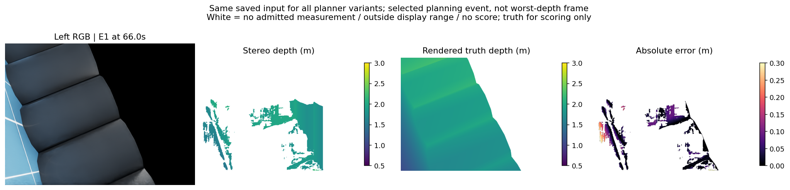
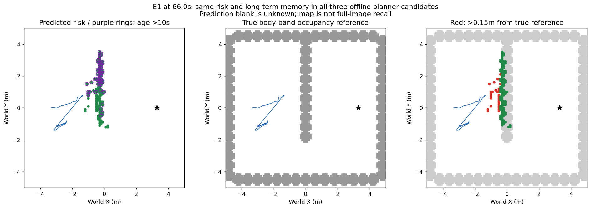
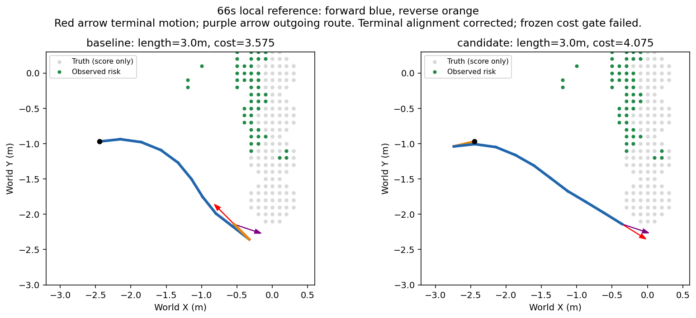

# 地图到路径规划：三个改动的实际实现与回放结果

日期：2026-10-13。用户已授权自主实施与验证。本轮修改并验证了三个独立规划消费者；均未通过预定准入，保持正式 baseline 原行为。新增物理导航 **0 次**，拟合 **0 次**。不能将本轮解释为导航改善或可靠导航已完成。

## 1. 做了什么

| 候选 | 实现和完整资格范围 | 关键结果 | 决定 |
|---|---|---|---|
| 全局运动约束路线，再取前 8 个原语 | 同一已封存 E1 的全部 10 次参考生成输入；原计划和节点数精确复现；新完整搜索均有解；真实 MRO、fallback、首方向接口通过 | 17.5 秒完整新路线仍先倒车 2.7 米，前 9 原语与旧方案相同。所谓 2.4 米只是截断造成；原 `replay.pass_gate=true` 原样保留，独立防误报审查拒绝准入 | 拒绝，physical 0/2，余 2 关闭 |
| 局部终点运动方向顺着后续路线 | 10 个完整当前输入；只改变搜索 goal acceptance，原成本/净空/原语/节点数不变 | 仅 66 秒计划改变。终点夹角 153.27°→13.68°；完整长度均 3.0 米、内部换向均 1 次。候选额外初始换向 0→1，原名义成本 3.575→4.075，不满足冻结成本条件 | 拒绝，physical 0/2，余 2 关闭 |
| 用当前执行腿识别路径保留投影 | 原 168 次规划决定中的 167 次有旧参考边界；原 guard 与原保留决定全部精确复现 | 138 次符合候选条件、29 次回退；16 次实际改变投影，但保留/重规划决定改变 **0 次** | 拒绝，physical 0/2，余 2 关闭 |

本轮总计三个独立 cap2 均在准入阶段关闭，没有将其合并为可转移的 6 次预算。前两个实际驱动仅作准备，没有 admission、ledger 或运行目录。所有查询都使用已见开发 E1；没有独立泛化证据。CPU 执行会话均正常退出，不属于导航性能失败。独立审查分别保存在三个实验目录中。

## 2. 为什么仍反复重规划

先前“投影歧义可能造成重规划”的假设已被完整回放否定。未筛选状态时有 24 个跨运动腿最近投影，但真正应用候选后只有 16 个投影改变，且没有决定改变。

关键的 66.0 秒与 81.5 秒：原算法和修正算法都发现，仍需经过的**未来路径末段**到已观测风险格的最小距离为 **0.732954 米、0.745692 米**，均低于固定要求 **0.870711 米**。最近风险格分别为 `[230,189]`、`[230,184]`，在对应参考生成时（51.0、71.0 秒）是未知，当前已被观测为风险。风险位于未来路径，不能因为把旧倒车段排除就忽略。

十条参考在各自生成时的地图上均通过原连续净空检查，最小距离范围 **0.890013–1.005354 米**。本数据不支持“规划器刚生成的路线就被同一地图判为无效”；支持“后续观测补全风险后，旧路线失效”。这不证明地图每个风险点正确，也不排除控制误差。

## 3. 同刻深度、真值与误差

下面均为原始已封存 E1 的 **66.0 秒**，按规划事件事后选择；不是新仿真、随机帧或最坏深度帧。三个候选均使用同一感知输入，未修改测距源。

深度色条单位米，显示 0.5–3 米；误差色条 0–0.3 米。白色表示无准入测量、超出显示范围或无有效评分，不表示自由空间。渲染真值仅用于离线评分。

| 口径 | 同刻结果 |
|---|---:|
| 有限真值可评分预测像素 | 25,062 / 45,444 个置信测距像素 = **55.15%** |
| 可评分像素占整张图 | 25,062 / 307,200 = **8.16%**；不是障碍召回率 |
| 绝对深度误差 P50 / P90 / P95 | **2.45 / 9.53 / 17.85 厘米** |
| 当前进入地图源的点中，真值有效 | **1,641 / 1,936** |
| 上述有效入图点实际落地面 | **0 / 1,641**；仅本帧、此条件分母 |
| 有效入图点世界位置误差 P50 / P90 | **1.59 / 2.97 厘米** |

## 4. 当前风险与长期记忆是否准确

左图绿色：系统当前保留的风险格；紫圈：最后一次风险采集距当前超过 10 秒。中图灰色：真实机体高度带占据参照。右图绿色：距参照不超过 0.15 米；红色：超过 0.15 米。蓝线为该旧运行截至此刻实际轨迹，黑星为目标。预测空白是未知。

同刻共 **147** 个风险格，其中 **31/147** 距参照超过 0.15 米；超过 10 秒仍保留 **68** 格，其中 **12/68** 偏离参照超过 0.15 米。这是格中心与机体高度带参照的空间指标，不是像素深度误差、完整场景召回或精确三维碰撞证书。地图累计错误与本帧 0/1,641 地面误报使用不同分母，不能互换。

## 5. 终点方向候选长什么样

蓝段前进、橙段倒车，红箭头为终点运动方向、紫箭头为后续栅格路线方向。候选纠正了终点朝向，却增加了初始方向交接；未通过冻结成本准入，所以没有运行对应真实导航。cost 是原名义距离加换向代价，不是实测时间。

## 6. 接续

保留现有感知、IMU、地图、控制及原阈值。下一研究问题转为：**当前观测只覆盖部分障碍时，如何选择能持续获得观测的局部绕障子目标，避免反复朝尚未观测清楚的障碍端部规划？** 先有限核对旧 route-side、再观测、ray 和未知探索机制，区分“观测支持/未知边界的规划消费者”与已关闭候选；不得假定未知为自由，不得通过缩小安全间距或扩展虚构墙体解除问题。

该下一方法尚未实现或准入。按最新自主授权，证据足够后另冻一个单环节机制、输入和停止条件；同输入完整检查通过才有界同版 90 秒实际对照。三个本轮否定不调参、不换名复活。学习路线保持暂缓。研究基准证据可交付；可靠三场景导航、学习导航增量与整体目标仍未完成。
