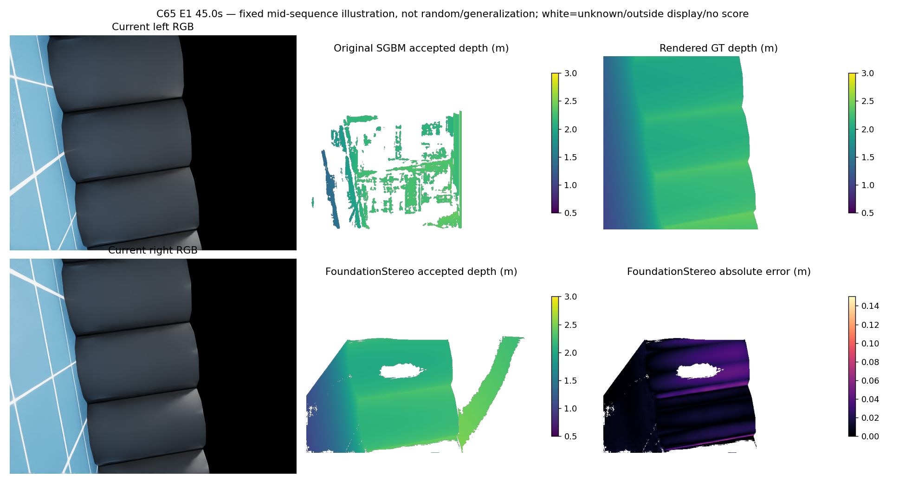
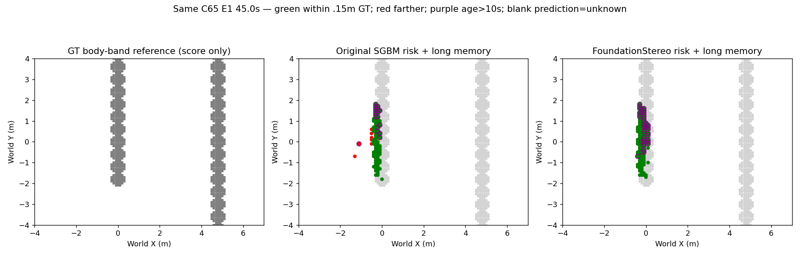

# FoundationStereo 未微调完整开发序列结果（2026-10-14）

## 结论

标准FoundationStereo ViT-large 23-51-11显著降低条件深度误差，多组最终错误风险归零；原固定投影/纹理/风险消费者的可见目标召回七组均低于80%，H/C54精确率还低于95%。本次固定源+消费者组合拒绝导航准入，fit0、physical0，未尝试4个物理额度关闭。权重保留为离线诊断源；不微调、不扫参。完整开发来源已见，非新泛化；没有新实际导航或学习导航增量。

1267对预测先封存后GT评分；6300原地图/1267原packet与surface exact。GPU生成正常退出0，耗时约86.5分钟；首轮缺USD路径，唯一环境恢复1/1仅加入已安装依赖，不改算法。

## 全序列与最终89.9秒地图

|组|深度P90 原→预训练(m)|BEV精确率|BEV召回|格定位P90(m)|最终错误风险 原→新|最终旧错误 原→新|
|---|---:|---:|---:|---:|---:|---:|
|H|0.1005→0.0119|93.70%|51.25%|0.100|21→21|21→21|
|E0|0.4272→0.0826|99.94%|66.99%|0.000|8→0|2→0|
|E1|0.1177→0.0177|95.42%|73.08%|0.100|30→0|20→0|
|B54|0.1181→0.0188|95.18%|70.56%|0.100|24→0|15→0|
|C54|0.1336→0.0188|94.00%|68.53%|0.100|12→0|12→0|
|B65|0.1136→0.0175|96.11%|74.64%|0.100|57→20|7→0|
|C65|0.1290→0.0173|96.25%|66.54%|0.100|3→0|3→0|

## 完整分母

BEV目标为当前左眼有限0.5–3m、静态CAD未遮挡、真值高度0.05–1.5m表面；不是全场景召回。预测入图点与可见真值量化到0.1m格，双向0.15m容差；真值只评分。表中分母为逐帧格实例，不能等同永久地图格。地面空间误报排除0.15m障碍重叠，与源像素真地面误报分开。原真实障碍query保留55.9%–81.4%是同像素入图点口径，不能当场景召回。

|组|评分像素/合法预测像素|评分占全图|入图地面误报/有限GT入图点|预测格/可见真值格实例|正确预测/覆盖真值格实例|空间地面误报格|
|---|---:|---:|---:|---:|---:|---:|
|H|8909760/8909856|16.02%|2625/98017|1604/3030|1503/1553|101|
|E0|6030056/6030126|10.84%|61/143318|3264/7720|3262/5172|0|
|E1|16103125/16519428|28.96%|2090/407072|3166/4157|3021/3038|73|
|B54|14076192/14521666|25.32%|1820/378635|2861/3879|2723/2737|68|
|C54|9467781/9582133|17.03%|2380/233836|2282/3311|2145/2269|109|
|B65|16337284/16891687|29.38%|3860/441966|3342/4290|3212/3202|90|
|C65|15370715/15938724|27.64%|725/418622|2984/3993|2872/2657|0|

1267帧中E0有1帧深度P90>0.3m且至少1000评分像素，其余六组为0。该条件分位并不代表全图无错；无命中、遮挡和未知另计，不能当自由空间。

## 同刻图像：C65 E1 45.0秒

固定中段示例，非随机代表或最差帧搜索。白色为未知/超显示域/无评分；深度0.5–3m，误差图上限0.15m。

地图灰为真实bodyband参照（仅评分）；绿距参照≤0.15m，红>0.15m，紫圈风险年龄>10s。预测空白为未知。90秒轨迹终态与89.9秒图时钟分开。

## 核验与限制

prediction_seal逐输入/输出/官方源码与权重SHA在评分前通过；独立2534方法帧统计重新聚合通过，仅统计独立核验，不夸称第二次模型或全几何独立复算。原生IMU/估计pose与原消费者条件沿用；已见开发序列、同轨迹离线比较，不是新闭环因果或独立泛化。完整补充全时刻地图、阻塞源16点与耗时见supplement_result.json（完成后补充摘要）。可靠导航和学习导航增量仍未成立。

补充核验：原C65阻塞格16像素中13个测量有效，误差0.004624–0.055019m，另3未知；未知没有变成自由或清除旧在线风险。全900步C65风险中心距离起点低于固定0.870711m的时刻70→0，H463→0，C54359→0，E0406→406，其余均0→0。这是同轨迹离线起点阻塞统计，不是机器人绕障成功或完整通道可行性证明。完整已安装参考通道阻塞计数未复算（未评估），不能称该门槛通过；其他冻结门槛已充分否定导航准入，不继续派物理。

E0灾难帧为38.5秒（frame385），整体P90合格也不能掩盖它；七组召回51.25/66.99/73.08/70.56/68.53/74.64/66.54%。评分器初版元数据键/来源哈希/未知NaN序列化错误已修复，原科学预测、地图及模型协议未变，初版保留。生成环境恢复1/1与这些离线报表接口修复分开，不冒充科学性能重试。
