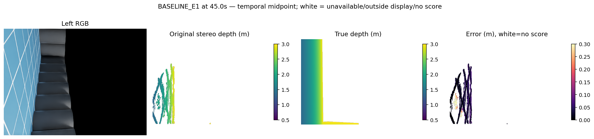
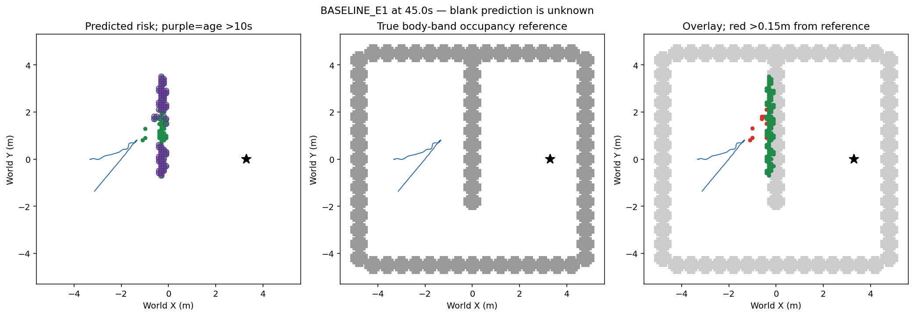
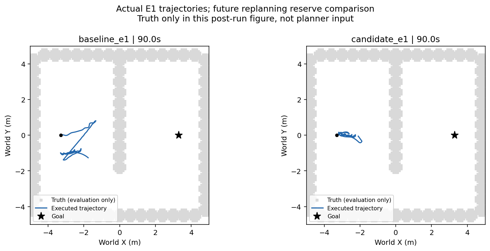

# 重规划余量导航实际对照（2026-10-13）

## 结论

拒绝本候选。E1同版两次实际90秒都超时、无接触；候选净推进1.199410m低于基线1.385624m。可靠导航、学习导航增量与整体仍未完成。

原框架已经每0.5秒检查完整剩余参考，缺检查假设否定。新单环节在原0.870711m强制规划净空之外额外保留0.2m；该经验余量不是制动或安全保证。固定双目/原生IMU、地图风险语义、控制、相机与照明。GT只监督/评分，不清风险或认证自由。基线为同版原路径回退框架，不采用已拒绝的v54端部策略。初始规范、理想原生IMU、低层理想IMU和地面/未知探索先验保留并披露。

|E1实际90秒|基线|候选|
|---|---:|---:|
|净接近目标m|1.385624|1.199410|
|剩余m|5.214377|5.400591|
|总走m|11.032761|7.251095|
|实际规划尝试/安装/失败|7/7/0|70/6/64|
|全程深度P90cm|11.3629|12.8968|
|接触/到达|0/否|0/否|

完整181双RGB无一对相同；同条件开发对照，不是完整输入因果或泛化。每臂900map/4500物理命令/181native注册/5401可用接触/双901视频独立复算与封存核验通过。主执行者77次实际native地图全局/局部query复算；独立审查未重跑全部77搜索，但重算全部6条安装净空、98保留检查和64阻塞，候选6条安装路径连续净空均满足1.070711，98次保留边界复算通过。6条候选与同状态原查询不同；这是规划介入证据，不是轨迹因果增量。

## 失败解释

58–89.5秒64次失败均由起点低于额外1.070711门槛，13次也低于原0.870711，目标未阻塞。最近风险格(-1.1,-.1)距body-band参照0.8m，GT只是事后评分。58–90秒320块零请求下实际总走0.626826m/净位移0.299842m；零请求不能等同零物理动作或证明制动故障。新增余量没有阻止本次可规划性丢失，也更保守。不得调余量或缩原安全距离复跑。

## 同刻图像与地图

选择完整序列时间中点45秒，非最差帧搜索。深度单位m；预测展示当前置信0.5–3m，白色不可用/超展示域/不评分；真值+inf是渲染无命中，不代表物理自由。地图灰色是body-band真实参照；绿为风险、紫圈年龄>10秒、红距参照>0.15m，蓝实际轨迹、黑星目标。预测空白为未知。

### baseline_e1

45s深度P50/P90/P95=[0.029561758041381836, 0.07924828529357927, 0.25598561763763417]m，评分18655/18677置信范围像素，占整图18655/307200。入图点真值可用3/9、地面误报0/3。同刻风险/偏离/旧10s/旧偏离=[110, 9, 72, 4]，终态89.9s=[212, 57, 74, 7]。

全程深度P50/P90/P95=0.029841/0.113629/0.144099m，有限评分5189430/7042692（73.69%），占整图9.33%，渲染无命中却有预测1853262像素实例。不是全图召回或独立空间覆盖。

### candidate_e1

45s深度P50/P90/P95=[0.03513622283935547, 0.10750937461853027, 0.12352039813995364]m，评分35203/40811置信范围像素，占整图35203/307200。入图点真值可用1709/1917、地面误报0/1709。同刻风险/偏离/旧10s/旧偏离=[100, 7, 19, 1]，终态89.9s=[103, 3, 94, 3]。

全程深度P50/P90/P95=0.035348/0.128968/0.160281m，有限评分5420089/7777076（69.69%），占整图9.75%，渲染无命中却有预测2356987像素实例。不是全图召回或独立空间覆盖。

## 代码、运行与封存

本根包含protocol、baseline/candidate drivers、reserve.py、supervise.py、actual_effect.py、全部运行输入/输出、视频、独立审查与SHA。预算physical2/2关闭，fit0、recovery0。预派发SHA元数据命名修正失败在子进程创建前拦截，不耗物理/恢复预算；初版栅格样本通过而连续净空失败方案保留，修正为原连续验收，不调整门槛。科学运行未改。宿主2301129/2301145/2313019已正常退出。

下一有限问题：无路回退零请求与实际动作/惯性是否相符，先核对旧制动/归零/安全停候选以避免重复，再从当前nativeIMU、请求、物理目标完整重构；有新证据才冻结独立单环节执行合同，GT仅评分。不能直接宣称控制故障、重开旧候选或在线删除假格。
