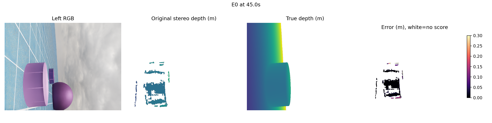
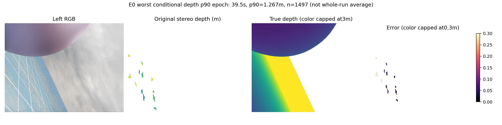
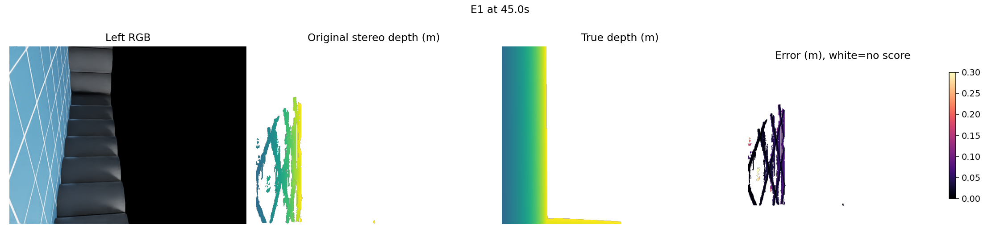
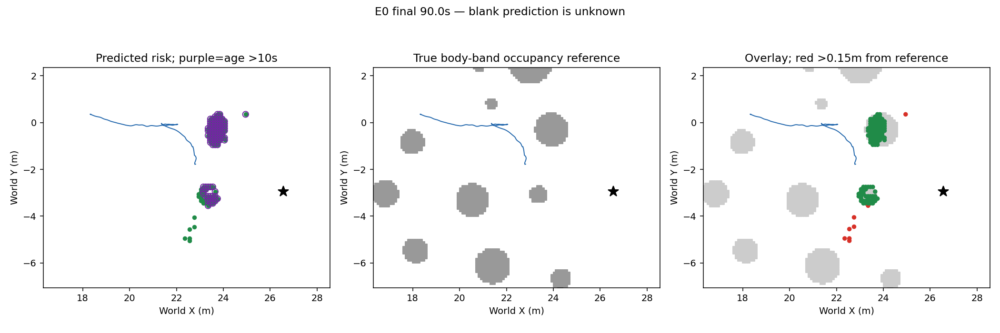
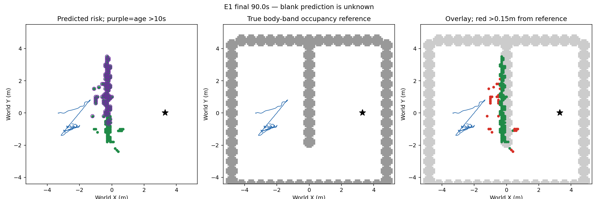

# 新场景双目、地图与可信度校准实测结果

本轮实际完成两次90秒E0/E1双目+原生IMU仿真采集、900×2请求/9000物理命令、两场景完整原始输入核验；随后资格通过后进行一次冻结的轻量置信度拟合，留出失败而拒绝；同轮再实现不训练的竞争测距检查，整序列离线评价仍失败。没有把文件交付、模型训练或无碰撞称为导航成功。

## 原始预测深度与真实深度

从左到右为RGB、原始可信双目深度、同刻渲染真值、绝对误差。45秒图主要障碍测距较好，但预测稀疏；它不能代表整段运行误差。

这张是≥1000有效预测像素的保存帧中，条件误差90分位最大的一帧，属于**事后选择的最差示例**。误差色条在30厘米截断，真值深度颜色在3米截断；高于色条上限不等于被忽略。原始预测在0.5–3米范围内，评分真值不限制在3米内。白色表示没有可评分预测。

## 周围真实障碍、预测地图与长期记忆

左：实际预测风险图，紫圈是最后更新超过10秒的风险；中：同一区域的真实body-band占据参照；右：叠加，红色距离真实参照占据格中心超过15厘米，绿色空间接近。蓝线是真实轨迹，黑星是目标。预测空白为未知，不是已测自由。

真实参照使用已有`vertical_max_body_band`栅格，不是完整3D真值表面；15厘米是栅格中心评分容差，不改在线门槛。它与上一份E2报告的解析障碍轮廓/10厘米容差口径不同，不能直接比较错误格百分比的优劣。

|新实际采集|E0|E1|
|---|---:|---:|
|终态|90秒超时、无接触|90秒超时、无接触|
|净推进|4.901米|0.777米|
|剩余目标距离|3.939米|5.823米|
|全体可信0.5–3米像素深度误差90分位（含机器人表面）|42.72厘米|11.77厘米|
|已入图点3D位置误差中位数 / 90分位|8.23 / 53.80厘米|2.43 / 6.20厘米|
|已入图点可评分比例|143261/147261（97.28%）|225334/262774（85.75%）|
|可评分入图点中真值地面误报|9.92%|0.342%|
|终态风险格|127|175|
|其中最后更新超过10秒|108|115|
|距body-band参照格中心超过15厘米|8|30|

入图点为筛选后点集合，全体像素为另一口径；两者误差分位数不能混为一谈。以上不是全图召回或完整地图精度。E1测距较准却推进很少，说明感知统计和导航行为需要分别验收。新采集使用forward60cm相机、冻结高度筛选/视角风险确认框架，与原90秒套件的相机/记忆配置不同，不能把新旧E0到达率直接归因于某个单环节。

## 一次冻结可信度模型：拒绝

独立目标：当前SGBM光轴深度误差是否超过15厘米；消费者只过滤当前点的可信度，剔除为未知，不写自由或删除旧风险。12个当前双RGB/视差/局部匹配/native注册特征，H/E2训练，fresh E0/E1整序列留出，train-only标准化，一次ridge-logistic拟合，无阈值/网络/参数扫描。

旧V整序列有限真值覆盖55.77%，排除24.1秒共同物理前缀再额外10秒后仍60.77%，均低于冻结70%；旧V拒绝保持。新H/E0/E1覆盖77.28%/99.16%/74.70%，所有有≥20候选点的观测均有≥20标签，全部实际合法终态/181对输入通过，才允许一次拟合。旧forward/H同轨迹同组，不增加独立训练样本。

|当前CAD筛选候选点口径|原始深度误差90分位|模型过滤后|真实正高度障碍点保留|
|---|---:|---:|---:|
|H/E2训练|10.053厘米|9.997厘米|99.778%|
|E0留出|42.673厘米|42.665厘米|99.9997%|
|E1留出|11.759厘米|11.751厘米|99.944%|

E0仍超过15厘米，且>30厘米误差占18.34%超过10%门槛。模型拒绝，未进入新导航。物理预算cap4：数据采集used2，条件导航未尝试2已关闭；fit1、恢复0。旧153执行库、旧2/30采集及旧候选预算未恢复。

## 竞争测距检查：当前实现拒绝

对原测距±30厘米的两个假设，比较当前7×7图块的NCC与绝对光度残差、当前CAD可见性；更好竞争解释意味着原匹配不能唯一支持，剔除仍为未知。它不使用地面竞争先验，也不训练模型。

H/E0/E1全部作为开发评价（此前已查看数据，不能称新独立留出）。预测先封存，再读渲染真值。E0误差90分位仅42.673→42.634厘米，仍失败；真实正高度点保留99.628%。该实现拒绝，physical0/fit0，未用物理预算4全部关闭，不改偏移、NCC或图块救分。

审查限制：实现没有完整要求原匹配右图块的CAD遮挡/纹理支持，不能称严格支持版已完成有效验证。当前关节来自诊断记录，但543个采集时刻与公开17D proprio[9:12]逐值相同，已核验来源等价。保留实现和失败证据，不在看见结果后改定义重评分。

## 深度正无穷的进一步限制

此前“无有效有限深度”像素在H/V中全部是+inf，没有NaN/零/负值。提取代码只转换dtype与检查尺寸，并未造出这些值。NVIDIA公开文档说明无穷深度对应未命中物体，但公开API描述零值哨兵；当前安装实际+inf及裁剪语义还需确认，不能直接把全部+inf当有限3D位置真值。[NVIDIA官方API](https://docs.omniverse.nvidia.com/kit/docs/omni_replicator/1.12.27/source/extensions/omni.replicator.core/docs/API.html)

独立统计：过滤模型在H/E0/E1的+inf参照候选中仍保留236867/238051、4313/4338、408847/409624，几乎没有解决这类有限预测。原有限深度资格和拒绝未改。下一步先核对安装版无命中/裁剪语义及物理可见域，再决定独立“有限表面是否存在”的标签目标；不得以重定义标签救回当前模型。未来真值仍只作监督或评分。

## 执行证据与复现

两个宿主child925441/936520及parent925422已退出。原始执行审查分别核验900请求、4500物理命令、181相机原生注册、900实际风险图重建、全接触可用和双901帧视频。6个合成接口检查只证明因果时刻、字段对齐、不可变输入和剔除为未知，不证明模型精度。

保留首次拟合前脚本语法失败（fit0）及最初视差方向接口错误（fit0）；修复代码后仅一次实际拟合15次优化迭代，不能把优化迭代称15次模型训练。CPU durable日志记录真实退出，GPU环境恢复0。

[完整拟合/留出结果](../experiments/source_confidence_calibration_20261012_v1/fresh_result.json) · [竞争实现结果](../experiments/stereo_competing_depth_20261013_v1/result.json)

源可信度研究阶段得到有效否定结论；可靠导航和学习导航增量仍未完成，自动任务继续。
