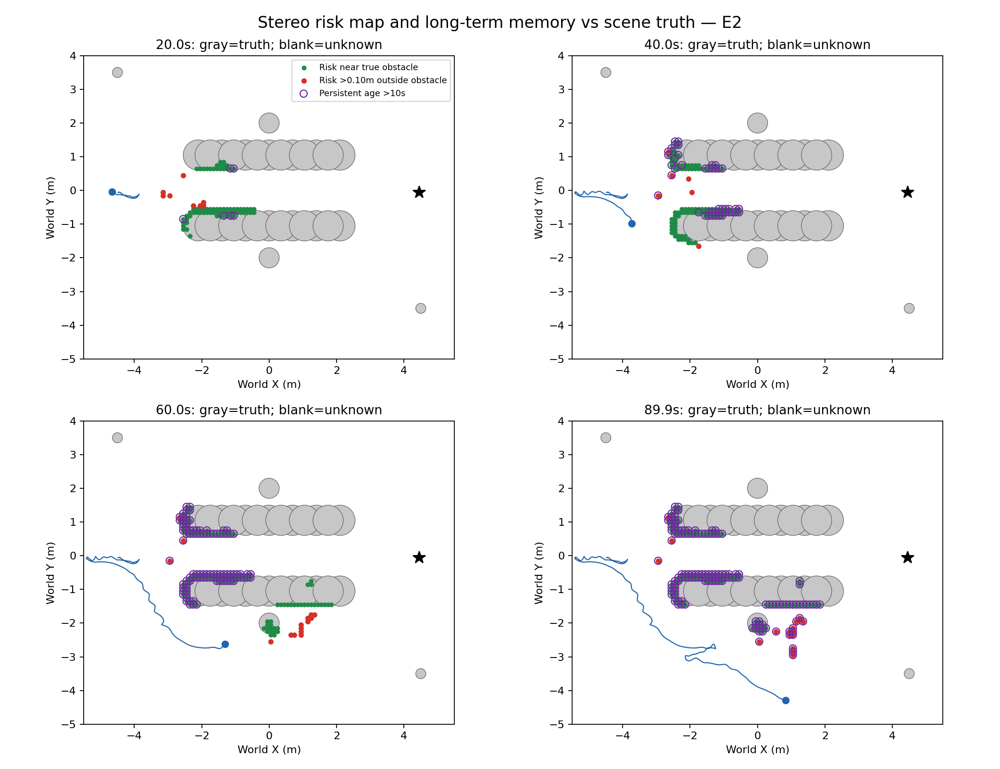
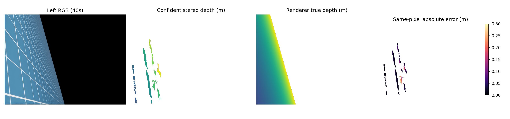

# 双目障碍图与长期记忆的真值对照

评估对象：最新已封存的 E2 90秒视角确认实验。实际输入仍为双RGB、原生IMU位姿与当前关节/CAD遮挡筛选；仿真深度和障碍物几何仅在本次事后评分使用。此次新增物理运行0，训练0。不是新导航成功结果。

## 结论

地图部分符合真实障碍边缘，但存在位置偏差、地面误报及误报永久保留。它是稀疏障碍表面风险图，不是完整环境重建；空白是未知，不能作为可通行证据。长期记忆能保留正确观测，同时也保留了错误观测。当前不能交付可靠导航。



灰色：真实场景障碍的XY投影；绿色：预测风险格位于真实轮廓内或距轮廓不超过10厘米；红色：距所有真实障碍投影超过10厘米；紫色圈：已确认且最后更新超过10秒的长期格；蓝线：真实运行轨迹；黑星：目标。绿色只说明空间接近，不是该点来源正确的证明。图中完整灰色真值是评估者所知，机器人在线并没有这幅完整地图。

## 定量结果

|对象/指标|结果|含义|
|---|---:|---|
|保存双目观测|181对|完整0–90秒记录|
|进入风险图的点实例|76,002|包含跨帧重复，不是独立样本|
|具有有效同像素渲染真值的点|60,176（79.2%）|其余15,826无法用该深度真值评分，不能算正确|
|已入图点的3D位置误差中位数 / 90分位|7.36 / 26.42厘米|原生位姿注册后的实际地图点|
|已入图点的XY位置误差90分位|26.31厘米|与10厘米地图分辨率相比不可忽略|
|仅换成真值相机位姿后，3D误差90分位|24.35厘米|事后分解，在线没有用真值纠正；测距本身仍有较大误差|
|原生位姿注册偏移90分位|5.44厘米|同一预测点分别用估计/真值相机位姿变换的差异；分位数不能相加|
|真值属于地面的已入图点|1,934 / 60,176（3.21%）|地面阈值为真值世界高度绝对值≤3厘米，预测却进入正高度风险图|
|89.9秒最终风险格|145|全部已确认，全部最后更新超过10秒|
|最终距真实障碍轮廓超过10厘米的格|16 / 145（11.03%）|明确空间不符，均被长期保留；10厘米仅评分容差，不改在线门槛|
|所有可评分来源均为地面的长期格|12|有些来源真值不可评分；不能称所有原始来源都已被证明是地面|

90%的可评分入图点误差不超过26.42厘米，仍有10%更大。原先全体0.5–3米可信像素的光轴深度误差90分位是19.90厘米（含机器人表面）；该指标与这里筛选后环境风险点的三维误差口径不同，不应直接比较好坏。

评分采用已有scene SHA绑定的30个Cylinder/Sphere精确解析投影，不采用障碍包围盒当真实轮廓。正风险是表面点，不能用完整实体体积IoU评价。对可评分且已被选中入图的像素，累计真实正高度表面有114个格；终态风险在本格/四邻格覆盖92格（80.70%），但这是**已选择观测的条件覆盖**，不是全图召回率。未匹配、被过滤、背面和视野外障碍没有进入这个分母，当前不能声称漏检率只有19.30%。

## 当前帧测距示例



40秒相机主要看到斜地面。预测图空白是没有可信匹配，并不是没有障碍或测得自由空间。误差图只评分有效同像素预测，色条在30厘米处截断；更大误差不会凭空消失。真值图也只展示3米内有效深度。

## 应如何修改

1. **先修当前双目点的可信度。** 真值位姿下仍有24.35厘米的误差90分位，说明仅改善IMU注册无法消除主要测距误差。下一独立候选将校准“当前匹配是否可能误差超过15厘米”的置信度；输入只用当前双RGB、视差、局部匹配特征、原生IMU及CAD。真值仅提供训练/评分标签。按完整物理序列分组留出，既检查误差降低，也检查真实障碍保留与观测覆盖，防止把点全删掉换好分数。已有高度区间和地面竞争解释机制失败，不再调阈值重试。
2. **长期记忆需要保存可撤销的观测证据与不确定度。** 两次观测、相机移动10厘米仍不足以证明正确。本次16个空间错误格已经长期化。后续记忆机制应保留每次来源、位置协方差和冲突证据，在可靠的多视角表面一致性下晋升；出现独立新测量冲突时降为待确认/未知，不用“没有看到”直接清成自由。这是后续待验证机制，不能把真值评出的红格在线删除，也不能把延长TTL作为修复。
3. **保持未知与可通行分离，并增加覆盖评价。** 先建立带当前CAD可见域的完整图像障碍覆盖分母，再评价漏检与盲区。局部规划应根据可验证的观测覆盖决定是否需要重新观测，不能把稀疏图空白当作安全路线。90秒绕到场景南侧仍未到达说明地图修正之后还必须验证导航闭环。

实施顺序是源可信度→记忆证据处理→真实90秒导航验证。每次改变一个主要环节；旧负结果和封闭预算保留。上述改动尚未获得导航成功证明。

## 核验与复现

全部900张实际风险图由原生来源和视角确认算法逐张重建，与保存labels/codes完全相同；2347个评估输入文件SHA256与既有封存匹配；真实场景SHA也匹配已有occupancy身份。原运行和原工作树未改。

使用现有ball_wm环境：

```bash
PYTHONDONTWRITEBYTECODE=1 MPLCONFIGDIR=/tmp/ball-map-mpl /home/an/miniconda3/envs/ball_wm/bin/python experiments/stereo_map_truth_audit_20261012_v1/audit.py
PYTHONDONTWRITEBYTECODE=1 /home/an/miniconda3/envs/ball_wm/bin/python experiments/stereo_map_truth_audit_20261012_v1/verify_inputs.py
```

[数值与每帧明细](../experiments/stereo_map_truth_audit_20261012_v1/metrics.json) · [输入核验](../experiments/stereo_map_truth_audit_20261012_v1/input_verification.json)
