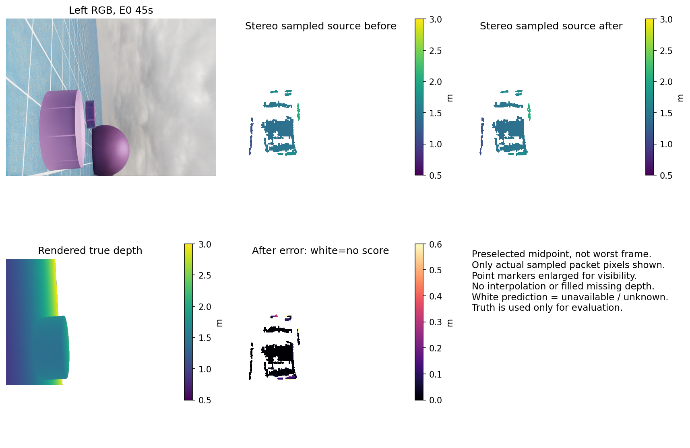
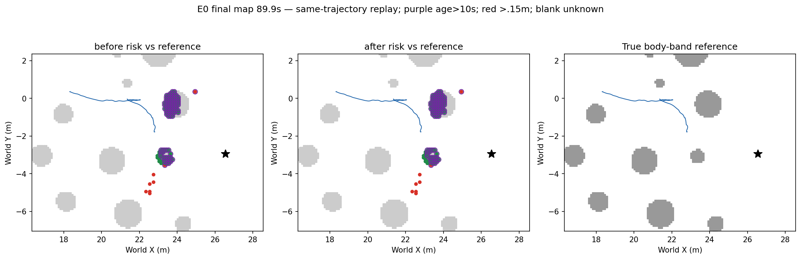
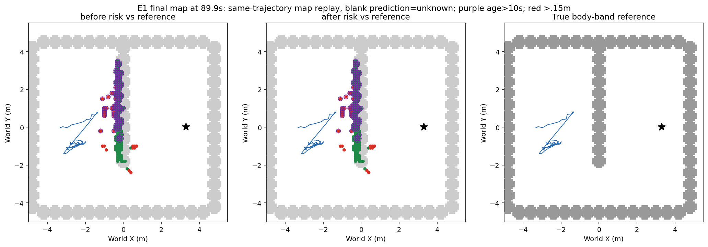

# 当前双目对应归属：完整测量与地图结果

更新UTC：2026-10-13T03:29:03.061883+00:00。结论：拒绝这一候选；物理0/4，未使用4次关闭，fit0。可靠导航、学习导航增量均未实现。

只在现有CAD/距离/机体排除/stride2源点内，排除争用同一个取整右像素的所有左像素。不是全图一对一保证；正确表面透视和取整也可能争用。原左右一致性不等价于这个规则。三组均为已见开发数据。

|组|源点/保留|P50前→后m|P90前→后m|P95后m|真实障碍保留|有限GT/保留点|有限GT/全部图像像素实例|
|---|---:|---:|---:|---:|---:|---:|---:|
|H|1,047,726/1,044,392|0.023504→0.023468|0.100526→0.100211|0.178395|99.397%|806,456/1,044,392=77.218%|1.450%|
|E0|517,800/516,000|0.047588→0.047554|0.426731→0.426933|0.583834|99.657%|511,662/516,000=99.159%|0.920%|
|E1|1,619,230/1,613,196|0.027311→0.027356|0.117591→0.117646|0.144891|99.439%|1,203,614/1,613,196=74.611%|2.165%|

每组181次源曝光，共543对；全部图像分母每组181×640×480=55,603,200像素实例。有限GT/已预测源点是条件评分覆盖，不是全图召回。正高度障碍条件为GT世界高度(0.05,1.5]m，保持原定义；无渲染命中不代表物理自由。E0超过0.3m误差仍18.340%，原P90≤.15m、离群≤10%门槛失败。

E0保留有限源点中，事后GT地面误差>0.3m为14,641/142,695，真实正高度障碍为79,198/360,588。进入地图的这些两类点分别有13,924/14,202与19,834/128,616超过0.3m。该分类仅解释误差分布，不是线上标签或因果根因证明，也不重定义旧门槛。

|同轨迹完整回放|风险格前→后|距参照>.15m格前→后|年龄>10s格前→后|其中偏离参照格|地面误报/有限GT入图点前→后|
|---|---:|---:|---:|---:|---|
|E0|127→127|8→8|108→108|2→2|14213/143261→14202/142823|
|E1|175→175|30→30|115→115|20→20|771/225334→766/223679|

两组原始地图各900幅逐帧准确复现；过滤后的最终地图标签均0个单元变化。地图最后时刻89.9s，点指标覆盖源曝光0–90s，不能将末帧90s点当作89.9s地图成员。无新导航轨迹；这只是同输入、同轨迹的地图消费者回放。地面误报定义GT世界高度绝对值≤.03m；空间错误定义到既有身体高度带占用参照格中心>.15m，非完整三维表面/全图召回。

预选E0 45s中点，不是事后最差帧；图显示实际源点像素，放大点标记以便看清，没有插值填补未知。深度色条.5–3m，误差0–.6m；白色为预测不可用或无评分。

地图绿色风险、紫圈>10s历史、红色距真实参照>.15m、灰色身体高度带参照、蓝轨迹、黑星目标；预测空白未知。

源预测543输出先封存再GT评分；独立输入/输出/源码/GT身份及数字复算通过。地图首次执行会话143中断已保留，非性能失败；一次宿主durable恢复正常退出0。初始E0坐标轴裁切及稀疏像素缩放可读性问题已通过仅重绘修正，初始图保留，测量和地图数值未改。

下一研究入口：Finite novelty check then freeze one distinct current-pair ordinal/Census matching-cost depth estimator, replacing measurement generation rather than filtering or retuning the rejected SGBM confidences. Existing ORB sparse matching and temporal variants are already rejected (mission229-248/1501), do not replace descriptor or replay them. Only current paired RGB/native calibration/CAD masks; no lighting or camera changes; no GT online. Specify fixed correspondence/domain/ambiguity rule and complete grouped sequence accuracy plus true-obstacle/measurement coverage before execution; known H/E0/E1 are development only. No threshold sweep or old candidate rescue. If source gate fails close candidate; if passes newcap<=4 including necessary sameversion baseline/fresh actual test. This is an unimplemented research hypothesis, not an admitted source or promise of navigation.
