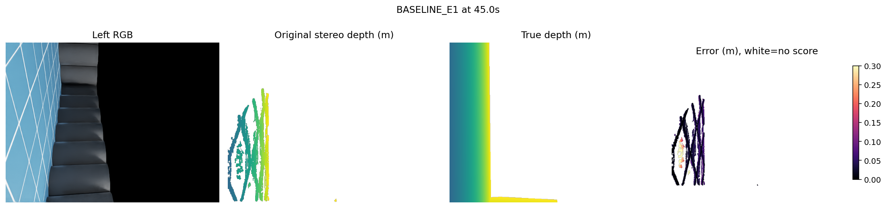
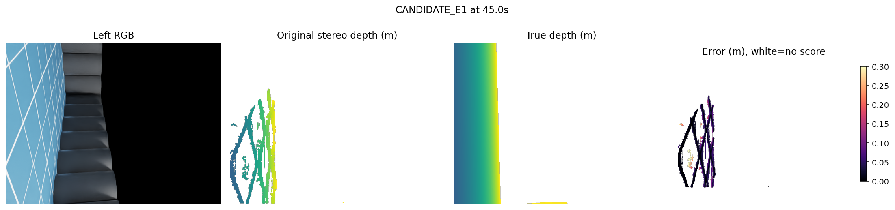
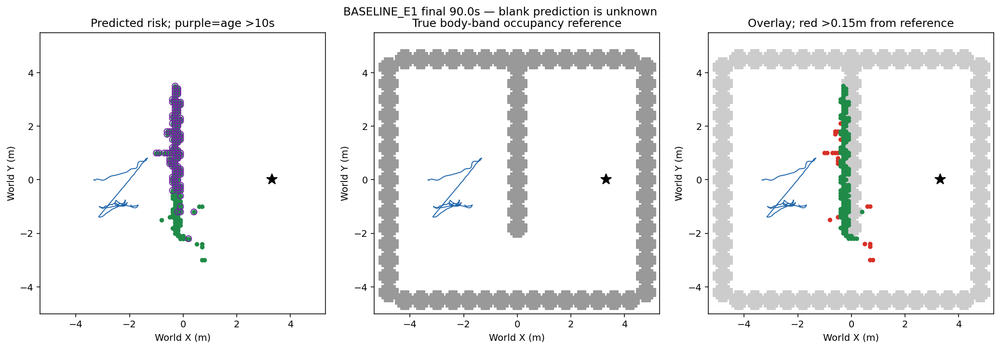
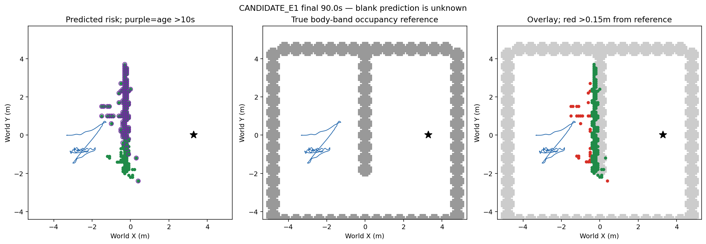

# 切向场目标：真实E1 90秒对照

新消费者仅改变lookahead目标：以当前路段切向和横向误差形成场方向，沿用原lookahead长度；末端/换向退回原目标。8几何与8实际MRO边界检查及独立预审后运行两臂。预审发现剩余arc错误，在派发前修正并保留旧源和审查。真实双RGB/SGBM、原生IMU编码器位置、规划/记忆/gyro反馈/gain/PID/相机/光照沿用；初始规范、平地高度先验、低层理想IMU特权披露，GT只评分。

## 结果

|指标|基线|切向场|
|---|---:|---:|
|净推进/剩余距离(m)|1.252724/5.347276|0.545893/6.054108|
|实际终态/接触|90秒超时/0|90秒超时/0|
|深度p50/p90/p95(cm)|2.79/11.70/14.60|2.96/12.17/14.89|
|有限可评分/置信预测像素实例|4,789,024/6,461,971 (74.11%)|4,865,295/6,254,227 (77.79%)|
|可评分/完整源图像像素55,603,200|8.61%|8.75%|
|有效入图点/入图实例|238,187/275,861 (86.34%)|253,229/290,346 (87.22%)|
|有效点中GT地面误报实例|1370/238187 (.575%)|1047/253229 (.413%)|
|有效入图点位置误差p90(cm)|7.39|5.93|
|终态风险格 / >10秒保留格|179 /118|184 /114|
|距body-band参照>15cm格|22/179|30/184|
|其中>10秒保留偏离格|13/118|19/114|

候选净推进低0.706831m且未到达，按冻结到达门槛拒绝，cap2/used2关闭、fit0/recovery0。不调整lookahead或场系数救分，不迁移本候选E0/E2。两臂181对RGB源完全不同，仅同冻结条件的开发场景比较，非完整因果或独立泛化。双臂900map/4500物理请求/181原生注册/5401可用无接触/双901帧视频及独立5732/5727原始SHA核验。全部实际PID1570097/1570113/1582048已退出。

523次场目标由当时native float64位置及已安装参考重算精确，全部目标改变，原几何/BankMap/gyro correction/协议限幅到实际请求523次核验，342个实际请求块与候选同状态旧目标counterfactual不同。该counterfactual不是另一条物理轨迹。初版评分器误将位置当float32导致60条检查失败，源位置本来float64；旧代码/错误记录保留，改为当前native float64严格逐值一致核验，不修改运行/门槛。

## 直接图像对照

下图为固定中点45秒，非事后最差帧。顺序RGB/预测深度/renderer真值/有限可评分误差，深度范围.5–3m（蓝近黄远），误差0–.3m（暗小亮大），白色缺预测或不可评分，黑色是实际RGB内容。预测图不由GT遮掉nohit。

终态90秒地图：世界坐标米，绿预测风险、紫圈>10秒保留、灰真实身高带占据参照、红格中心距参照>15cm、蓝实际轨迹、黑星目标；预测空白未知。参照非精确3D真值；像素/入图点/格分母不同，覆盖不是全图召回，不把源指标差异归因于改变立体匹配（源未改）。

## 接续

存储阻塞已解除，本轮持续完成实际闭环后以有证据的拒绝结论验收。下一研究优先当前匹配测量资格：有限检查现有paired/LR源是否已保证左右像素一对一归属；若不是，冻结独立当前right-partner碰撞拒绝消费者（歧义降为未知，不能清风险或当自由），实现完整序列源资格与保持真实障碍覆盖，GT仅输出后评分。若资格失败直接拒绝，不调阈值/换网络/扩旧库；仅满足资格后新cap<=4含必要同版baseline/fresh实际验证。旧confidence/nohit/anchor/记忆/heading等拒绝和预算不恢复。可靠导航、学习导航增量、整体目标均未完成。
