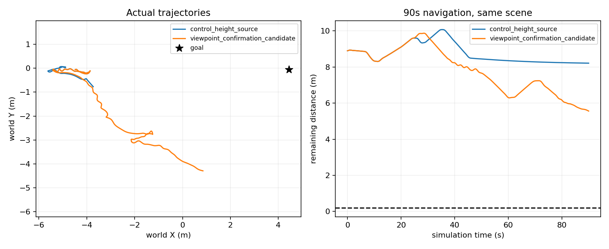

# 视角确认风险记忆与地面歧义源资格：实际阶段结果

更新时间：2026-10-12T15:16:18.976992+00:00

本轮连续完成两个不同机制的实现与核验。视角确认候选实际E2运行90秒，比最新冻结对照额外净推进2.652米，但尚未到达，测距门槛也失败。随后地面竞争解释的confidence筛查完成181对整段源资格，改善不足，未启动新导航。两个候选均拒绝，不调门槛重跑。可靠导航和学习导航增量均未成立。

## 实际导航

| 方法 | 时限与终态 | 净推进 | 目标余距 | 接触 | 测距误差P90 |
|---|---|---:|---:|---:|---:|
| 最新冻结高度筛选对照 | 90秒超时 | 0.687817m | 8.212182m | 0 | 0.100471m |
| 新视角确认风险记忆 | 90秒超时 | 3.339932m | 5.560068m | 0 | 0.198978m |

新条件只改变长期风险的晋级：同格至少两次曝光，且IMU估计的左相机中心位移达到现有一个地图格宽0.1m。所有当前/近期10秒风险仍即时生效；已确认风险仍永久保留；过期未确认格为未知，绝非已观测自由。相机与标定固定为前移60cm研究配置，源包含冻结的高度筛选，IMU/编码器、原生估计位姿、地面/安全起步/未知探索先验、规划安全距离及PID均沿用。相机位移包含机体旋转带来的移动，此条件是必要启发式，不是误差独立或深度正确性证书。

新方案179次零主轴请求（对照595次）、511次前进、210次后退，16个参考版本（对照98）。585个历史请求块发生差异。沿本次真实输入重算旧晋级方式，779/900幅地图变化、峰值24格，说明机制实际改变地图。两眼181对RGB均与历史对照不同，额外进展不能全部归因于单一改动；同E2用于开发，不能当独立泛化。新轨迹长度12.903m，仍有绕行及局部规划不可达，不能把路程增长当作可靠导航。

5项因果/晋级/过期CPU测试和实际source运输独立通过。实际durable正常退出0，约460秒墙钟；导航为90秒超时。独立核验900幅地图、900请求→4500物理目标、181位姿注册、5401个可用无接触记录、两视频各901帧、5712运行封存文件全部通过。到达要求0.2m，源P90要求0.15m，实际两项均失败：used1/3，余2关闭，恢复0、训练0。

## 后续源筛查

已实现当前双目“竞争地面解释”：使用当前native IMU相机位姿和声明的平地先验，将左眼7px patch的地面交点投影到右眼。仅当原0.5～3m范围内的地面解释全patch可见、当前CAD不遮挡、纹理足够、NCC达到旧诊断0.9且不差于原视差解释，而原测量偏离地面超过原0.05m时，才将confidence降为未知。原SGBM与视差不改，不校正深度，不清旧风险；先验没有被写成测量。

6项合成几何、图像歧义、当前地面保留、遮挡、时钟与不可变性检查通过；181对当前输入输出先封存，再读渲染真值评分。

| 指标 | 原输入 | 地面解释筛查后 |
|---|---:|---:|
| 有效评分像素 | 1,603,788 | 1,602,643 |
| P90绝对误差 | 0.198978m | 0.198511m |
| >0.3m比例 | 3.6736% | 3.6178% |

剔除1145点，其中1123个评分为地面，21个评分为正高度表面；正高度像素保留率99.9975%。保留门槛95%通过，原测距0.15m门槛失败，source_entry拒绝、实际导航次数0。这里的像素高度标签是离线渲染评分，相关像素不是独立样本，不代表完整障碍覆盖。独立审查重算完全一致。

最初CPU脚本在CAD构造前缺少pxr而退出，未产出预测。已沿用已有USD包路径解决，原错误log保留；只有一次完整181对科学输出，没有换参数重算。CPU完成由工具exit0与predictionseal核对；该CPU初始启动未使用durable wrapper，如实保存reconciled记录。实际导航使用durable监督。CAD和特定SDK依赖15份身份已绑定，未冒称跨机器runtime资格。

## 接续与尚未完成

下一独立问题是测距可信度校准：明确预测当前匹配超过0.15m误差的独立目标、允许的当前双RGB/原视差/IMU/现有CAD输入，以及confidence消费者；先完成整序列覆盖与分组留出资格，再允许一个冻结学习候选。不得将它写成命令排名、复用旧153条库或旧30条已关闭预算，不替换网络救分。同一实际物理轨迹的重复RGB必须分在同组。新数据/实际试验需另立有限预算，数据资格失败不训练。

原90秒套件仍为1/3到达，35秒历史身份保持，研究交付包此前已完成但跨机器实跑未证实。可靠导航、学习导航增量及整个项目尚未完成，自动任务继续。

## 可核验证据

- [视角机制协议](../experiments/viewpoint_confirmation_navigation_20261012_v1/protocol.json)、[代码](../experiments/viewpoint_confirmation_navigation_20261012_v1/viewpoint_confirmation.py)、[准入](../experiments/viewpoint_confirmation_navigation_20261012_v1/admission.json)
- [真实结果](../experiments/viewpoint_confirmation_navigation_20261012_v1/candidate_e2_assessment.json)、[独立闭合](../experiments/viewpoint_confirmation_navigation_20261012_v1/independent_closure.json)、[同输入地图干预](../experiments/viewpoint_confirmation_navigation_20261012_v1/map_intervention.json)
- [双目视频](/home/an/Documents/ChatGPT/球型机器人导航/experiments/viewpoint_confirmation_navigation_20261012_v1/candidate_e2_run/stereo_view.mp4)、[第三视角视频](/home/an/Documents/ChatGPT/球型机器人导航/experiments/viewpoint_confirmation_navigation_20261012_v1/candidate_e2_run/third_person.mp4)
- [地面筛查代码](../experiments/ground_ambiguity_source_20261012_v1/ground_ambiguity.py)、[预测输出封存](../experiments/ground_ambiguity_source_20261012_v1/prediction_seal.json)、[源资格结果](../experiments/ground_ambiguity_source_20261012_v1/assessment.json)、[独立审查](../experiments/ground_ambiguity_source_20261012_v1/independent_review.json)
- [CAD/SDK来源](../experiments/ground_ambiguity_source_20261012_v1/qualification_provenance.json)、[CPU终态记录](../experiments/ground_ambiguity_source_20261012_v1/cpu_execution_reconciled.json)

Python沿用`/home/an/miniconda3/envs/ball_wm/bin/python`，Isaac与原资产沿用现有环境。各协议/source map记录代码、scene、输入、PID、mask与标定的准确身份；未修改原项目或上传。实际监督入口`/home/an/Documents/ChatGPT/球型机器人导航/experiments/viewpoint_confirmation_navigation_20261012_v1/supervise.py`拒绝覆盖已有ledger/status；已关闭预算不能通过再次运行该入口恢复。独立复算应使用另一个输出目录，保留封存根。
