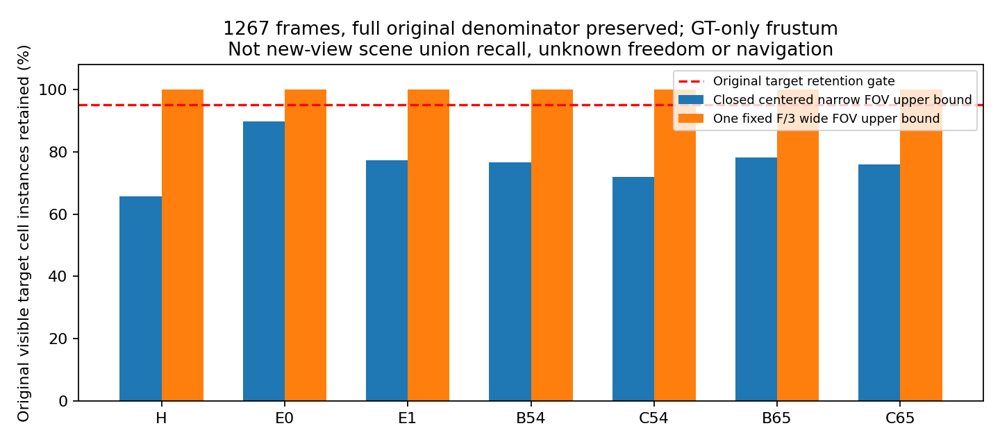
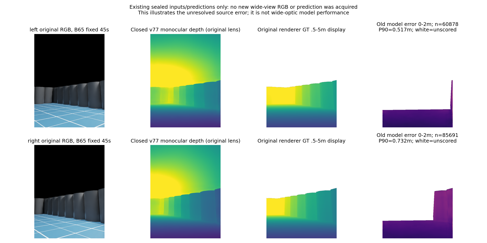
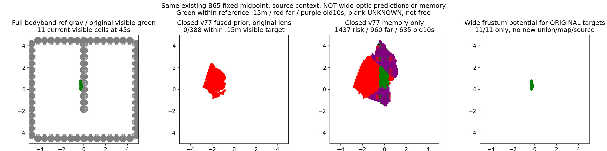

# 宽视锥分解与同曝光采集合同

## 有效完整结果

固定中心前后布局作共同几何参考：Focal从584.888889px变为预冻结的单一194.962963px，保持640×480、.5–3m测量域、场景及光照；不是扫焦距/角度，旧窄布局结论不变。七已见开发组1267帧，原双目全像素有限GT、静态CAD未遮挡、真实bodyband .05<z<=1.5m、距root≥.55m、.1m格去重的原联合可见目标，分母保持完整。

|组|原目标格实例|窄视锥上界|保留仅测量域|单一宽视锥上界|
|---|---|---|---|---|
|H|3681|65.80%|100%|100%|
|E0|8963|89.72%|100%|100%|
|E1|5553|77.35%|100%|100%|
|B54|5278|76.68%|100%|100%|
|C54|4775|72.02%|100%|100%|
|B65|5690|78.14%|100%|100%|
|C65|4923|75.87%|100%|100%|

共38863/38863原可见格实例在宽视锥内。GT仅离线，source深度域未扩大、原门槛95%未放宽。原已见点支持全部保留不等于新场景联合召回、新相机像素采样、无遮挡或学习效果；旧双眼GT不能生成新方向的真值。1267格计数完整核对，独立解析几何条件原深度≥.55时，center-front轴向距离减少.05，原横向相机偏移±.3与原FOV范围仍落入单一F/3视锥；无随机像素划分泛化。

## 代码与真实执行

安装版Camera.initialize绑定render product，回调同时填rgba和custom annotators；set_local_pose默认world坐标必须指定usd；CameraParams的矩阵由安装PointCloudGenerator按world-to-local求逆。新adapter在构造/initialize前装配置，RGB/depth标签/渲染矩阵同帧深拷贝，拒绝旧帧、time错位、焦距、尺寸、单位、NaN及复制期间更新。GT矩阵/depth仅离线标签，不提供在线规划；没有使用拒绝模型。11纯接口情形与实际startup覆盖AST启动顺序核验通过，不能冒称原生采集通过。

第一次资源尝试在SimulationApp惰性启动之前导入SDK失败，退出1；唯一恢复已先启App，又在原runtime尚未加入scripts路径前导入collect_data失败。两次无有效帧和完成scene reset。第二次原durable报告finished0却存在异常且没有capture_seal，完成守卫明确拒绝退出码0替代实际完成。其后CPUscore退出1（无seal）不记成模型性能失败。原始状态/异常/代码版本保留。

路径与App清理所有权已经修正、输出隔离与封存完成校验已实现；还没有真实帧证明。used2/cap2及接口恢复1/1关闭，不自动重开。具体额外验证程序有显式human_authorized/cap1文件门，尚未授权。已向用户请求上限120秒的单次8帧原生验证，无训练/导航/光学参数修改；等待资源选择是预算边界，不要求用户判断可行性。

## 原源问题的同刻背景（并非新宽镜头输出）

B65固定中帧45s，非最差/随机选择。以下两路预测来自已封存v77、原相机，未重推理。左/右误差P90=.516532/.731615m，GT .5–3m静态CAD非遮挡条件评分60878/85691，占各自全307200像素的19.82%/27.89%。完整图不是这些条件像素的召回；预测显示.5–5m、误差0–2m仅显示裁剪，白未知/不评分。

原45s可见目标11格，旧左332/右202/融合388预测格，距目标≤.15m均0，原目标覆盖均0/11。旧长期地图risk1437/距全bodyband参照>.15m为960/年龄>10s为635。这里当前分母是可见GT，长期分母是全bodyband；不能合并成全图召回。新宽视锥图仅是原11格的潜在保留，不是新预测或永久记忆。图范围[-5,5]m；全计数包含范围外风险。

新宽视角RGB/单目预测/渲染GT资格、误差分位、有效源覆盖、地面误报、错误风险/长期保留及nav终态全部N/A，不能填0或用旧图替代新结果。宽视角只回答几何潜力，不能解决v77源测距/类别错误或证明可靠导航/学习增量。
