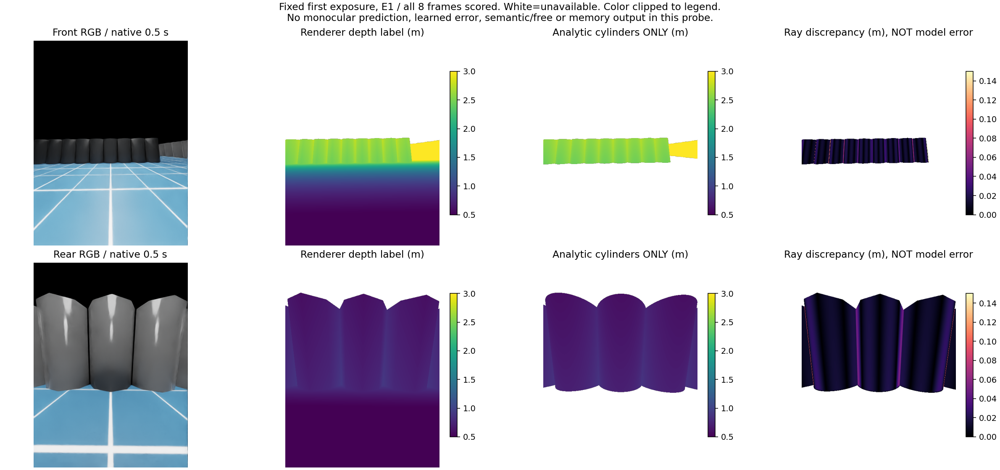
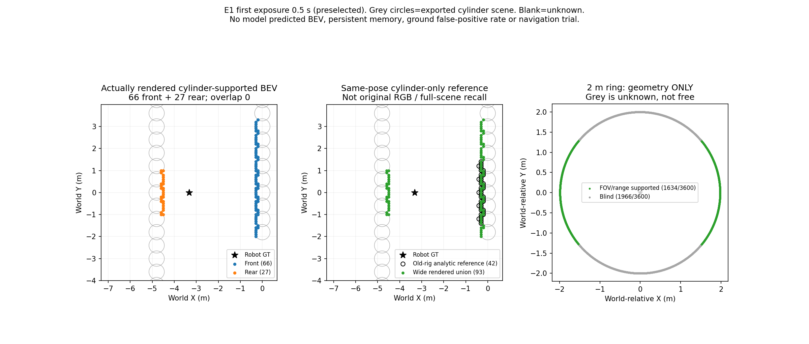

# 前后独立单目布局：8帧实际覆盖与局限（v82）

## 决策

前后宽针孔布局具有**有限的实际后视覆盖增量**，保留为几何研究证据。两路单目方案的在线距离与类别源仍是v77拒绝状态，本轮没有模型、训练、永久记忆或导航。既有关闭预算不重开。

本次完整使用v81封存的E1原生0.5–4秒8对曝光、全部像素、71个同runtime导出圆柱和8个实际关节状态。没有新仿真。原1267帧/38863格实例的无新遮挡上界不重跑，也不升级为新场景实际召回。

## 实际新增覆盖

BEV网格0.1m，使用封存renderer位姿、有限光轴深度.5–3m、距root≥.55m、世界bodyband(.05,1.5]m，只统计与同场景解析圆柱射线距离差≤.02m的渲染点。这是**GT离线诊断支持子集**，没有在线语义或自由空间含义。

|完整8帧指标|结果|分母与限制|
|---|---:|---|
|前视障碍格实例|511|逐帧格计数后相加；不是511个不同实体或永久格|
|后视障碍格实例|217|全部是前视没有的格实例|
|前后交集/联合|0 / 728|后视贡献217/728=29.81%；无重叠不能证明测距正确|
|同姿态旧窄视角解析参照|340|圆柱最近交点，未包含离线不可用地面及原相机CAD遮挡；不是旧RGB真实可见目标|
|与新联合图完全同格|290/340=85.29%|完整保存，不能隐藏这50个非同格实例|
|距新联合格≤.15m|340/340=100%|最大最近格差.1m；不能替代原精确格保留95%门槛，也不是全场景召回|
|2m等角环几何支持|1634/3600=45.39%|原窄视角519/3600=14.42%；不扣场景遮挡|
|2m等角环盲区|1966/3600=54.61%|每帧均相同，主要在两侧；不是360度环视|

固定布局前后中心偏置±.45m，测量光轴下限.5m。因此各自中心射线的近端在base-link前/后约.95m；这只是身体坐标中的中心射线域，不是全方位安全距离或停车距离。

实际关节状态下逐顶点CAD前/后最大光轴位置在-.050633至-.050023m，均在.01m近裁剪后方，8/8零CAD渲染遮挡证书成立。仅覆盖这4秒运动；不证明实体安装或硬件可行。

## 全像素身份核对：小样本通过不能扩大为全图通过

每眼8×307200=2,457,600像素：

|口径|前视|后视|
|---|---:|---:|
|有限渲染深度|1,287,586|1,970,328|
|有限且.5–3m|839,752|1,274,509|
|另满足root排除及bodyband|225,584|1,008,637|
|其中明确圆柱支持|195,368|883,237|
|其中未明确身份/未知|30,216|125,400|
|近地面高度带[-.05,.05]m|614,168|265,872|

近地面高度带是离线几何统计，不能冒充语义真地面、学习地面误报或观测自由。没有运行模型，地面误报率、预测BEV精度、长期正确/错误风险均N/A。

解析圆柱预期深度.5–3m共有1,315,322条像素射线，其中渲染有有限值1,300,502（98.87%，占双眼全像素26.46%）；差≤.02m为1,135,729，按全部预期射线分母为86.35%。未满足身份支持的像素保留未知。

上述有限射线的距离差P50/P90/P99/max为.012439/.022617/.051251/3.018972m。它是**解析参照和渲染标签的差值**，不是单目预测误差，不能归咎为renderer真值坏了。RGB与深度可见圆柱分面，而解析模型使用光滑圆柱；另有遮挡/边界与像素中心等未分解因素。保存stage的远程default_environment引用在离线USD无法解析，缺完整地面几何身份。本轮没有放宽.02m或冒充全场景最近命中验证。

v81固定80条射线中72条可评分且均≤.02m的历史结论保持；本次扩大像素域揭示其代表性有限。原95%精确率/80%可见召回/.15m位置门槛不变，未用本轮条件子集通过源准入。

## 曝光与IMU

8帧raw曝光时钟相对逻辑时钟固定+.219999995s，属于epoch起点差。曝光与native IMU区间末端差0；IMU区间起点比曝光早.019999999553s。原传感器戳与曝光差约20ms，不能把区间起点body轴当作曝光末端姿态。

本轮gyro范数×20ms最大.0037784rad（约.2165度），仅一阶转角量级，不是独立姿态误差上限；未读取IMUorientation，也未产生新的在线姿态估计。当前BEV图用renderer位姿作GT诊断。

## 直接图像

固定选择第一帧E1 0.5s，未事后搜最好/最差。两行分别前/后RGB、渲染深度、解析圆柱深度和二者差值。白色不可用；深度颜色.5–3m、差值0–.15m，超范围只颜色截断。**单目预测和预测误差N/A**。

该帧前66/后27/联合93格，旧解析参照42格：37同格，42在.15m内。图蓝前、橙后、绿联合，灰轮廓为导出圆柱；空白/灰色盲区都是未知。没有模型BEV或长期记忆图。

## 复现与接续

协议及完整结果位于`experiments/wide_view_offline_20261015_v1/protocol.json`和`result.json`。`analyze.py`读取封存帧和USD，仅CPU离线，实际67.93秒正常退出；`check_and_plot.py`独立标量400射线与向量解最大差1.03e-14m，8帧集合计数及全部支持像素齐次坐标回投exact，输入SHA核验通过。环境ball_wm Python3.10、已有Isaac omni.usd.libs、NumPy/SciPy/Matplotlib；没有安装或下载。

复现入口：设置已有Isaac `omni.usd.libs-1.0.1+d02c707b.lx64.r.cp310`到PYTHONPATH及其bin到LD_LIBRARY_PATH，运行`analyze.py`；后运行`check_and_plot.py`。完整解析命令见本次工具记录；原项目只读。

下一决策应回到**在线米制深度来源**：仅用v77已封存输出和标签，有限分解两路距离误差是否以一致尺度偏移为主，还是存在无法由单一尺度解释的空间形变/左右差异；不拟合校正、不重新推理或训练、不改变消费者、不将拒绝模型接入导航。该诊断必须能决定是否值得冻结一种具有真实在线尺度约束的新目标，否则停止该路线。几何广角保留为覆盖研究候选，不追加本轮物理或把它当模型救分。全场景标注资格及新鲜实际90秒导航仍未成立。
