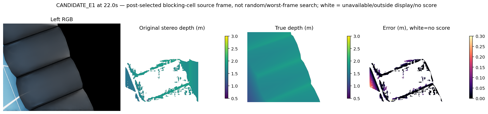
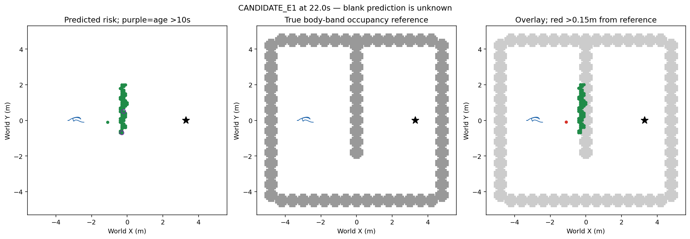

# 世界配准与测距误差分离资格

v67世界配准/测距误差分解完整两E1共362源完成：基线257177/296346、候选268327/304926点GT可用，pose-only位置P90 .039153/.043361m，measurement-only .053728/.062323m，full .064743/.068351m。相机位置最大.046082m，旋转最大.026449/.024874rad。阻塞格(-1.1,-.1)仅22/22.5s十+六=16点，GT16/16，pose贡献.018986–.020290m，真位姿重投影后测距误差仍.963131–1.020285m；否定本次阻塞由累计位姿主导假设，不启动pose修正/物理，fit0physical0recovery0。误差向量相加exact但范数分位不可相加，GT仅离线，原query域不补洞。

完整原生变换与同刻渲染位姿评分，未将真位姿送入导航。原理想原生IMU/encoder、初始规范、固定高度先验继续披露；本次是世界累计变换审计，区别v50局部中心/航向重置。旧位姿/ORB方案不重开。

|原入图域|基线|候选|
|---|---:|---:|
|有限真值点/入图点|257177/296346|268327/304926|
|位姿贡献P90m|.039153|.043361|
|测量贡献P90m|.053728|.062323|
|原完整位置P90m|.064743|.068351|

结论仅针对当前两开发E1完整轨迹与阻塞16点，不证明所有姿态估计足够好；完美位姿反事实仍保留约1m测距错误，不能在线混合GT。栅格中心量化最大.070711m另算，不可用来解释1m测距。

## 事后阻塞来源帧22s

这是阻塞来源选择，非随机代表/完整最差搜索。深度P50/P90/P95=.01498/.08961/.13171m；有限评分28525/45201=63.11%，占整图9.29%。误差图上限.3m，尾部约1m已饱和。少数入图错误可形成长期风险，不能以P90掩盖。

地图绿风险、紫圈>10s、红距bodyband参照>.15m，蓝轨迹/黑星目标，空白未知；22秒风险76，偏离1，旧2，旧偏离0。全程候选入图地面误报435/268327，GT可用268327/304926。像素、点、格口径不同，不是全图召回；渲染无命中不可当真实自由。无新实际运行。

## 接续

下一有限核对当前双目二维区域的平面视差/区域联合支撑与旧dense/ground竞争、Census扫描线、原ORB机制是否存在实质区别。仅在新证据支持时冻结当前双RGB二维区域联合几何测距候选（区域结构支持，不假定整个场景平面，不依GT删点），固定匹配域/歧义未知和完整开发组精度、逐帧大误差、障碍与测量覆盖门槛；失败直接关闭不扫参，不救旧局部代价或旧模型。未实现/未准入；合格后才新cap<=4同版fresh90秒实际验证。
