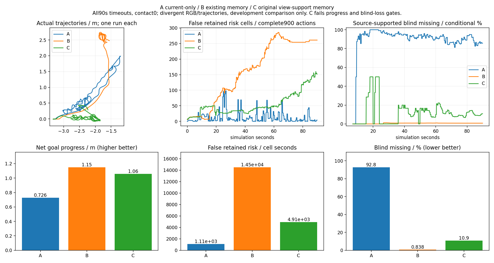
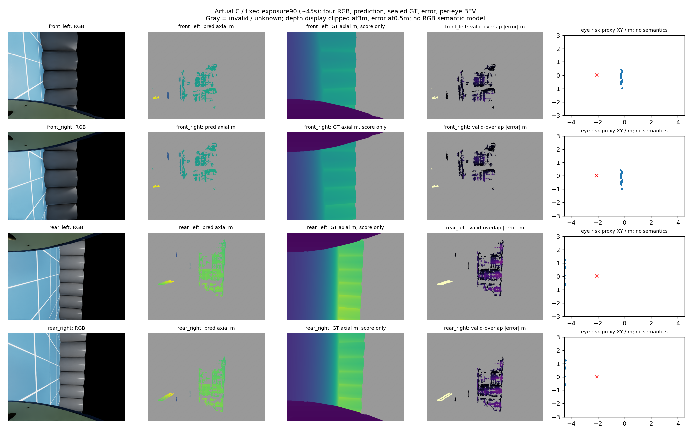
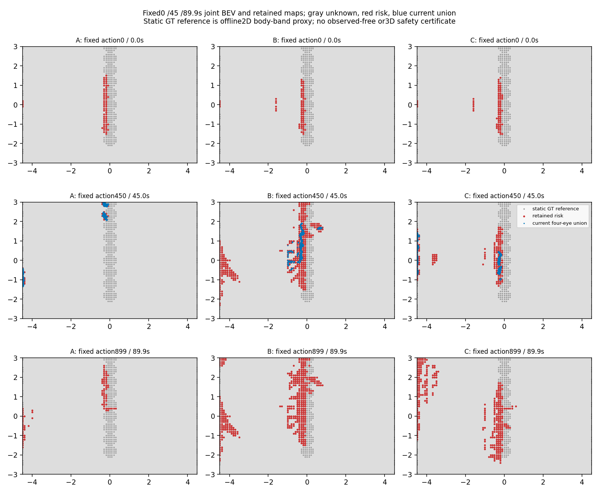

# 四相机风险记忆A/B/C开发对照结果

日期：2026-10-19。A仅当前观测、B原显式记忆、C原视点支持记忆。每臂一次E1开发闭环，90秒/900动作/181组四RGB；A/B复用既有封存数据，C为用户明确批准的一次原参数负对照。

**结论：C未通过预先冻结的综合条件。错误风险减少不足以保证导航推进；漏保留真实历史支持目标的代价仍明显。三臂均未到达。**

## 同版实际结果

| 指标 | A当前观测 | B显式记忆 | C视点支持 |
|---|---:|---:|---:|
| 终态 | timeout90 | timeout90 | timeout90 |
| 已记录障碍接触次数 | 0 | 0 | 0 |
| 净目标推进m | 0.726066 | 1.149765 | 1.059739 |
| 实际总行程m | 10.921833 | 6.776337 | 7.489438 |
| 倒车请求秒 | 34.5 | 7.1 | 21.2 |
| 等待换向秒 | 24.4 | 14.3 | 43.3 |
| 错误风险格×秒 | 1109.0 | 14501.3 | 4913.2 |
| 曾被源支持的盲区漏保留/分母 | 61455/66215 (92.811%) | 634/75700 (0.838%) | 1694/15480 (10.943%) |
| 首次持续无路秒 | None | 6.099999863654375 | 30.499999318271875 |
| 最长持续无路秒 | 0.0 | 30.0 | 10.5 |
| 全部无路代理秒 | 0.0 | 38.4 | 15.4 |
| 完整链P50/P90/P95秒 | 0.0642/3.8110/3.8352 | 0.1477/3.8008/3.8934 | 0.0714/3.7888/3.8081 |
| 条件深度P90m | 0.129887 | 0.141761 | 0.124890 |
| 风险格精确率/覆盖 | 14353/16972 (84.569%); 9035/14903 (60.625%) | 17248/21319 (80.904%); 10761/17942 (59.977%) | 15995/17277 (92.580%); 10372/17261 (60.089%) |

三臂各5401条接触记录均available、contact=false；这是本次仿真接触记录，非真实硬件安全证明。每臂181曝光均非空，风险点A/B/C分别1353136/1553767/2126477。换向统计去零方向切换A/B/C为9/7/16；等待换向时间来自保存tracker状态，不是新增控制干预。

## C冻结条件与决定

| 条件 | 固定界限 | C结果 |
|---|---:|---:|
| 净推进 | ≥1.649765m | 1.059739m，失败 |
| 错误风险格秒 | ≤11601.04 | 4913.2，通过 |
| 源支持盲区漏保留 | ≤5.838% | 10.943%，失败 |
| 完整链P90 | ≤4.180907s | 3.788783s，通过 |
| 接触/有效观测 | 接触0；非空曝光≥11、点≥100 | 通过 |

C相对B错误风险格秒下降66.12%，源支持盲区漏保留增加10.106个百分点，净推进减少约0.0900m，未达到B+0.5m的预定收益条件。原C离线拒绝结论和门槛不改，不用本次某一改善覆盖综合失败。

## 分母、未知与有效性

全部RGB像素为每臂181×4×640×480=222412800。目标、覆盖与误差为冻结0.5–3m距离、CAD排除、机体外与0.05–1.5m高度等条件的像素/格实例；不是完整真实语义或全部物理盲区。

| 臂 | 完整条件目标像素 | 有效测距目标像素 | 历史可见目标盲区缺失/分母 |
|---|---:|---:|---:|
| A | 32853285 | 4812812 | 91040/96135 (94.700%) |
| B | 46703520 | 5404827 | 23452/100660 (23.298%) |
| C | 42126169 | 7870459 | 27493/44125 (62.307%) |

后一完整历史可见目标口径包括从未被源充分测到的目标，和“曾被源支持”口径不同，不能混为真实障碍全部遗忘率；C分别62.307%与10.943%。缺测/无效/遗忘输出未知，不等于自由。0.15m二维静态body-band格评分是代理，不是3D安全证书。

| C各眼 | 条件目标像素 | 有效测距目标像素 | 风险点 |
|---|---:|---:|---:|
| front_left | 11058784 | 2272007 | 601720 |
| front_right | 8926021 | 2273979 | 603840 |
| rear_left | 10610982 | 1669138 | 462281 |
| rear_right | 11530382 | 1655335 | 458636 |

## 问题定位与边界

C首次满足固定“6秒后连续≥5秒零请求且无成功规划”的事件在策略305/30.5秒。216风险格中34格按封存后的GT参考判断为错误；仅将这34格变为unknown，离线二维全局连通性从无路变有路。这支持该事件存在错误风险封堵；没有执行这条反事实路径，也没有证明动力学、局部运动原语或三维安全。它不能成为在线GT删除器。B同类事件6.1秒，A没有满足本固定事件的事件，不能事后另挑事件。

真实输入不逐像素相同：C/A首次动作分叉6.0秒，C/B为7.5秒，公共动作前缀的RGB也已不同。C/B首曝光四眼RGB平均差约0.40–0.69灰度值。路径和支持分母随闭环变化，66.12%与10.106pp是各自完整开发运行的描述性比较，不是随机显著性、独立泛化或逐像素配对因果效果。

失败层仍涉及测量错误与风险持久化的权衡。删掉全部历史风险的A缺失92.81%，C的几何视点确认也不能同时守住漏保留与推进门槛；本轮不支持直接安装C。离线GT连通性恢复不是新的在线规划动作合同，未因此准入P3规划/控制改动。现有错误源修复和旧学习候选仍按原关闭身份，不扫参数、补采或换名复活。

## 恢复执行与来源限制

用户另准一次“仅评分恢复”：原评分器4→10仅一行在内存修正，以新入口/单次台账执行；原代码、旧3/3台账、首次错误1及原数据保持。恢复北京时间2026-10-19 14:28:08–14:28:57，父2423843/子2423844，正常0；未超时/中断，无剩余活/僵尸。恢复1/1结束、再恢复0，未调用新的源、推理、训练或物理导航。原完整数据在GT评分前后SHA逐文件一致。原GT无效+inf运算产生警告，随后原finite条件排除；未将其当自由或修改评分。

动态import未登记sys.modules，原C memory与navigation仍缺于loaded-source清单。精确冻结SHA、启动接线及900条C专有诊断支持所执行版本，不能追补该登记缺口；结果保留此来源限制，不宣称完整动态模块审计通过。

固定名义相机/曝光/照明、原串行SGBM、原姿态估计/规划/控制保持。初始规范与高度先验、无滑移半径.4m滚动、低层理想反馈继续披露；没有真实RGB语义模型，类别语义N/A。完整链P90约3.79秒，不能宣称满足0.5秒在线合同。

## 同步图像

固定C曝光90（约45秒），展示四眼RGB/预测轴向深度/GT/有效重合像素绝对误差/每眼风险BEV；深度显示0–3m、误差0–0.5m，灰色无效。显示条件不是新的评分门槛。固定地图策略帧0/450/899，所有臂相同时间索引，公共XY显示窗[-4.5,4.5]×[-3,3]m；裁剪只用于展示，数值评分使用完整声明域。红风险/蓝当前联合/灰未知，GT参考仅离线。

## 状态与下一步

三臂实际运行和本次统一描述性评分已保存；C固定候选拒绝并关闭。原baseline可复现交付保留，可靠到达、独立泛化及学习导航增量仍未完成。原automation同id/每小时/原prompt已恢复ACTIVE，当前无实验运行。下一须依据完整三臂明确的测量错误与记忆漏保留权衡，形成具体且与关闭方案不同的在线消费者/学习合同，才冻结新预算；本轮没有准入新模型、源或规划动作，不把整理结果冒充新路线。

独立结果审计28项通过，无新增Critical/Important；原2185产物、完整封存SHA、原代码/失败/旧预算与聚合计数均核对一致。原动态模块登记缺口仍保留，未通过修改原日志补齐。独立复核仅审查保存数据，未重跑评分/规划/物理或新GT计算。
