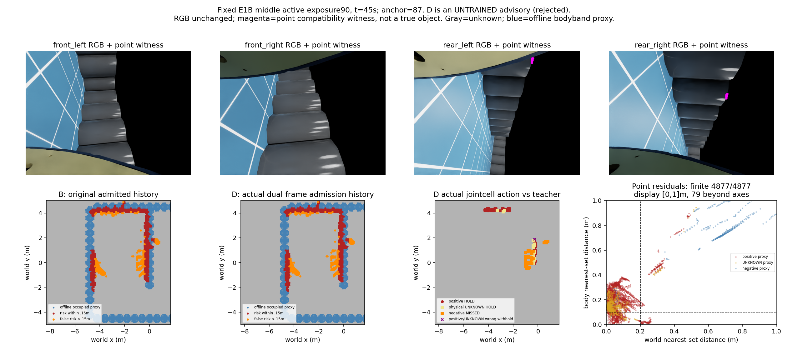
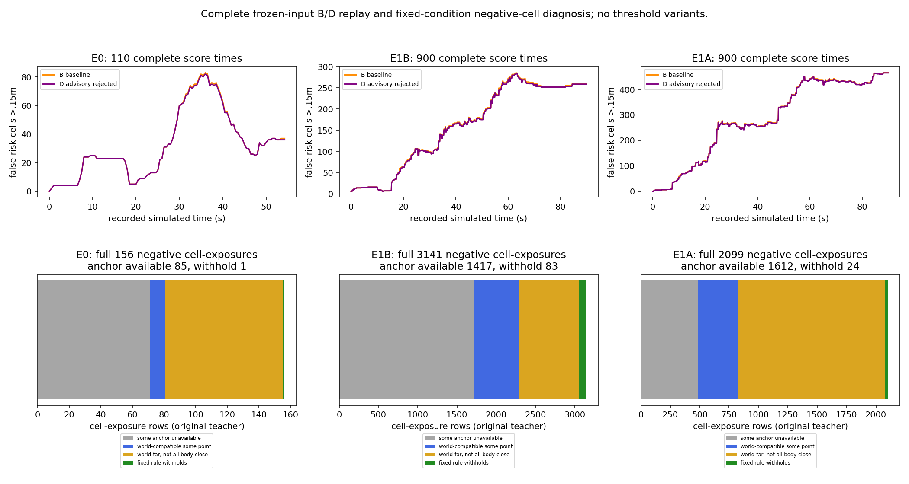

# 世界/机体双坐标点集一致性：风险入库必要资格

2026-10-17。根：experiments/body_locked_support_qualification_20261017_v1。固定当前四路相机、原SGBM、原生IMU/主轴编码器和原地图评价。**固定机制拒绝；没有导航或学习收益。**

## 问题与机制

v115显示颜色/累计次数相关性不能直接迁移到E1低纹理及持续误报。本轮只检验一个不同的、未训练的信息假设：错误测距点集是否更像随机器人移动，而不符合静态世界。低纹理本身不证明这一假设，故不据此训练新模型。

输入是封存源每眼的世界点及各时刻因果估计机体位姿。尺度完全继承现有K/双目基线、gyro/encoder/.4m无滑移运动；初始规范仍特权，位姿无在线硬误差界。没有新RGB匹配/测距、模型权重、GT几何或额外硬件进入预测。

固定规则：

1. 当前时刻只在过去10秒选择**最新一个**估计机体平移≥.20m的曝光；不足则HOLD。
2. 对同一眼当前点，计算到该历史眼点集的世界坐标最近距离 `d_world`；另将两时刻点分别变换到各自机体坐标，计算最近距离 `d_body`。
3. 点见证仅为有限 `d_body≤.10m 且 d_world≥.20m`。这是两种点集的兼容性比较，**不是真实点对应、真实性概率或位姿误差界**。
4. 同曝光同格四眼共同决定：只有格内**每一个**实际源点均有见证，才WITHHOLD_NEW；任何点缺支持/世界相容则HOLD。点数和四眼不冒称独立确认。
5. 只改变新曝光是否进入原B的当前/近期/持久状态。已接纳历史不清除或因拒绝刷新；原曝光身份消耗后不可迟到重入，不写自由。原始点云历史独立保留用于该几何诊断，不能重插拒绝风险。

区别核对只读三处直接代码：旧C只以基线+锚点角度决定永久确认、近期层不变；旧strict-farther投影历史锚点做清除反证；原24特征只含格内汇总，没有跨格全点云的世界/机体双残差。本轮不重开这些预算，也不是给v115逻辑回归换特征重训。新候选记为D，原P1 C仍拒绝。

## 冻结域、门槛和预算

- 完整470曝光（E0 110、E1B/A各180）、2985832原源点、40052格曝光动作、1910评分时刻。E1两轨迹属同一已见场景，全部开发，不是独立泛化。
- 原风险误差参照仍距静态解析bodyband占据proxy>.15m；原未过滤源支持盲区分母完整保留。物理教师正≤.10m、负≥.20m、中间/域外UNKNOWN，只在预测和地图封存后评分，不缩分母、不变旧标签。
- 每序列要求：错误格秒减少≥20%；原源支持盲区缺失增加≤5个百分点；HOLD教师保留≥95%；positive和UNKNOWN各拒绝≤5%；选择器P90≤.10秒。接口、1010张旧B地图exact同时要求。
- 独立CPU资格dispatch1/1、生成1/1、恢复≤1；本轮恢复0。源预测/模型调用/拟合/物理/导航全部0。确实执行了点集最近邻几何求解，不能写成计算0。
- 失败关闭固定机制，不扫历史、基线、残差边界或“全部/部分点”规则，不把any-point计数变成替代策略。

## 必要工程检查与执行

先用手算合成点检查随机体点/静态世界点、空历史、平移不足、过期、新表面、联合全点、规范不变性与因果拒绝。红阶段预期NotImplementedError一次，绿阶段通过；这不是科学性能失败，也未读取归档数据。没有运行无关项目测试。

首轮独立预检发现评分输入SHA字典未实际执行的Important；在派发前修复：全部预测封存后、地图回放前核全部3024输入，评分前再次核对，教师数组仍不进入预测。原预检协议/代码文本保留，科学规则/输入/门槛不变。再审查解除阻塞后才派发。

实际资格UTC 13:59:37.331–14:00:02.694（北京时间21:59:37–22:00:02），parent4163515/child与PGID4163534，predict/replay/score均正常0。完整预测先seal→输入校验→地图seal→GT-only评分。service inactive/MainPID0；无live/zombie子进程。原项目只读。

## 完整结果

|序列|B错误格秒|D错误格秒|改善|原源支持盲区分母|B/D缺失|
|---|---:|---:|---:|---:|---:|
|E0|1768.600|1757.300|0.639% **失败**|18868|2161/2565|
|E1B|14501.300|14354.900|1.010% **失败**|75700|634/634|
|E1A|25688.500|25556.000|0.516% **失败**|66215|708/708|

E0盲区缺失增加2.141个百分点，E1两段0；三段均未满足20%收益。其余固定门槛通过不等于安全或可导航。

|序列|WITHHOLD全部|其中负/正/UNKNOWN|正误拒率|UNKNOWN误拒率|选择器P90|
|---|---:|---:|---:|---:|---:|
|E0|35|1 / 31 / 3|1.756%|2.564%|.00424s|
|E1B|251|83 / 118 / 50|.822%|1.362%|.02349s|
|E1A|138|24 / 87 / 27|.721%|1.007%|.03063s|

共424次格曝光拒收中，只有108个属原物理负proxy，另236正及80UNKNOWN。不得用“所有单类误拒率≤5%”宣称选择器准确；误报收益门槛实际失败。时延仅选择器+聚合，包含历史KD树构建，不含源/磁盘/规划/控制或完整四路链。

### 固定同步展示

固定E1B第90个有效曝光、45秒（180曝光中点），不按结果挑图。上排四RGB原字节及各眼点见证，洋红点只表示兼容性见证；下排B/D历史BEV、实际联合动作与离线教师、原始世界/机体残差。灰unknown、蓝占据proxy、红正确风险、橙>.15m错误风险；动作绿叉拒负、紫叉误拒正/UNKNOWN。地图显示固定10m裁剪，残差图显示[0,1]m，超轴数另注；全部数值评价完整域。新增RGB语义/深度及深度误差、实际导航N/A；不能将残差叫真实测距误差。

## 一次有界归因

只读原始残差/索引/教师保存数组，无新最近邻、预测或变体回放。UTC14:02:20.347–14:02:21.312，parent4166334/child4166336正常0；独立统计dispatch1/1、恢复0关闭。完整470/2985832点/40052动作重新计数。

|负标签格曝光|全部|所有点有锚支持|所有点body-close|所有点world-far|二者同时/实际拒收|
|---|---:|---:|---:|---:|---:|
|E0|156|85|1|75|1|
|E1B|3141|1417|270|846|83|
|E1A|2099|1612|119|1274|24|

锚曝光分别94/110、103/180、165/180。缺锚确实限制E1B（1724/3141负格曝光含缺支持），但不能解释全部失败：E1A有1612个负格曝光具完整锚支持，其中1274个全部world-far，只有24个也全部body-close。E0具锚85个负格曝光中仅1个body-close。因此，**“误测主要是一组刚性随机体移动的点”没有得到完整域支持**；低纹理与持续误报不能直接推出机体锁定。

最近邻点集不是物理对应，点密度、新显露/遮挡、估计位姿和可变误匹配都可能造成这些残差。此统计只定位固定假设的覆盖/区分不足，未证明唯一误差机制，也不证明所有时序线索无效。混合来源全点规则还会拒绝正/UNKNOWN proxy，不能仅报告108个负拒收。

**决定：** 关闭D及进一步训练/导航，不放宽body-close、不移锚、不延长历史或换成any-point。保留原B、原C拒绝、v115拟合负结果与全部旧预算。当前没有准入下一模型或记忆机制；不再重复本世界/机体比较或其失败层统计。未来需要有独立新证据支持不同的在线可得区分信息，才能立项。

## 独立审查、交付与状态

独立审查完整470保存输出/动作/地图，2985832点阈值和索引、40052动作、1910评分及1010旧B地图/290曝光地图重建均一致；全部输入/代码/封存时序通过。34个披露采样点以独立NumPy暴力求最近邻核验，未重算全点NN、未调用生产selector；完整失败层计数亦独立复核。审查过程Python环境导入问题仅影响审查启动，换用已有ball_wm环境后完成，未安装依赖，不是科学运行恢复。

代码、协议、原预检及修复、fixture、原始残差、地图、日志、PID、预算、独立审查、SHA封存保存在实验根，资料包同步。没有新视频/轨迹/物理，现有导航资料继续原路径。候选结束不等于整体完成；可靠导航、完整实际三臂和学习导航增量仍未成立，automation保持原每小时ACTIVE，不自动Git。
