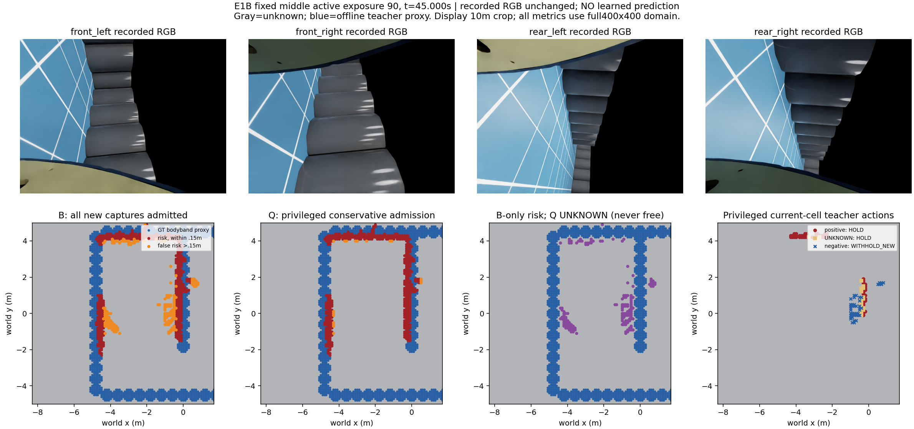
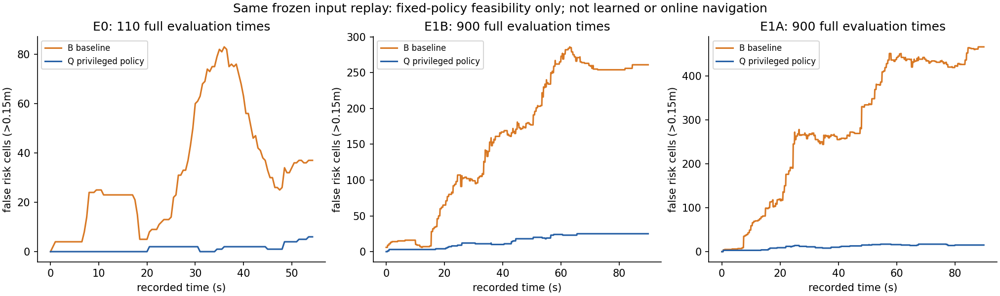
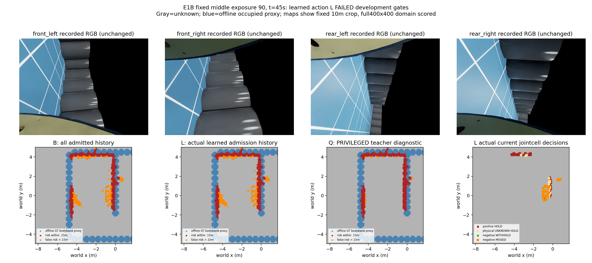
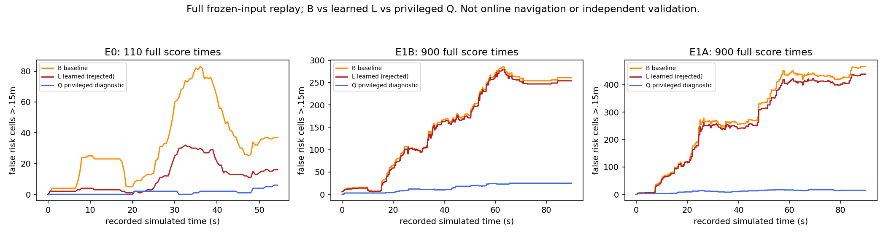

# 当前曝光风险入库：必要对照、因果接口与唯一学习检查

日期：2026-10-17；固定四路相机、原生IMU/编码器、原SGBM源。当前阶段为开发研究，不是可靠导航或学习导航增量交付。

## 问题与决定

v112证明：只拦永久入库而保留全部近期风险，E0错误风险最多下降15.95%，达不到20%。v114又证明同query深度一致性标签不能直接充当风险格支持真值。因此本轮检查**新曝光/格是否入库**，同时保护已经接纳的历史，不再拟合旧长期-only目标。

这是一项现有组件的组合消融：复用静态格教师与24个因果特征，改变消费者的入库位置；不宣称新的测量机制或逐来源真实性。一个曝光中同格四眼共同作一次决定，重复观测不冒充独立确认。

## 固定教师动作与unknown

- 原物理正标签（距静态占据proxy≤.10m）及原UNKNOWN（.10–.20m留白/域外）均HOLD_BASELINE。
- 原物理负标签（≥.20m）为WITHHOLD_NEW。只是此曝光不入库，不能清除原有历史，也不写自由。
- 曝光身份与决定不可变，被拒来源不能在后来作为历史重新入库。已接纳历史按原近期10秒及持久条件更新/自然失效。
- 物理UNKNOWN仍UNKNOWN。E0/E1物理known比例94.259%/83.290%，不改写v111/v114的旧90%资格失败；动作默认策略的完整性不是物理真值覆盖完整。
- 原教师为静态解析bodyband粗占据proxy，不是完整三维安全、真实RGB语义或每个source的几何真实性。

## 先完成的特权必要对照

`experiments/conservative_capture_admission_20261017_v1`。全部470原始曝光、1910评估时刻；预测源/GT/相机不重生成。动作读取离线教师，属于**特权诊断**，不是部署或学习结果。

|完整序列|B错误格秒|特权Q错误格秒|减少|原源支持盲区完整分母|B/Q缺失数|
|---|---:|---:|---:|---:|---:|
|E0|1768.600|70.800|95.997%|18868|2161/2161|
|E1B|14501.300|1361.100|90.614%|75700|634/634|
|E1A|25688.500|1048.400|95.919%|66215|708/708|

三序列均通过冻结20%错误改善与盲区漏保留增加≤5个百分点；1010个旧B策略地图exact。E1A的B是A轨迹上的反事实回放，并非又实跑一次B。全部是已见开发数据，不能当独立验证。该固定策略也不是所有学习器的数学改善上界。

当前曝光动作支持：E0共2038行，其中HOLD1882、WITHHOLD156，分别344/138个不同教师格、96/47个曝光；E1两轨迹同一场景共38014行，HOLD32774、WITHHOLD5240。计数不代表独立样本数。

### 同时刻图：固定E1B第90个有效曝光，45秒

上排四路记录RGB未改变；下排B与特权Q完整历史风险状态、仅B保留格和离线教师动作。灰unknown、蓝教师占据proxy、红距proxy≤.15m风险、橙错误风险；显示固定10m裁剪，数值评价用完整400×400地图。Q拒绝处是unknown，不是自由。新增测距/深度误差、逐眼入库图及导航为N/A。

独立审查全470动作/地图、1910评分、2985832来源ID与2439输入身份，未发现重要问题；预算dispatch1/1、恢复0，正常0退出。12:00:49–12:01:07 UTC，parent4042288/child4042306；无物理、拟合或导航。

## 源输入前端资格

`experiments/capture_admission_feature_frontend_20261017_v1`。纯运行接口仅接四RGB、原源观测字段及估计位姿，不接文件/标签/静态图/场景ID。特征记忆保留实际源观测，与风险是否入库分开；它不能把拒绝风险重新写回地图。

亲自完成470次特征提取：40052格行×24通道=961248标量；七数组/曝光共3290数组与原封存值dtype、shape及字节完全相同，原源2985832点、域外0。检查未来/重复曝光先于读payload拒绝、教师字段拒绝、无效输入不改状态。全部字段严格当前/过去；累计次数有超过10秒的信息，不声称严格10秒记忆。

函数耗时P50/P90/max=.08776/.10558/.43706秒，只是特征函数，未含测距/投影/规划/控制，非完整链时延。12:08:36–12:09:38 UTC，parent4050395/child4050396正常0；特征调用470/470关闭，源预测/拟合/物理/导航0。

独立审查核全470输入和输出参考身份及实际生产断言，没有第二次调用470次前端；这一审查范围不冒称独立重新提取。

## 唯一学习候选的冻结合同

`experiments/capture_admission_action_learning_20261017_v1`。

- E0整序列训练2038行；E1A/B共38014行，同一已见开发场景两轨迹。无随机相邻帧拆分，无fresh输入。
- 24个已资格因果特征，E0-only均值/标准差。一个平衡加权逻辑回归：既有SciPy L-BFGS-B，固定C=1等价惩罚族，最多200迭代；截距不正则。预定sklearn依赖缺失在派发前发现，未下载、未先拟合；显式目标已独立审查，不冒称数值等价复现sklearn。
- class1是WITHHOLD教师动作分数，不是校准的物理风险概率。阈值固定.95；NaN/不可用分数HOLD。
- 仅一次fit。权重先封存→470曝光40052分数先封存→地图封存→GT-only评分。含2038训练一致性分数及1个NaN接口行，分数总cap42091。
- 每序列同时要求错误格秒减少≥20%、原未过滤源支持盲区缺失增加≤5个百分点、HOLD教师保留≥95%、物理positive与UNKNOWN各误拒≤5%。学生可能误拒UNKNOWN；5%是评价容忍，不能写成运行时绝不误拒的保证。
- 不收敛正常STOP；任一开发门槛失败关闭本候选，不加迭代、换特征、阈值或重拟合，不进入物理。

预先只预约hard8/9两场景的B/L共4次90秒物理上限，先后B,L与L,B，固定seed8032026/9032026。仅查资产名称及opaque SHA，未打开留出画面、几何或标签。未认证全项目未见；实际准备前须核污染参照与几何签名、因果集成及全部身份。污染/无法确认/任务生成失败即关闭预约，不替换。预约不是派发；本轮物理/导航0。具体数值/停止和任务生成合同见heldout_preregistration.json；两场景对不能冒称四独立场景或可靠导航证书。

## 学习结果

**拒绝固定候选，不重训，不进入留出/导航。** 12:24:30–12:24:47 UTC，parent4066631/child4066651正常0；确实完成一次ML拟合，67次优化迭代、71次目标函数评价，并非fit0。权重、全部470预测和地图依次封存后，才完成GT评分。源重生成/物理/导航0。

|序列|B错误格秒|学习L错误格秒|错误减少|原盲区B/L缺失|positive误拒|UNKNOWN误拒|
|---|---:|---:|---:|---:|---:|---:|
|E0训练域|1768.600|612.800|65.351%|2161/2300，分母18868|9/1765|11/117＝9.402% **失败**|
|E1B开发|14501.300|14079.000|2.912% **失败**|634/634，分母75700|1/14349|0/3672|
|E1A开发|25688.500|24198.900|5.799% **失败**|708/708，分母66215|0/12073|0/2680|

E0盲区缺失增加.737个百分点虽未超过5个百分点，但其UNKNOWN少数类别误拒不能被总体HOLD保留98.94%掩盖。E1A/B完整盲区无新增缺失，但没有足够错误改善。新L不是原三臂C复活；原C拒绝和所有旧结果不变。

新图仍固定同一个E1B曝光90、45秒，非按结果挑帧；RGB和测距源原字节未改。L图为实际封存模型分数进入消费者的历史图，Q明确特权。决策图绿叉正确拒负、橙方漏拒负、紫叉误拒正/UNKNOWN；灰背景unknown。逐眼新距离/误差和实际导航N/A。完整评估域及分母见表和result.json，而非图中裁剪。

独立审查全470预测/动作/地图、1910评分、1010B、2917输入及12代码身份、权重与封存先后关系，未发现重要问题。审查没有再次调用模型、前端或测距源。

## 有界失败归因与修复决定

亲自完成一次预登记的保存数组统计：470曝光/40052行，不调用模型、不改分数或阈值。12:26:26.147–12:26:26.699 UTC，parent4068700/child4068701正常0，dispatch1/1、恢复0关闭；完整统计与独立复核见diagnosis/。

1. **消费者能起作用，固定学生没学出可迁移的拒绝。** 同一入库位置的特权Q能明显减少错误，学习L也逐步改变状态，旧B1010图exact；不是模型未被调用或入库钩子失效。
2. **已见数据存在明确训练支持缺口。** E0负例分数中位.968875，而E1B/A为4.56e-7/.07018；固定.95处只拒30/3141及108/2099个负例。E1B有2744/3141个负例至少一个特征超出E0所有类别边际范围，其中灰度2597、梯度2563、累计次数1153；E1A为536/2099，灰度487。E0训练负例灰度均值范围.383–.867、累计次数log范围.693–1.386；E1B负例灰度中位0、累计log中位2.639。标准化灰度系数+1.884和累计次数−2.364与这些训练相关方向一致。
3. **边界UNKNOWN仍被误拒。** 训练域已误拒11个，说明默认动作虽定义保守，学习近似并不自动继承保守保证。

这些统计支持分布缺口与固定模型相关方向，不能证明它们是全部唯一原因，也不能分离联合特征信息不足、线性容量或所有优化影响；范围内也可能没有联合支持。未证明所有学习器无效。

**修复决定：** 不把失败模型接导航，不降低.95、不重设颜色/计数归一化、不改TTL、不把E1事后并入训练，不增加同候选拟合。预留hard8/9四次物理全部关闭、使用0；留出未取得或揭示。消费者与因果前端作为已验证接口保留，原源错误没有被本轮修好。

**下一可执行项：** 仅基于已经看过的E0/E1，做一次训练支持/教师合同设计核对：必须明确覆盖低纹理及持续误报、边界UNKNOWN的保守动作、诚实的场景角色与现有数据可得性。没有独立新证据支撑实质修复就维持学习路线停滞，不派采集/训练或换名重开本账本。当前没有准入的下一模型。

## 状态和复现

三项主阶段均已正常结束，无运行。传统RGB完整baseline及A/B实际开发负结果保持；本轮只有离线特权、接口与学习负结果，没有新实际导航、完整三臂或学习导航增量。可靠导航/整体研究未完成。所有源码/协议/环境/输入SHA、权重、预测、地图、审查、日志、PID和预算保存在三个实验root，关闭manifest自排除；不自动Git。

运行入口分别为control/frontend/learning各自supervise.py及冻结protocol.json；原目录有防重复guard，不能删除ledger重派。工程复现须另行明确预算和输出目录，并绑定相同原输入/源码SHA；本说明不重新开放已关闭研究预算。原始工程环境缺sklearn，使用已存SciPy；无需下载模型或GPU。
