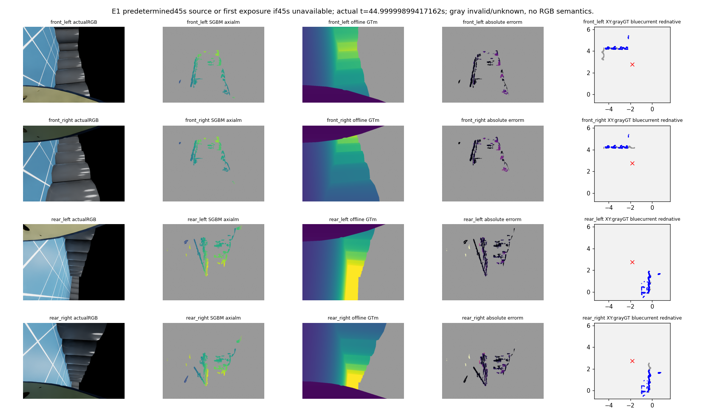
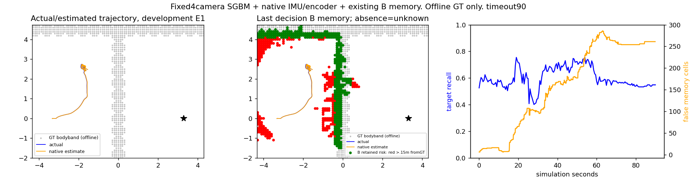

# 当前四相机传统RGB弱基线：完整E1与假阻塞归因

2026-10-17。P0已实际完成；允许缺失和误差的独立条件化baseline，不追改旧95%/80%准入、35秒成绩或拒绝。当前固定四RGB＋原生IMU/主轴编码器，未训练/下载模型、未调整相机/照明，原项目只读。

## 实际结果

| 当前四路E1开发闭环 | 结果 |
|---|---:|
| 终态 | 90秒超时，未到达 |
| 实际障碍接触 | 0；5401次检查均可用 |
| 目标距离 | 6.600→5.450m |
| 净目标推进／实际总行程 | 1.150／6.776m |
| 动作块／四路曝光组／原生IMU及物理状态 | 900／181／4501 |
| 倒车请求时间／tracker等待换向时间 | 7.1／14.3秒；不是实际倒车/制动时间证书 |
| 完整控制—渲染—来源计算P50/P90/P95 | 0.1477／3.8008／3.8934秒 |

端到端含日志/当前执行/渲染与2Hz四路测距突发，不能只报非测距周期的低耗时；仿真在计算时暂停，并非实时达标。无碰撞不等于导航成功或真实硬件安全。

## 固定实现和真实输入

前组front_left→front_right，后组rear_right→rear_left；原始极线竖直，逆时针90度后按正视差查询，同时恢复两个符号方向，共四眼。平行对基线0.65012m，当前焦距294.770878px；原SGBM448/block5、LR1.5px等匹配参数保持。仅按新标定换算米，不将此称为新测量机制。

动态CAD只读已知机体和当前关节；距离.5–3m、stride2、自体半径排除.55m。由原生估计姿态投影后，用.05–1.5m高度带作为**弱风险代理**，没有真实RGB语义分类器。unknown不写观测自由。四路来源、像素对、曝光、原生位姿、原始距离、地图、计划、动作与物理轨迹均保留。

记忆固定为已有B：近10秒风险＋两个曝光epoch确认后持续保留；不把两个高度相关曝光当独立误差概率。规划/控制沿用固定局部栅格、原语、参考保持和roll PID；世界目标是任务输入，无GT全图/参考进入动作。披露初始规范、.4m球半径/固定高度、静态地面/安全起始先验、理想低层bank反馈与packet区间相位。

## 完整测距分母

| 实际源、各自开发域 | E0全部110组 | E1全部181组 |
|---|---:|---:|
| 可见目标格实例 | 11652 | 17942 |
| 风险格精确计数 | 1800/2038=88.32% | 17248/21319=80.90% |
| 完整可见目标格覆盖 | 2665/11652=22.87% | 10761/17942=59.98% |
| 真目标像素分母／有效测距目标像素 | 4476747／374892 | 46703520／5404827 |
| 非空风险曝光组 | 104/110 | 181/181 |

格为0.1m，匹配参照容差0.15m，允许一格邻近多个目标；不是精确3D安全/像素召回。E1有测距目标像素的条件轴向深度误差P50/P90/P95=0.0459/0.1418/0.1615m，不能掩盖完整域缺失。E0每眼条件P90约.440/.383/.361/.381m；两域成绩不能混用。E0包含原2535悬空格，完整目标未删除；RGB类别/地面误报率、学习收益N/A，高度代理的GT地面来源另存完整计数。

E0封存后一次有限配对分解：4476747真目标像素中，956989（21.38%）满足伙伴相机FOV/距离/CAD必要条件；917257还满足最近像素渲染深度±.02m的近似共同可见诊断。它不是精确全部可见性，也不是新源门槛。说明本固定配对不能覆盖所有单眼可见目标；共同区域里仍有真实匹配误差，不能将全部漏测归因几何。

## 为什么会无路：本次实际记录的一个有界反事实

事前选取首次持续≥5秒“零请求＋无成功计划”事件，发生在6.1秒。相同原生估计起点、目标、0.1m网格和0.870711m净空下：

| 仅离线栅格诊断 | 是否有全局栅格路径 |
|---|---|
| 原实际风险图，127格 | 无，与实际失败复现一致 |
| 仅把其中15个GT判错风险格改为unknown | 有，长度8.588m |
| GT静态bodyband参照网格 | 有，长度9.437m |

因此这次**栅格阻塞可由错误风险格解释**；没有将GT删除列表用于在线控制。它不证明全程唯一原因、局部原语可执行、改图后一定导航成功，亦不认证3D净空。此事件在6.1秒，近期正风险已足以封路，不能只把问题归结为很老的记忆。

B全程错误风险积分约14501.3格×秒、最多286格；此前确被源覆盖、当前不可见目标的漏保留634/75700=0.84%。这说明应区分“保留有用盲区证据”和“保留错误风险”。冻结原评分还保存全部曾可见目标的缺口率23.30%，其中包括从未被源测出的目标；该数不能叫源观测遗忘率。

## 同一轮记忆修复决定

完整E0同输入A/B/C回放已完成。C仅要求视点变化再永久确认，错误风险减少14.24%但已观测盲区漏保留11.45%→57.01%，未达事前20%改善/≤5个百分点代价。关闭C，不调角度/平移/TTL或派C物理。详见[视点支持记忆结果](view_supported_memory_results_20261017.md)。不是实际三臂或学习收益。

下一具体工作：围绕本次假阻塞检查**针对旧风险的真实新观测反证**是否可用，严格区别更近表面的遮挡、缺失/无效和有效更远表面的矛盾。先有限对照旧冲突/清除实现，在已封存E1上评价候选证据覆盖及误伤真实障碍，不在线清图、不复活旧源、不再统一抬高确认门槛。只有实质不同且有据的单因素修复成立才冻结后续预算。C不合格期间不冒称P2三臂具备执行资格。

## 同刻图与完整轨迹

四RGB/真实SGBM/GT/绝对误差/每眼当前BEV固定45秒；不是按效果选帧。灰色深度为invalid/unknown，误差显示0–.5m；每眼BEV灰GT、蓝当前风险、红原生估计位置；GT仅离线。没有RGB预测语义。

蓝实际轨迹、橙原生估计、灰GTbodyband、黑星目标；B长期风险绿为距参照≤.15m、红为更远，缺失unknown。右侧全程覆盖与错误风险使用独立纵轴。

## 可复核交付

根 `experiments/four_camera_weak_baseline_20261017_v1`；README列实际入口，protocol/navprotocol固定108项直接源码身份和6项输入；运行末态另存实际已加载源码与USD层身份。另外封存142份实际源码/直接配置字节副本于source_snapshot与source_snapshot_index.json；原始USD/场景和SDK仍为已记录的外部依赖，跨机器运行未核验。所有运行结果/代码/原始视频/轨迹/地图保留，未自动Git提交。

E0生成06:45:51–06:51:12UTC正常0；E1监督06:51:40–07:05:25UTC正常0，终态timeout90。宿主parent3720822/child3720823已退出，服务inactive/MainPID0；非沙箱PID。预算E0计算1/1、E1物理1/1、恢复0/1剩余关闭；P1回放1/1、恢复0剩余关闭。正常进程退出与导航未到达分别记录。

4501原生IMU/物理、全部900请求与policy逐项相同、181×4实际视频解码完整、时序及配对最大矩阵差9.02e-8核验。完整运行封存后教师评分，封存前后SHA一致；独立代码复核的两个启动问题已在实际派发前修正，没有消耗物理恢复。GT原目标cache身份补齐；评分/可视化分母和单位限制单列。闭环源与控制代码在运行中未改。

这是一个已实际运行且有失败证据的弱baseline。跨机器运行、可靠导航、完整实际三臂与学习增量均未完成，原automation保持。

资料封存收尾曾因调用方重复传入helper自带的metadata键退出1；只修正封存调用后完成，记录在administrative_seal_recovery.json。科学生成、评分与物理不重跑，科学运行恢复仍0；行政封存恢复1/1。
