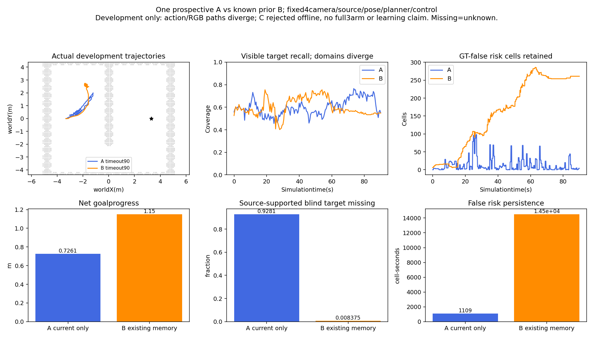
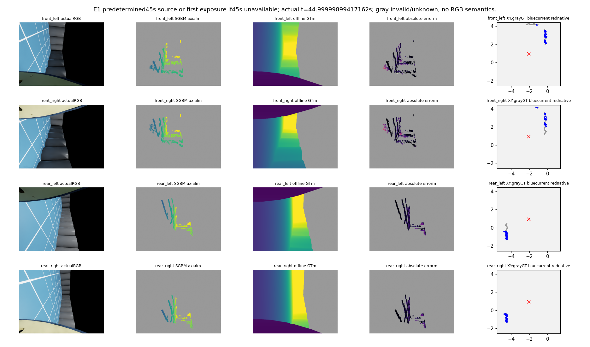
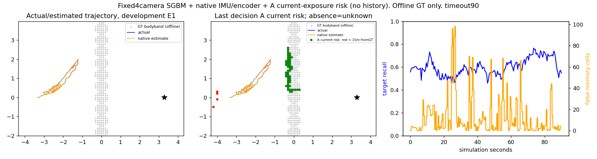

# A仅当前观测与B现有记忆：当前四路实际90秒开发对照

2026-10-17。A根 `experiments/current_exposure_baseline_navigation_20261017_v1`；B复用既有封存 `experiments/four_camera_weak_baseline_20261017_v1`。C视点支持候选已离线拒绝，未派C物理。**这是两臂开发性实跑及三臂离线负结果，完整三臂实际验证、可靠导航和学习增量尚未完成。**

## 结果：没有一个可直接安装的记忆改进

A减少错误风险持久化92.35%，但盲区漏保留明显增大，目标推进反而较少。B保住了更多已经由源支持过的盲区目标，同时会保留错误风险并发生无路。不能从这两个开发案例推出所有场景效果，也不能把遗忘/空图当观测自由。

| 指标 | A仅当前曝光 | B现有显式记忆 |
|---|---:|---:|
| 终态 | 90秒超时 | 90秒超时 |
| 障碍接触 | 0/5401可用样本 | 0/5401可用样本 |
| 真实动作/四路曝光/原生IMU | 900/181/4501 | 900/181/4501 |
| 净目标推进m | 0.726066 | 1.149765 |
| 总行程m | 10.921833 | 6.776337 |
| 反向请求累计s（非真实倒车时长） | 34.5 | 7.1 |
| tracker pending方向累计s | 24.4 | 14.3 |
| GT错误风险格×秒 | 1109.0 | 14501.3 |
| GT错误风险格最大数 | 98 | 286 |
| 曾由源支持、当前盲区目标漏保留 | 61455/66215=92.8113% | 634/75700=0.8375% |
| 持续零请求且无成功plan累计s | 0 | 38.4 |
| 最长该事件s | 0 | 30.0 |
| 全链P50/P90/P95 s | .06423/3.81101/3.83519 | .14766/3.80082/3.89339 |

盲区分母按各自轨迹中“过去被实际源支持、当前不可见的目标”计算，两个分母不同，不能当完全相同样本的因果遗忘率。无路事件是预定义日志判据，A没有该事件不等于路径可执行或目标到达。完整时延包括执行/渲染/四路测距，仿真在计算时暂停；不符合实时0.5秒合同。

## 同版来源与匹配范围

A导航与B只差一行导入：用原 `CurrentExposureRiskGrid` 替换 `RepeatedExposureMemoryGrid`；SGBM、因果位姿、相机/光学、规划和控制字节保持。A每个策略周期只消费当前曝光的records，原10秒source_history即使在日志中保留也不进入A风险图；每个2Hz曝光保持至后续曝光，不把5个策略周期当独立图像。旧历史变unknown，不是free；原非绑定路线侧先验不变。

两个run共享初始gauge、执行状态、episode和6个真实stage layer的SHA。首帧四眼GT深度和渲染位姿exact；初始6秒原生位姿最大差约1.84e−9。**RGB仍不逐像素一致**：首帧四眼RGB MAE约.864–.950/255，原因未完全隔离；动作首次分叉policy60=6.0秒。后续轨迹和观测域不同，不宣称像素配对的随机试验或统计显著性。

A可见目标格9035/14903覆盖、风险格14353/16972精确（60.6254%/84.5687%）；B为10761/17942、17248/21319（59.9766%/80.9044%）。A条件深度P50/P90/P95=.03256/.12989/.15398m（4,812,812有效目标像素）；B为.04594/.14176/.16154m（5,404,827）。这不是源本身提升，路径/目标不同；类别仍是高度代理，不是RGB语义。四路生成P90 A2.91666s、B3.14842s，均非完整实时通过。

图像固定45秒，灰色缺失/未知，深度0–3m，误差色阶0–.5m、超限饱和；XY灰GT/蓝当前点/红原生位姿。最后图是当前观测消融图，不是长期地图新算法。全部181曝光参与评分，不按这张图缩分母。

## 预定数值门槛

源非空支持、碰撞非劣与时延≤B×1.1通过；盲区漏保留≤B+5个百分点、净推进≥B+.5m失败；错误风险格×秒≤B×.8通过。A/B均未到达(.2m且contact0)。所以不能推荐移除历史记忆。评分脚本最初的comparison字典漏列事前已声明的arrival，`declared_gate_audit.json`补全两项false，保留原文件和门槛，拒绝结论不变，不重推理或重评分。

## 一次有界失败归因：未发现无守卫重建证据

已冻结并检查全部900A+900B策略记录。A实际新版本重建26次：初始1、几何守卫拒绝3、几何必要条件通过但既有连续cell-tube守卫拒绝22。B为82次：初始/无route77、几何拒绝4、tube拒绝1。**两个run均0次完整守卫通过而无解释重建。** geometry的necessary screen不能代替完整tube条件；原trace的`unguarded_rebuild_example_present`字段只检查前者，完整守卫补充审计明确纠正其语义，未改原trace或控制器。

A/B非零请求方向切换9/7次，均无一次在新reference重建后1秒窗口内。这个时序不能证明换向唯一原因，也不支持直接添加“强制保持旧reference”或放松安全守卫。反向请求时长和pending时间不是实际倒车/控制失败的等价证据。当前没有准入P3规划/控制修复，不重复旧请求翻译或强迫方向候选。

## 执行、封存与可复现入口

- A实际物理UTC07:52:18–08:05:04正常0；host parent3785925/child3785926。90s/900动作/181四路曝光/4501原生IMU与物理；4视频各181帧完整解码。物理1/1、恢复0，关闭余量，不重跑B/C。
- 全run先封存2185文件，再教师评价。评分UTC08:05:24–08:06:04正常0，parent3800631/child3800632；评价1/1、恢复0。trace08:09:48–08:09:49正常0，parent3805989/child3805990，fit/physics/replay0，cap1/1恢复0/0关闭。
- 作者核验全部900A地图与最新实际source风险格/采集时刻exact，无观测free；181原始帧及预测SHA、103共享实际载入模块字节、4501时钟和视频通过。独立审查支持该域，保留RGB不一致、分母不同和小样本局限。
- `navigation_protocol.json`及`e1_run/protocol_at_dispatch.json`固定源码/配置/输入；`loaded_source_identity.json`记实际模块；`evaluation_protocol.json`固定评分；`author_audit.json`、`initial_condition_audit.json`、`declared_gate_audit.json`和`trace_full_guard_audit.json`给出核对/澄清。
- 原生IMU/encoder无滑移、特权初始规范/地面高度、理想低层bank反馈、packet相位、非RGB语义和unknown探索假设保持。原项目只读，未Git提交/上传；跨机器实际运行未验证。

## 下一直接动作

已知问题是“盲目永久确认会积累错风险、盲目遗忘会丢掉真实盲区”，而非已证实的控制器重置错误。下一只评估一个面向**历史风险持久入库可信度**的监督目标资格：保持当前风险、测距源和控制不变，在线输入仅当前/过去RGB、原始stereo与因果来源；GT只教师标注。先明确完整标签覆盖、unknown和整序列分组，有限对照已关闭固定patch-confidence源过滤及视点确认，确认消费者/目标实质区别；不直接训练、选阈值、重启旧C或承诺改进。当前E0/E1均开发数据，独立验证必须另冻结未见整场景/轨迹预算。若资格不成立，明确缺口；不继续旧辐射场/文献链或强行改PID。
