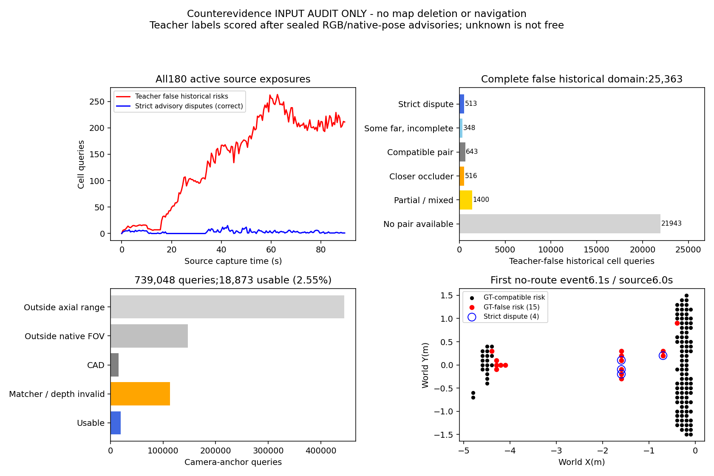
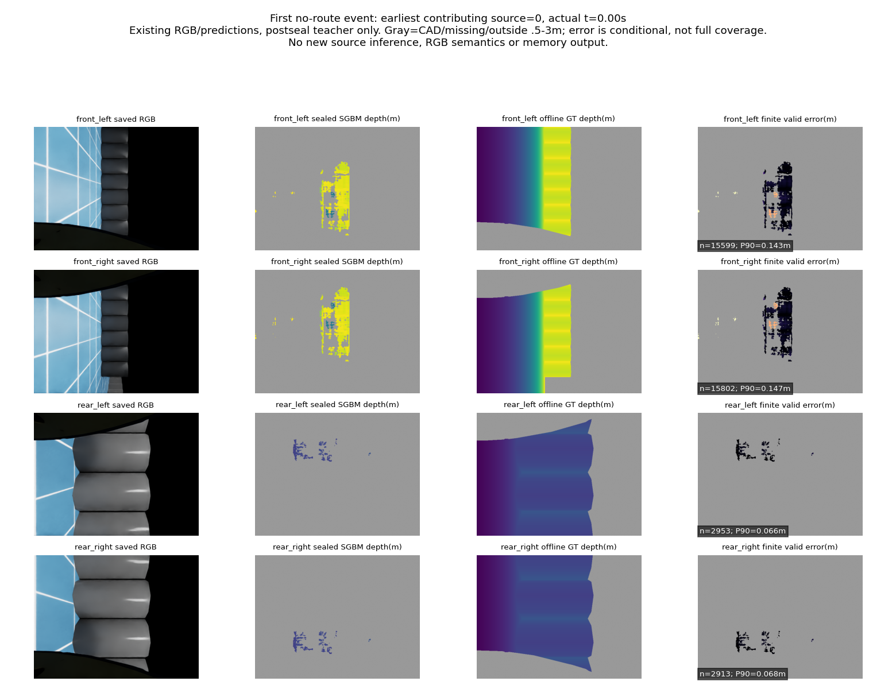

# 当前四路错误风险：反证输入与出生原因

2026-10-17。根：`experiments/risk_counterevidence_input_20261017_v1`。原P0/P1预测、源码、封存和关闭预算不变。本阶段没有重新测距、拟合、采集或导航；另行预注册的A臂导航不属于本诊断。

## 结论及修复决定

当前B会把少量错误测距输入保留成长期风险；之后这些位置大多没有可用的新配对观测。现有“比旧点更远”反证不足以全面纠错；不把视野外、遮挡或无效匹配当自由，不安装删除器。旧更远射线、冲突/遮挡分类已有实现，本轮是当前四路实际输入资格检查，不宣称新算法。

有界教师分解支持深度/源有效性是本域主要输入原因，位姿不是主要修复方向。这里大多数GT深度替换收益来自排除不合格输入，并非把距离坐标修正；不能因此宣称获得在线正确深度。

P1视点支持C继续关闭。继续任务清单中仍有解释价值的A仅当前观测实际90秒，与已知开发B对照；只替换原A记忆类，源/控制不变，不重跑B、不派C，不声称完整三臂或学习完成。先完成这个实际记忆代价对照，再依据同版轨迹、错误阻塞和真实盲区损失决定是否有依据改消费环节。不会先调旧C或重复旧patch-confidence过滤器；后者已有明确覆盖拒绝，不换名再跑。

## 反证检查：全域及原门槛

输入为已封存E1的全部180次活跃曝光（0–179，policy=5×source）；终态180没有后续动作，单列不参与决策。曝光之间保持原图，不能将900个策略周期当900次独立观测。

105,463风险格查询中21,162为当前正观测，保护不删；历史84,301次，其中教师错误25,363、教师真实兼容58,938。每格/眼保留最新真实测量、同曝光选最小query UID，最多四个代表点，并保存来源、partner UID和时间；不是完整体积证明。

固定原0.2m启发差距，按当前估计位姿投影到原640×480四眼原始深度和CAD。配对必须两眼都有效且更远，较近表面属于遮挡；兼容/缺失/混合分别记录。严格标志要求所有代表点均满足；any-anchor是事前登记的次要敏感性统计。只有标志，没有地图编辑。

| 统计 | 严格all-anchor | 次要any-anchor |
|---|---:|---:|
| 识别历史错误格 | 513/25,363=2.0226% | 861/25,363=3.3947% |
| 误指教师真实格 | 30/58,938=0.0509% | 63/58,938=0.1069% |
| 标志教师精确率 | 513/543=94.4751% | 861/924=93.1818% |

原必要门槛为错误历史格覆盖≥20%、教师真实历史格误指≤1%、因果/当前保护通过。严格覆盖失败，**不准入记忆修复或清除**；低误指比例不是零误删保证。

历史错误25,363次完整互斥解释：严格513；有部分更远证据但代表点不齐348；无更远而存在兼容643；无更远而有较近遮挡516；仅混合/部分1400；全部配对不可用21,943（86.514%）。

739,048个相机-锚点查询：轴向范围外444,522，范围内视野外147,319，CAD15,596，匹配/深度无效112,738，可用18,873（2.5537%）。这些是坐标域/有效性原因，不证明物理空间自由。

首次持续无路事件policy61=6.1秒，使用source12≈6.0秒，原127风险格、15教师错误格。82当前正格、45历史格；15错误中1当前保护、14历史。严格标志识别4/14历史错误（4/15全部错误），次要标志5/14，教师真实误指0。本轮没有用这4格重新规划，不据数量推断路径一定恢复。

## 错误输入出生：完整181曝光、1,553,767原风险点

另行冻结fit0教师诊断，保持原查询UID选择，比较原深度/原生位姿、真深度/原生位姿、原深度/渲染位姿、两者真值。反事实在相同UID上重新应用原0.5–3m、根距离≥0.55m、高度(0.05,1.5]合同；被排除是反事实unknown，不是实际清空或自由。

原65,095点实例落在教师错误格。真深度/原生位姿后：57,752被排除，7,164仍合格但落到教师兼容格，179仍错误；另产生10个原非错误点的错误输入，故总错误189。不能把99.725%的原错误队列剩余率改善全部说成坐标修正。

仅换渲染位姿，原错误队列仍61,052，减少6.211%；总错误63,443，包含2,391新错误。事前“深度替换原错误减少≥50%、仅位姿减少≤10%”的有限归因假设通过；不是在线算法或导航成绩。

原错误输入的教师表面：55,796无有限正深度标签（85.71%）、7,233身体高度带、1,880地面、186其他高度。无有限教师返回不等于物理自由，也不能计为已知无穷距离误差。有限错误深度分位只含9,299点：P50/P90/P95=0.4581/0.8621/1.2263m。教师兼容格的有限1,327,184点对应0.04406/0.14003/0.15920m。

有限错误点的仅深度XY位移P50/P90/P95=0.5242/0.9495/1.2488m（9,299点）；仅位姿XY位移为0.02121/0.03778/0.03947m（65,095点）。分母不同，均为教师诊断，不能作为在线误差界。原15个首次阻塞错误格均有逐眼/逐曝光来源，不用GT生成删除表。

## 首次阻塞与全程统计不能混为一谈

首阻塞15错误格的最早来源在source0/1/2/3/4/8，分别6/3/2/2/1/1格，即0–4秒的原零请求观察阶段；多曝光并不保证独立正确。按每格最早曝光、固定眼顺序、最低query UID的展示代表，仍主要是有限深度的错配，不能把全程85.71%的无有限教师返回比例移用于这15格的原因。完整逐次/逐眼来源保存在birth_result.json，不据代表图缩小评分分母。

## 执行、复核及局限

- 反证07:44:33–07:44:38 UTC正常0，host parent3777057/child3777099；180输出先封存后教师评分。CPU dispatch1/1、恢复0，剩余恢复关闭。
- 出生分解07:48:15–07:48:23 UTC正常0，host parent3781634/child3781666；独立CPU dispatch1/1、恢复0关闭。无效GT值矩阵运算有RuntimeWarning，但finite掩码排除，无效值未进入条件分位或反事实有效风险；不重生成输出。
- 作者独立齐次逆矩阵、逐格集合归约、全部180输出标志与教师计数核验exact；365生成身份、3教师身份核对。独立审查无影响本域结论的重要问题。
- 细小潜在接口差异：审计用floor(x+.5)，P0原grid用rint；恰好半格时不同。本次180曝光无任何点/当前保护差异；记录而不改封存结果，不能将代码泛用为等价。
- 所有配对眼相关，0.2m差距无位姿/测距标定硬界；当前最多四个代表点不能证明整个格体积清空。教师0.15m二维bodyband邻近不是三维安全证书。
- 本轮新RGB/深度预测、学习、长期地图修改及导航均N/A；使用旧封存实际RGB测距作输入诊断。P0原源、时延及P1拒绝不改写。原项目只读，不提交Git。
