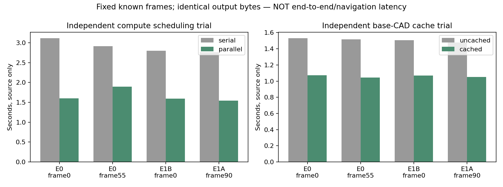

# 固定四路测距源：保持输出不变的实现提速（v113）

## 完成事项

两个独立单因素工程对照均通过冻结门槛。只改变计算调度和已知CAD中静态部分的重复工作；匹配器、阈值、输入、相机、语义/高度代理、位姿、记忆、规划和控制未改。没有新采集、神经训练、神经推理或物理导航。

| 对照 | 固定四帧原实现 | 固定四帧工作版 | 成对时间比中位数 | 完整输出资格 |
|---|---:|---:|---:|---|
| 四个独立SGBM调用并行 | 2.762–3.112s | 1.543–1.891s | 0.5631 | 470曝光×16数组=7520逐字节exact |
| 固定四路静态base CAD缓存 | 1.478–1.530s | 1.045–1.074s | 0.7049 | 470曝光×4CAD=1880逐字节exact；4帧两版本共8次完整源调用exact |

固定帧预先选择E0 0/55、E1B 0、E1A 90；各一次，串/并或未缓存/缓存顺序交替。两组是分别实施的实验，不能把不同组时间相减当成同次直接测得总收益。每组中位成对比≤.8、各帧比≤1.1，全部满足。缓存初始化另测：未缓存并行0.239s、缓存0.557s；表中steady调用不含该一次成本。

最终源四个开发样本仍约1秒，高于旧.5秒要求；新弱baseline未据此宣称旧严格门槛通过。没有运行新的完整控制/渲染链时延或导航，不能把源耗时当端到端延迟、到达/碰撞或学习收益。测距错误与覆盖没有改善，原错误风险保留结论不变。

## 实现与证据范围

第一项：四个独立native matcher分别执行原四次compute；每个CV仍单线程，输入数组由Future持有，输出全部返回后才结束predict。动态CAD、正负视差换算和后处理沿用原代码。四离线进程仅加快完整资格吞吐；该批处理下的逐帧时间不当作在线性能。完整470域为E0 110、E1B 180、E1A 180，都是已见开发数据，非fresh。

第二项：复用此前已存在的静态base缓存思想，适配用户固定四路。base_link相对机体变换恒为I、相机随同机体固定；仅缓存此部分。三动态link每次仍使用实际关节。原逐三角形布尔并集可拆为静/动态OR，浮点边界由完整1880掩码exact检验。不是新测量/学习机制，也没有使用GT场景。原两路缓存的光学/膨胀/frozen mask未移入四路。

第一项真实重算478次原SGBM（4串行＋4并行开发计时＋470并行全域），运行时逐一比较dtype/shape/原始bytes；相同内容直接引用旧预测归档，未另存重复候选数组。独立审查核对源码、执行记录与全部引用，未重推理。第二项真实完整源8次，另470次仅mask检查；没有把后者说成470次完整源重算。结合已通过的下游相同运算，给出冻结输入域的组合等价依据，不冒称实测了缓存版470份完整新预测。

工作版入口 /home/an/Documents/ChatGPT/球型机器人导航/experiments/fixed_source_static_base_cache_20261017_v1/source_entry.py，提供FourSGBM及原points/常量；只有离线前端资格。未改已封存运行源码、当前默认在线入口或原项目，未自动Git提交/上传。源码、配置、协议/输入/旧数组SHA及114份原身份快照在两个实验根，跨机器实际运行未做。

## 监督、预算与审查

并行资格2026-10-17T10:04:20.724382+00:00–2026-10-17T10:12:29.168548+00:00正常0，parent3923519/child3923521，四worker全部结束；dispatch1/1、源478/478、恢复0/1余1关闭。缓存资格2026-10-17T10:13:30.090490+00:00–2026-10-17T10:17:51.439080+00:00正常0，parent3933272/child3933273；dispatch1/1、完整源8/8、完整mask470/470，恢复0/1余1关闭。两项fit/神经推理/物理/导航均0，旧预算未重开。

派发前审查发现原直接子进程监督无法充分清理四个spawn后代，已仅在当前工作版修为独立PGID、TERM/KILL整组、退出确认；旧共享helper不改。正常/带孙进程超时两个接口fixture通过，强制KILL分支仅源码检查未实跑。实际两组结束均无存活或僵尸组成员。冻结前修订字节另存，不把派发前工程修复算作科学恢复。

## 与本轮学习结论及下一动作

v112已证明：当前/近期风险必须全保留时，E0错误格秒最多下降15.95%，达不到本长期入库方案冻结的20%。停止该方案补采/拟合；不改旧标签带、门槛或删E0救分。该结论只限既定消费者，不是所有学习不可能。报告 /home/an/Documents/ChatGPT/球型机器人导航/reports/persistent_entry_limit_and_compute_results_20261017.md。

这次实现提速没有解决源误报或提供新学习增量；当前没有准入的学习/记忆干预。后续先复用v109已封存的错误出生分解，有限检查“近期错误的可区分输入与完整监督目标”是否能形成实质不同的消费者，尤其区分无近处表面支持、底层无效和保守UNKNOWN；不把无GT hit当在线自由，也不重做出生评分。最多核对旧point-height风险头和旧static-cell风险头两项直接合同；若只是旧视觉过滤/网络换名，则不立拟合预算并明确学习停滞。暂不实际重跑A/B、不新采集、不修改原控制/近期风险或继续提速扫参。可靠导航、完整三臂与学习增量仍未完成。
