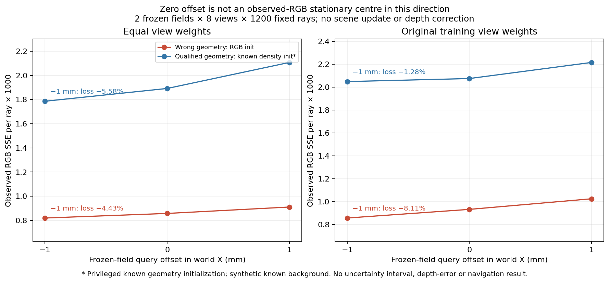

# 米制几何不确定性：两种机制核查及驻点前提诊断

本轮沿v104核查：能否把几何表面位置与颜色渲染核带宽分开，并从现有RGB/K/IMU编码器位姿给出可反证的不确定性证据？只选BayesRays、GURecon两个具体机制，没有下载模型或安装依赖。

## 原始来源与合同差异

[BayesRays论文§4.2–4.4](https://arxiv.org/html/2309.03185)在冻结场的空间查询坐标上施加变形，用局部Laplace/Fisher近似描述场对变形的敏感性。[官方实现](https://github.com/BayesRays/BayesRays/blob/main/bayesrays/scripts/uncertainty.py)求RGB Jacobian，不使用观察RGB残差。它与射线终止厚度、LK点跟踪不同；尺度可沿用米制坐标，但本轮没有建立厘米级实际误差覆盖。其局部近似不能自动覆盖模型偏差、位姿误差或其他模式。[官方说明](https://github.com/BayesRays/BayesRays)的深度评估/可视化也不能替代当前域校准。

[GURecon论文§3.2–3.4](https://arxiv.org/html/2412.14939v1)从SDF交点和法向构造切平面patch投影，用四个较低SSIM不一致分数蒸馏连续三维不确定性场，并学习视角相关外观项。该连续表面目标不同于旧LK，但仍需已有SDF表面，且输出一致性分数不是米制区间。当前SDF/UDF只有已知几何工程参考，缺GT-free RGB重建和独立完整伪标签资格，不用真实法向/标签补洞，不先训练。此次只查看[官方仓库](https://github.com/zju3dv/GURecon)与论文，未运行实现，不能记为性能失败。

有限历史核对：旧LK包含回环、光度、三角化及像素扰动的米制敏感性；当前两方法有不同表示/统计目标，但没有自动增加米制测量。旧预算不重开，也不把“与旧目标不同”直接当源准入。

## 最小检查：局部统计中心是否已成立

BayesRays的后验解释以零变形处为局部模式。当前两场只拟合了固定1024步，是否可当作观察数据的驻点尚无证据。因此先冻结一个fit0前提检查，不先实现Fisher场或置信过滤。

- 两冻结末态：RGB初始化错误场；已知density初始化的几何合格场，后者含GT初值特权。
- 同一合成fixture的8个拟合RGB视角，每视角1200个native stride16点，每场9600条，不按标签/距离/误差挑样。
- 同时平移density和color的查询坐标，在world X上检查δ=−.001、0、+.001米；固定模型参数与原渲染/背景，不更改场景或输出新深度。
- 目标L=mean_rays sum_RGB((renderRGB−observedRGB)^2)，只用观察RGB。零中心二次变形先验在δ=0处梯度为0；观察似然方向梯度非零即可否证该方向的后验驻点条件，与有限正先验强度无关。
- 在δ=0用自动求导，预冻结abs(g)>1e−6；用固定1毫米符号下降方向验证RGB损失下降>max(2e−8,1e−5L0)。两个偏移都是诊断查询，没有选择/应用一次场景更新。

## 结果

| 场 / 聚合 | δ0观察RGB SSE | 方向梯度（SSE/m） | 固定−1mm下降 | 相对下降 |
|---|---:|---:|---:|---:|
| 错误场 / 等视角 | .000857713 | .04588394 | .000038000 | 4.430% |
| 错误场 / 父采样期望 | .000931394 | .08427318 | .000075523 | 8.109% |
| 特权合格场 / 等视角 | .001891994 | .15363953 | .000105666 | 5.585% |
| 特权合格场 / 父采样期望 | .002074122 | .07733446 | .000026510 | 1.278% |

四项都否证该固定采样上的观察RGB驻点条件。全图/全分布是否驻点没有测；自动梯度与中心差分的值可因分段插值跨结点不同，但符号一致。

蓝色场有已知几何初值，红色场几何错误；低RGB损失不代表正确深度。两个横轴偏移仅是冻结场查询，不是新训练/修正结果。本轮未计算Hessian、不确定性数值或厘米误差区间；也未测试两方法实际不确定性排序、AUSE或当前四路源性能。真实四RGB/预测深度/GT深度/深度误差/BEV/长期地图/导航均N/A，普通诊断不重画旧图。

## 问题解释与决定

本轮新增证据是：当前两个末态在这组观察RGB上的局部统计中心前提不成立。官方Jacobian算法仍可算出一个Fisher启发量，但不能据本轮检查将它认证为实际测距误差区间。这个前提检查本身不区分正确/错误场；不是BayesRays性能失败，也不证明此方法的排名必然无效。

GURecon的表面/法向前提和米制标定合同也没有在当前真实源上建立，不能仅通过多加一个学习头得到合格距离。没有有据的新米制不确定性修复准入，本表面/不确定性接续到此结束。当前v99/v102旧场不追加收敛/先验/噪声/置信过滤预算。

当前表面/后验不确定性修复接续结束，不继续拟合、加置信头、改核宽/先验/噪声或用旧v99换消费者救分。下一轮回到测量生成，最多核查两个原始来源，具体问题为：因果3D可见性与遮挡顺序驱动的photo-consistency是否能在无已知背景/GT轮廓条件下生成有界米制表面约束？可优先读Space Carving及Generalized Voxel Coloring原始论文/官方实现，并仅对直接相关旧轮廓锥、逐像素平面扫描、v99颜色混合机制做有限区别核对。明确每一步真实RGB如何否证一个距离假设、可实现因果视点/位姿/遮挡来源和完整域缺口；不可见/缺失/不一致不能当自由。仅若形成实质非重复、可执行合同才同轮冻结独立最小预算并实现；否则如实记录无路/停滞，不派实验。本方向尚未研究成候选或准入，不是恢复旧预算的许可。

## 执行与复核

北京时间2026-10-17 00:38:24–00:38:27，durable parent2830527/child2830561正常0结束。dispatch1/1、诊断1/1关闭，fit/optimizer/物理/E0重生成/监督网络训练/导航0，恢复0。瞬时查询没有写新场景checkpoint，模型state逐张量exact、optimizer状态为空；已封存旧源码/输入/输出身份不变。

作者CPU复算16视角/48身份；δ0颜色逐点与旧生产渲染bitwise exact、观察样本与旧采样exact，损失最大复算差6.51e−19。独立只读审查无重要问题；指出生产守卫只检查δ0损失而未检查逐RGB身份，该项由独立已完成运行审计精确补证，不改科学源码/输出。原项目只读，没有上传新Git变更。

当前无实际运行，下一测量生成方向尚未选定/准入；可靠导航、学习增量与整体目标未完成。
