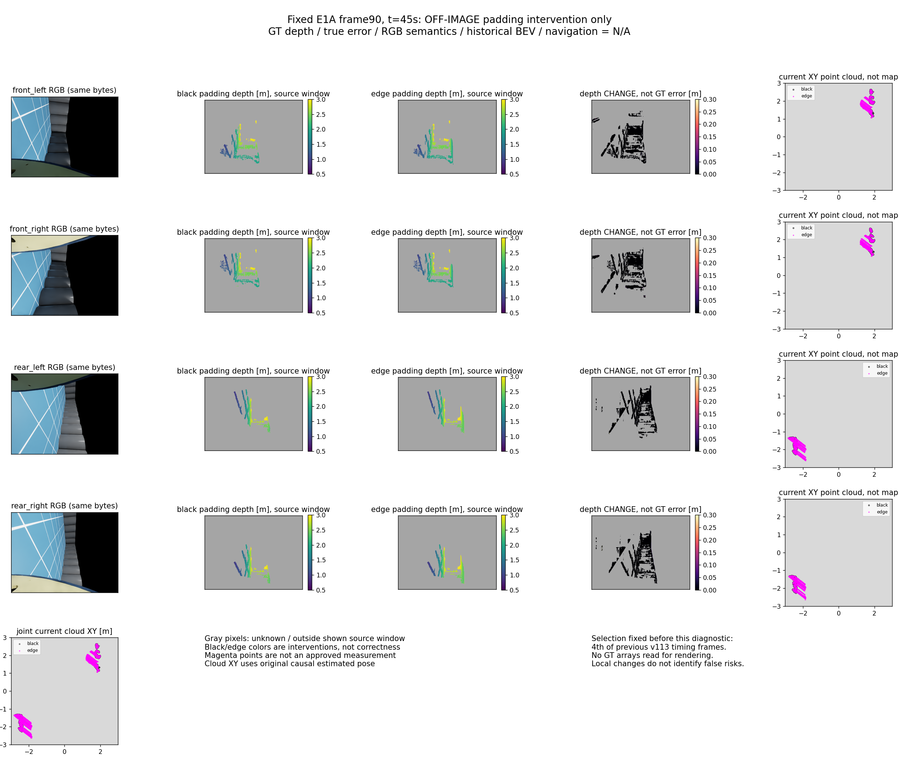
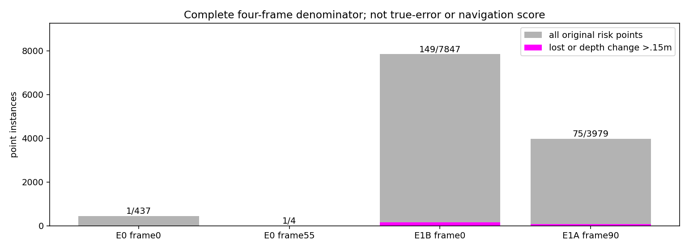

# 图外填充依赖诊断（2026-10-18，v117）

## 问题、唯一干预与结果身份

当前源在旋转后的图像两侧各加448列黑色像素，再做SGBM，最终仅检查选中匹配中心是否回到原图。本次问题是：这些不对应真实光线的填充值能否通过路径聚合影响图像内的距离？只比较黑色填充与边缘复制，原RGB字节、尺寸、匹配参数、已存CAD、估计位姿、距离/高度窗口保持。边缘复制也不是实际观测，**只是干预，不是准入修复**；依赖本身不等于违反SGBM规格、错距原因或导航收益。

复用v113已事前选定的4个开发帧，而非按本次误差挑选：E0帧0/55、E1B帧0、E1A帧90。没有新采集、仿真、学习或导航。冻结一次dispatch、最多8次四眼匹配重放/32个matcher.compute、120秒；不扫描填充方式。源掩码直接复用原封存输出，未重投影CAD，因此不是8次完整在线感知调用。

## 完整分母

- 黑色填充复现64个深度/valid/disparity/CAD数组与48个world/query/partner数组，全部dtype/形状/字节exact。
- 两臂原始输出先封存。4帧×4眼共4,915,200像素；原/干预valid分别347,616/358,158；valid身份变化15,274；两臂共同valid345,250，其中距离变化>.15m为903。这里valid尚未限制原风险源的.5–3m/高度窗口。
- 原风险源12,267点，226点（1.8423%）失去有效距离或同query距离变化>.15m。全部12,267点的query和partner局部支持离实际图像边界≥3px，覆盖5×5块和BT局部导数；这不证明所有SGM路径代价只依赖实际图像。
- 干预风险源共13,845点，可能新增错误，不能将点变多说成覆盖或精度改善。不是旧误报总量的1.84%，更不是错误减少1.84%。

|序列/帧|原风险点|受影响点|原点完整分母|
|---|---:|---:|---:|
|E0/0|437|1|437|
|E0/55|4|1|4|
|E1B/0|7847|149|7847|
|E1A/90|3979|75|3979|

### 每眼结果（全部固定帧）

下表变化分位是两干预输出之差，**不是GT误差分位**；N/A表示没有对应结果。

|序列/帧/眼|原valid|干预valid|共同valid|共同valid距离变化P90 m|原风险点|风险点受影响|
|---|---:|---:|---:|---:|---:|---:|
|E0/0/front_left|14428|14348|14338|0.0|0|0|
|E0/0/front_right|14490|14415|14403|0.0|0|0|
|E0/0/rear_left|17754|17814|17703|0.0|214|1|
|E0/0/rear_right|17642|17702|17590|0.0|223|0|
|E0/55/front_left|9978|9892|9868|0.0|2|1|
|E0/55/front_right|9570|9476|9453|0.0|2|0|
|E0/55/rear_left|21988|21918|21869|0.0|0|0|
|E0/55/rear_right|22488|22436|22396|0.0|0|0|
|E1B/0/front_left|28843|29383|28541|0.0|3522|69|
|E1B/0/front_right|28916|29464|28612|0.0|3529|67|
|E1B/0/rear_left|25696|26552|25552|0.0|402|7|
|E1B/0/rear_right|25777|26628|25630|0.0|394|6|
|E1A/90/front_left|27549|28824|27268|0.0|1371|34|
|E1A/90/front_right|28105|29337|27791|0.0|1310|36|
|E1A/90/rear_left|27224|30020|27144|0.0|645|2|
|E1A/90/rear_right|27168|29949|27092|0.0|653|3|

## 有界归因未完成：作者实现错误

预测封存之后，另冻一次fit0/恢复0的已存教师标签归因，拟统计原风险格内全部源点是否都受干预影响。该脚本将world→cell写成floor，而原features.py第29行使用np.rint，首次映射即KeyError，正常记录为退出1。它已读取首帧的旧静态格教师数组；没有写出任何分类/收益结果，不能声称整轮未读教师。此分析按恢复0停止，未修后重跑或换名领取预算。

这是作者坐标合同实现错误，**不是填充方案性能失败**。原静态XY教师的positive/negative/marginUNKNOWN不更改，也不能当点/射线深度真值。原协议的四帧负格20%必要门槛没有计算结果，状态N/A；真实误差分位、错误风险收益、四路语义、长期BEV和导航均N/A。

## 同刻可视化

固定展示第4个预选帧E1A90，约45秒，非最大变化帧。四RGB、两臂真实深度输出、输出差、各眼及联合当前XY点云；灰色表示unknown/显示源窗外，黑/洋红表示两种填充的点云，不能表示正确/错误。点云是当前源点，不是历史风险地图。

## 执行、封存与决定

主诊断UTC16:47:36.673949–16:47:52.461575，父141277/子PGID141278，正常0；归因16:49:16.179983–16:49:16.345583，父143070/子143071，退出1。均为durable user-systemd命名空间PID，不推断与临时工具shell的PID映射。主服务inactive/MainPID0/exit0，分析服务failed/MainPID0/exit1，无残留live/zombie。主dispatch1/1、匹配重放8/8、compute32/32、恢复0；分析dispatch1/1、恢复0/0，账本关闭。

作者只读重算8输出SHA、4帧64+48原数组及12,267点/226点计数，全部exact；不是独立审查。绘图仅读封存输出与RGB，不读GT深度/位姿/场景；没有新地图、训练或导航。原v116和所有旧源/拒绝/预算不改写，线上默认不切换。

已建立一个局部边界依赖事实，尚未证明它解释完整误报，**不准入padding-stability删点/入库策略，不扩大到470帧，不装边缘复制**。原始匹配的完整代价与图外假设支持尚不可见，改变填充只能测敏感性，不能提供可信距离。任何后续边界处理方案需要明确“不以图外伪RGB作为代价证据”的实际实现合同及收益证据；本次失败教师归因不以新名称重跑，当前没有已准入下一修复。完整三臂、可靠导航、学习导航增量与整体仍未完成。
