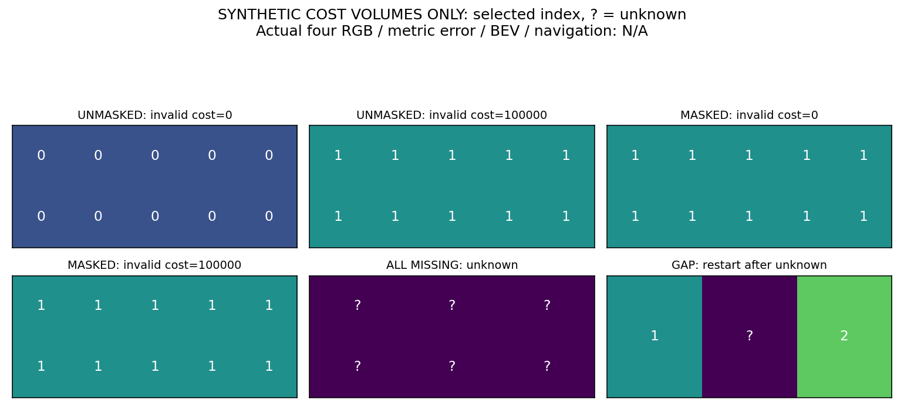

# 图内支持的代价聚合参考（v118，2026-10-18）

## 实际完成与边界

已实现独立NumPy float64三路径min-plus原语：无支持候选代价为正无穷；有支持候选只从有限前驱取最小值，整节点无支持时保持unknown，后续节点从当前代价重新开始。固定P1=600/P2=2400，left/right/top三路径求和；仅唯一有限最小值返回候选索引，平局或全缺失返回-1 UNKNOWN。它不产生自由空间或距离置信区间。

这是小型合成**代价数组**工程参考，不是完整OpenCV/SGBM复现，也没有真实RGB代价、BT计算、亚像素精化、原uniqueness/LR/median/speckle和四眼消费者。索引1不是1米。没有旧源输出等价性、真实错距或导航收益证据，不能安装为当前测距源。

## 控制与完整数值分母

- handcost固定，observed index1代价20，其余观测候选≥1000；无支持index0仅取0或100000。比较同一参考中mask on/off，两种填充各一次。
- 不掩蔽时赢家从index0变index1；掩蔽后两种无支持代价的聚合数组逐字节相同，赢家均index1。这是构造fixture的控制结果，非v117真实RGB错误归因。
- 全无支持、平局、缺失节点后重启以及8个seed20261018的2×4×3微型数组全部保留。15次有效aggregate调用，另1次supportedNaN入口拒绝，总入口16次；21个必要检查通过。
- 独立穷举直接枚举15,879次完整路径赋值及0/600/2400转移，与递推的有限支持、归一化相对代价和winner一致（atol1e-12）。不检验每路径共同加性常量，不证明概率校准或大场景行为。
- 输入数组前后字节不变。逐假设局部支持的声明几何见证x=450、伙伴x=322、d=128对应约1.49716m；说明逐候选支持可以有合法备选，不必要求整个448搜索区都同时在图内。该几何算术不是真实RGB恢复或可用深度。

## 执行与审查

先登记两次独立派发：RED未实现函数的预期NotImplementedError（子331530，UTC19:55:42.788557–19:55:42.989770，退出1），再数值资格（父453686/子PGID453688，UTC21:57:38.975232–21:57:39.229479，正常0）。两者是durable user-systemd PID，非临时工具shell；均无残留live/zombie，监督服务inactive/MainPID0/ExecMainStatus0。前后时间是独立开发派发，期间没有持续场景计算。

派发2/2、恢复0（剩余关闭）；真实RGB/source、GT、模型拟合、物理、导航均0。实际数值调用/穷举确实执行，不写compute0。没有跑项目测试套件，只做冻结的必要数值/因果接口检查。原有v117归因脚本仍按恢复0关闭，未修后重跑；旧源/相机/预算不变。

独立审查预检与保存数组核对无Critical/Important问题。它确认masked结果字节一致、allmissing/tie=-1、gap=[[1,-1,2]]，代码/输入/NPZ身份与台账一致，没有重跑kernel/穷举或真实源。预检发现15有效+1拒绝的预算表达歧义，派发前已明确16总入口并更新身份，原preimplementation协议保留。作者保存记录复核另列。

常用系统路径和active conda bin未找到c++/cmake/OpenCV开发头/库，并非对整个主机穷尽搜索，也非GPU/存储故障；未安装或下载依赖。此参考使用现有NumPy，不代表已有可移植的原生SGBM补丁。

## 图示与缺失输出

以下仅展示固定合成代价fixture，数字为索引、问号为unknown。实际四RGB、真实预测/GT误差、每眼/联合/长期BEV和导航均N/A，没有旧图或仿真帧充当新测距结果。

## 当前决定与下一直接动作

此原语小型合同通过，源码/fixture/协议/日志/数组封存，共19文件，manifest SHA `86dbb218ee01bacb8ae734fe3284307b1dc5d0e44bde2111d43824c00a83cf1e`。整体、可靠导航、完整实际三臂和学习导航增量未完成，当前没有运行。

下一可执行工程项：在现有Python内实现实际RGB→BT局部代价/5×5块代价与逐候选观测支持，明确边缘导数、图外候选与无支持路径的处理。先固定完整640×480四眼输入和两对双向查询、参考实现的选择/后处理差别及完整域输出；先做必要输入/坐标接口核验，再另冻真实输入计算与评分的最小总预算。不得把此float64原语或新RGB参考称为与原SGBM字节等价的单因素源修复；若不能隔离support开关，先说明复合差别，不宣称改善来自一个因素。真实输出先seal后GT评分，先开发资格再决定完整源/导航，不重跑旧v117教师归因或padding变体，不调阈值/模型救分。
