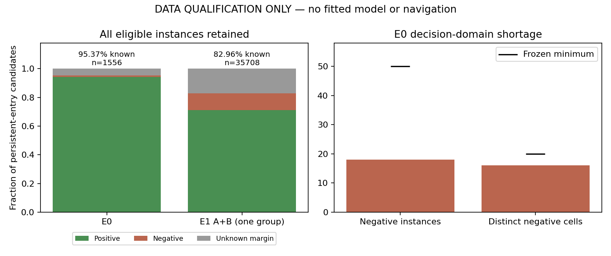

# 历史风险持久入库：数据资格结果（v111）

## 结果与问题解释

本阶段已完成，结论 **NOT_QUALIFIED_BEFORE_FIT**。不是训练后模型失败：本轮拟合、学习推理、源预测重生成、物理、导航均0。完整三臂实际导航、学习收益与可靠导航仍未完成。

| 整序列组 | 全部当前风险格实例 | 达到持久入库条件 | 正例 | 负例 | UNKNOWN | 已知标签比例 |
|---|---:|---:|---:|---:|---:|---:|
| E0（110曝光） |2038|1556|1466|18|72|95.37%|
| E1 A+B（360曝光，共一个场景组） |38014|35708|25402|4220|6086|82.96%|

表中正/负/UNKNOWN均以“达到持久入库条件”为分母；重复时刻不是独立样本。E0要求负例≥50、不同负例物理格≥20，实际18和16；全部156个单帧负例中138个尚未达到原两曝光入库条件，不能挪入学习目标凑数。E1要求已知标签≥90%，实际82.956%。6086个UNKNOWN全部来自10–20厘米教师留白带，域外0；不是缺RGB或执行故障。原冻结正例≤.10m、负例≥.20m不调整，原导航评价.15m不变。

## 实际消费者与历史区别

只拟让未来冻结的学习分数控制“两曝光之后进入长期层”，原当前及近期10秒风险全部保留；未知分数不晋升，不产生观测自由。全接纳/全拒绝/NaN只是接口fixture，没有训练过的预测。预先声明.95为未来晋升阈值，不是已校准可信度。

旧静态格风险学习、RGB/历史特征都已存在；此处结构区别只在长期入库这一干预位置。旧learned-cell head、按原像素GT高度标注的point logistic、被拒绝的当前点patch过滤和视点支持C均未加载/重跑。不是首次发明风险学习，也没有复活旧模型。

## 输入与教师隔离

完整470曝光：E0 110，E1B 180，E1A 180；两条E1末帧无实际策略决策，不进入本学习消费者域。原始源点2985832、出400×400消费者栅格0。所有40052当前风险格实例构造24个有限特征，37264实例达到入库条件。RGB、视差、估计高度、双目像素残差、CAD边缘距离及当前/过去来源/统计均来自原封存输入；世界位置/场景ID不是模型特征。近期统计窗10秒，生命周期曝光计数仍保留更早信息，不称严格10秒记忆或独立确认概率。

特征470档先封存，再由独立进程读原完整静态bodyband栅格生成470标签档。标签判断估计地图位置相对静态障碍格，不用“原像素是障碍”替代定位正确。无GT深度无命中像素不被当作在线自由。教师为.1m解析几何高度带投影，非精确渲染曲面/三维安全证书。原teacher最近距离全部独立复算，最大差0m。

E0/E1都是反复查看的开发数据；E1A/B同一场景组，不是相互独立留出。不随机拆相邻帧，没有新留出、校准、泛化或学习导航收益。

## 接口检查与一次修复

原全接纳mock与290份封存B地图逐格exact（E0 110、E1B 180），只是工程等价。独立审查发现单独接口允许新frame复用同timestamp，可能把同一曝光计数两次；数据读取层已要求严格递增，因此本次470曝光及原等价结果不受影响。

保留原consumer.py，单独consumer_repaired.py仅补“新frame必须有更大timestamp”，在访问payload及状态修改前拒绝。一次恢复已复现旧漏洞、验证新接口拒绝且状态exact，以及当前/近期保护、重复曝光、未来输入、未知不自由fixture。原特征/标签/结论未重生成。独立修复复核无重要遗留问题；未把接口通过当模型性能。

## 运行、预算与证据

主资格2026-10-17 08:45:23–08:46:28 UTC正常0，durable parent3842152/child3842171均退出；service inactive/MainPID0/ExecMainStatus0。dispatch1/1、恢复1/1关闭；fit0/0、源重生成0、物理0、导航0。恢复仅CPU接口fixture；原结果正常0不是运行失败。

原协议/源码/输入/旧参考SHA与470对输出均复核。author_audit.json及independent_review.json保留详细计数和边界。当前四RGB新预测、深度误差、每眼/联合/长期BEV、导航：N/A（本轮没有拟合模型，不重复旧图）。

## 关闭决定与下一动作

本固定数据资格分支在拟合前关闭；不删UNKNOWN、放宽标签带、把一次负例变成持久负例、交换旧角色或给同协议追加拟合。本结果不证明该学习思想不可行。

下一先冻结一份**新的整序列数据与教师资格方案**，明确如何获得跨场景持久负例、怎样保留边界UNKNOWN，以及训练/开发/真正留出的完整分组；现有E0/E1继续保留为已见诊断/压力域，不能冒称新留出或悄悄改写本次角色。须说明新证据为何解决上述两种缺口，并给出完整域验收和总采集/拟合预算；若不能成立，明确学习部分停滞，不采集、不训练、不恢复旧C/源模型。当前未登记新采集或拟合许可，不声称正在运行。
