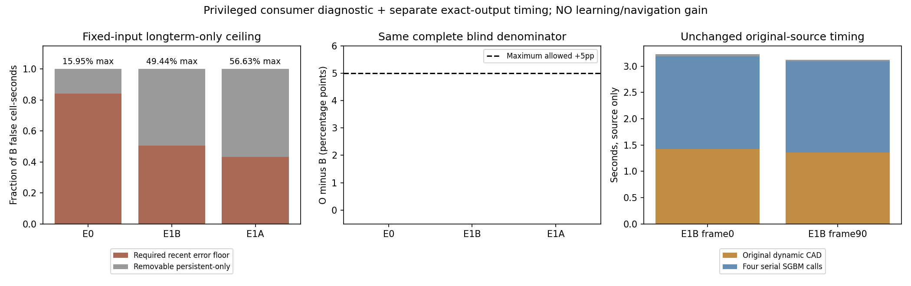

# 长期入库的可改善上限与独立实现耗时（v112）

## 本轮结论

停止本固定长期入库/边界弃权方案的新采集与拟合。即使已有教师完全正确，只控制长期层、保护全部近期风险的方案，在E0也最多减少15.9505%错误风险格×秒，低于事前20%。因此v111后不能只补训练负例就宣称问题解决。旧二分类数据资格仍拒绝、标签带/完整目标分母/旧结果与预算不变。

| 冻结输入轨迹 | B错误格×秒 | 不可绕过的近期错误格×秒 | 可移除的长期独有错误格×秒 | 理想教师降幅 | B/O盲区漏保留 |
|---|---:|---:|---:|---:|---:|
| E0 |1768.60|1486.50|282.10|15.9505%（失败）|2161/18868，两者相同|
| E1B |14501.30|7332.20|7169.10|49.4376%|634/75700，两者相同|
| E1A输入上的反事实B |25688.50|11140.60|14547.90|56.6320%|708/66215，两者相同|

E1A这一行是同A封存输入的B/O回放，不是实际B导航轨迹。E1A/B仍为同一个开发场景组。E0按原110曝光间隔计时、末曝光dt0；两条E1各900策略点×.1秒，分母不跨轨迹合并。

## 做了什么、为何可以归因

同470个封存活动曝光，原三态标签保持：距离静态教师占用格≤.10m为正，≥.20m为负，中间/域外UNKNOWN。O仅允许正标签在原两曝光条件后长期晋升，负/UNKNOWN分别保存且都不晋升；当前和近期10秒风险全部保留，缺失/未知不生成观测自由。这里直接使用GT标签，是强特权必要消费者诊断，**没有真实RGB学习预测或在线可部署性能**。

先seal470组B/O地图状态，再按110+900+900=1910个原时刻评分；B标签与1010份原B地图逐数组exact。全部当前/近期风险丢失0，三轨迹漏保留差0pp。E1A完整分母66215独立复核。

一次只读归因将每时刻错误拆为“近期已包含”和“仅长期额外包含”。O额外长期错误三轨迹全部0。因此在这些固定输入、静态教师、.15m评分、原时间权重下，任何包含全部近期风险格的输出，其错误格秒至少为1486.50（E0）。最大降幅为1−1486.50/1768.60=15.9505%。这不是所有测距、学习或导航不可能证明；它不约束改变源、近期层或其他场景的结果。不能事后删掉E0救本次全序列门槛。

## 独立工程瓶颈：输出不变的计时

另外登记独立极小工程预算，固定已知E1B frame0/90，各调用原SGBM源一次；只包装CAD与四次compute的计时，参数、数据与运算不改。两帧各4眼×深度/valid/视差/CAD=16数组，dtype/shape/全部原字节与旧封存exact。原始源耗时约3.216/3.122秒，其中动态CAD1.424/1.354秒，四次串行compute1.762/1.739秒。两点只是描述性归因，不是稳定P90、提速证明或完整在线链时延。

基于四次compute相互独立，已另冻结当前工作版仅并行调度四个独立matcher的工程资格；CAD和全部数学保持。先四个固定帧交替串/并行，要求所有输出字节exact、中位时间比≤.8且每帧≤1.1；通过才继续全部470曝光7520数组exact。新预算最多478次原算法调用、fit/物理/导航0，不是换模型/阈值、拒绝源重跑救分。真实状态在 `experiments/fixed_source_parallel_compute_20261017_v1/status.json`；先监督，勿重复派发。批处理进程并行仅加快等价检查，不能拿批处理耗时冒充在线时延。

## 运行与预算

必要诊断09:48:41–09:48:57 UTC，durable parent3907288/child3907304正常0，replay/score子PID在各process.json；dispatch1/1关闭，恢复0/1余1关闭，fit/源重生成/物理/导航0。归因CPU检查正常0，工具session9655，短命辅助PID未单独采到，未冒称该session是宿主PID。

独立原源计时09:54:22–09:54:30 UTC，parent3913204/child3913207正常0；dispatch1/1、源调用2/2关闭，恢复0/1关闭，ML拟合/物理/导航0。两服务inactive、所有相关主要进程结束。独立数组复核与数学上限复核无重要遗留问题。四路新语义、真实学习深度/误差、联合/长期学习BEV与导航N/A；本轮不重复旧RGB/GT图。

## 后续决定

长期-only学习分支关闭，无新增合格记忆/学习候选；不再补采扩库或拟合来尝试打破这个近期层上限。当前推进的是独立的同输出实现耗时资格，先接续它的真实进程和完整数组结果。通过也只证明实现等价和有限开发计时收益；实际四路链、导航安全/到达与学习增量仍需各自证据。任何新的近期风险干预必须有独立机制/完整域/预算，不能恢复旧patch置信过滤、缩TTL或更改旧门槛。
