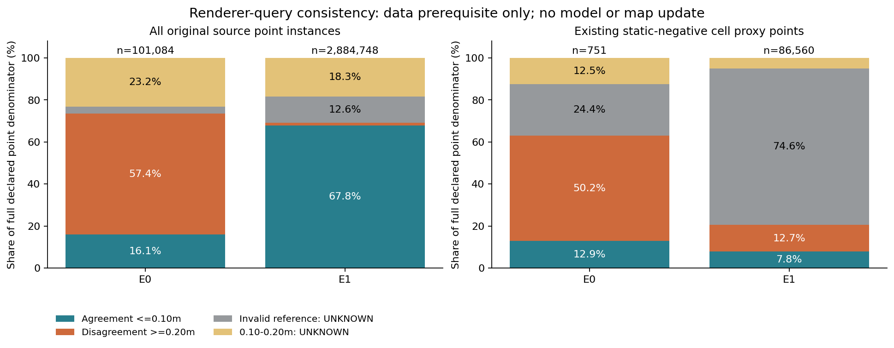

# 同query距离一致性监督：完整数据资格拒绝（v114）

## 问题、结果与停止决定

本轮检查一个不同于旧高度头的监督目标：原SGBM点的距离是否接近同一query的渲染深度。旧高度标签会把“query确是障碍，但距离错了”的点仍标为hazard。新目标改变监督语义，仍是风险候选可信度过滤的消费形式，不称为新过滤结构；没有选择、训练或运行模型。

完整470曝光、2985832点均来自已见开发数据：E0 110、E1B 180、E1A 180。E1A/B是同一场景组，不是独立留出。先封存26通道因果输入引用及有限性/UID/时间核验，再读取GT距离和旧静态教师。输出先封存，未改任何原源、风险地图、规划或控制。

**冻结数据资格拒绝，停止在训练前。** 这不是分类器性能失败，也不证明该目标不可学习。当前没有准入的学习方案或学习收益。

|完整点实例分母|E0|E1（A/B同一开发组）|
|---|---:|---:|
|全部源点|101084|2884748|
|一致≤.10m|16251|1954728|
|不一致≥.20m|57985|38812|
|GT无效UNKNOWN|3407|362619|
|有限.10–.20m留白UNKNOWN|23441|528589|
|全体known|73.4399%|69.1062%|
|已有静态负风险proxy点|751|86560|
|其中known|474/751=63.1158%|17753/86560=20.5095%|

两个known门槛均冻结为每组≥90%，全部失败。正负数量≥50、各类分布≥11曝光均通过；曝光数量不等于统计独立。静态负风险proxy由旧v111教师距离≥.20m定义，仅作为离线分层审计；它**不是**原>.15m完整地图误报分母。静态正proxy、留白域及每眼/每序列完整计数均在result.json，未删域。

图为完整两组总量，不选有利帧。蓝绿=一致，橙=不一致，灰=无效参考UNKNOWN，黄=有限留白UNKNOWN。右图仍包含其完整proxy分母。不是实际模型预测或机器人性能图；新的四RGB预测/误差、每眼/联合/长期BEV与导航均N/A，未重画旧图。

## 失败原因及修复决定

第一，主要错误子域缺少此目标的可信标签：E1静态负proxy中64542/86560点参考无效，另4265点落在固定留白；不能用全体known掩盖该缺口。全部366026个无效参考本次均为+inf，零/负有限值/−inf为0，原捕获合同排除NaN。旧no_finite_GT本身只是数值有效性类别，不能解释成线上已测自由。版本匹配的[官方Replicator1.11.35说明](https://docs.omniverse.nvidia.com/kit/docs/omni_replicator/1.11.35/source/extensions/omni.replicator.core/docs/API.html)将0解释为infinity/no-object；不能据此把当前保存的+inf逐像素认证为no-object。没有改变其UNKNOWN标签。

第二，深度一致性和风险格正确性不同：E0新负标签57985点中56344点位于旧静态positive proxy，E1为25510/38812。直接按这些标签过滤，可能抑制仍支持已有风险的点。这里是点实例交叉表，不是丢失风险格数量、地图回放或导航退化证据。正确的学习目标必须服务于实际消费者；单靠换分类器、增加迭代或改阈值不能消除这种目标错配。

因此关闭本固定目标的训练、恢复及地图消费接续；不把+inf改负、不收窄留白、不补采或重新计算来救门槛。v111长期-only、v112上限、旧两类头及其预算均保持。下一仅检查“来源特定的当前风险格支持”是否存在不同于旧全局static-cell先验头的消费者，并能保持边界UNKNOWN、同格其他来源和原历史；若相同或无完整合同，明确学习停滞，不立拟合预算。当前尚无该新合同或准入实验。

## 数值与输入合同

固定当前四路F=294.77087816197377px。标签残差为 `abs(predZ-GTZ)*norm([(u-319.5)/F,(v-239.5)/F,1])`，单位m；GT非正/非finite为UNKNOWN，GT不按源.5–3m截断。该同射线三维差在同刚体坐标变换下不变，不验证原生位姿准确性。渲染距离、RGB可见性、透明/机体表面和继承曝光相位限制保留；不称为真实RGB第一表面或障碍真值。

26输入是已封存24个当前/过去局部格特征按source_cell_row映射，加原点axialZ和signed disparity。没有globalXY/场景ID、GT标签或GT位姿输入。未来若有预测，其负输出只能抑制本次来源候选成为unknown，不生成free、不连带删除同格其他支持或历史；本轮未执行该消费者。

## 运行、审查与身份

UTC 2026-10-17T10:55:31.921939+00:00–2026-10-17T10:55:56.568592+00:00正常0（北京时间18:55:31–18:55:56），parent3976173、child/PGID3976175；服务inactive/MainPID0/ExecMainStatus0，无存活或僵尸组成员。dispatch1/1关闭，恢复0/1余1关闭。源调用/模型拟合/学习推理/地图回放/物理/导航全部0。这里确实读取并生成了470份新教师标签，不写成仅状态核对。

作者完整分区与身份核验通过。独立只读复核470保存标签/2985832点、470派生特征和旧静态标签映射、全部gate与SHA；另外只从冻结E0 0/55、E1B 0、E1A 90四帧12267点原输入独立复算三维公式，标签exact、残差最大差约8.9e-16m。未独立复算其余466帧原始深度公式，未重生成输出或调用源。

协议/代码/标签/输入引用、原封存关联、监督日志、独立审查及cause_assessment均在 /home/an/Documents/ChatGPT/球型机器人导航/experiments/query_depth_consistency_qualification_20261017_v1。旧输出未改，不自动Git。可靠导航、实际完整三臂及学习增量/整体仍未完成。
