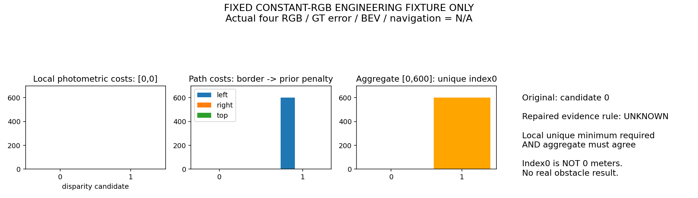

# RGB代价接口与一次受控有效性修复（v119，2026-10-18）

## 本轮做了什么

实现了独立Python/NumPy参考：RGB与裁剪Sobel-X梯度的对称BT半像素区间差、5×5块代价、逐候选图内支持、完整left/right/top float64路径、整数唯一最小值及固定10%条件。两臂只拟比较support开关；原OpenCV保留为封存上下文对照，**不是与其字节等价的单因素补丁**。原相机/FOV/640×480/两个配对/双向查询、CAD、原生估计位姿和距离/高度消费窗未改。

代码完成不等于实际RGB已运行：真实输入预测前的必要检查失败，原定predict和score均未派发，**无真实四RGB输出、GT误差分位、每眼/联合/长期BEV或导航结果，全部N/A**。未读取真实RGB或GT数值数组；只计算了合成小数组和文件SHA。没有扩大采集、拟合、物理或导航。

## 正确部分及边界说明修正

四个小代价体的批量递推与v118标量参考全部三路径字节exact；48个合成RGB/窗口代价与独立逐像素标量公式一致，48个支持点位置一致；原始小RGB数组不变，正反已知shift的支持代价为0。它们是接口检查，不是完整BT/OpenCV二进制一致性证明。

完整梯度BT支持应为**横向半径4、纵向半径3**：块半径2，梯度BT半像素区间再访问邻梯度，邻梯度又访问其相邻RGB。v117的margin3只是一项边距统计，不能称完整梯度BT的局部支持证书；此前后置ROI与源Z≥.5m不相交的结论不受影响，半径扩大只会更严格。旧v117输出/计数/封存不追改，实际“非局部”贡献未另评分。

## 失败、原因、受控修复

原8项检查中7真、1假：`flat_valid_tie_UNKNOWN`。固定零RGB11×15、视差[0,1]、位置(y=5,x=6)：

|量|候选0|候选1|
|---|---:|---:|
|局部光度代价|0|0|
|左路径代价|0|600|
|右路径代价|0|0|
|上路径代价|0|0|
|聚合代价|0|600|

左侧x=4只有候选0有支持，候选1从下一列才出现并承担平滑转移惩罚；局部无区分的颜色输入经支持边界/正则产生唯一聚合选择。因此“聚合唯一”不能直接当“观测唯一”。这是当前声明的有效性合同失败，不证明v118递推数学错误，也不证明真实机器人已有同类假障碍。这里选中视差0，**不是0米**，原正视差距离消费者还会拒绝它。

按原总cap4的第3槽只做同版同一失败fixture归因，保存unary/support/各路径/aggregate/decoder；没有改P1/P2、填充、阈值或输入。第4槽执行唯一受控修复：在原解码之后，只有至少两个支持候选、局部光度代价存在精确唯一最小值、且原聚合选择与该光度最小值相同才接纳，其余UNKNOWN。它使用已计算的代价，**不是新测距原理，也不是校准置信概率**。

该新解码小检查8项全部通过：固定平场全部UNKNOWN；保留唯一光度/聚合一致的字面例，拒绝两者不一致、光度最小值平局、singleton及全缺失。只读取已保存失败数组和5个字面例，2次新decoder调用，**没有重算BT/聚合或真实源**。这不证明真实图像误差/覆盖或导航改善；精确唯一也不能排除错误局部极小值。原失败代码/日志/协议完整保留，原fixture没有被改成通过。

## 审查、执行与预算

独立只读代码及保存数组审查确认上述原因和新检查，无新增Critical/Important。审查没有重跑任何kernel/解码/真实源/GT。原未执行源仍保留三项Important：predict计时未涵盖LR/points、score读GT前尚缺seal协议SHA核对、8GiB/swap0需由外部受限单元实施。**这些未修复文件不能直接拿来派真实预测。**

原总派发4/4：RED未实现函数预期1；必要接口检查退出1；固定失败归因正常0；受控解码小检查正常0。恢复0，原真实predict/score预约未用且关闭。全部进程退出、MainPID0；fixtures服务failed/exit1原样保留，其余监督服务inactive/exit0，子进程期望RED1单列。详细UTC/父子PGID见closure/各status；PID属durable user-systemd，不推断临时工具shell映射。

当前工作根34文件封存，manifest SHA `06d17f02d7c7f381772a6934bcc5cf464a064fefec81563f7313f2aa0708ec75`。原项目、旧v117/v118源码/封存及旧预算不改，默认源不切换，无Git提交。完整baseline/记忆三臂、可靠导航及学习导航增量仍未完成。

## 下一项可执行工作与预算身份

先在独立工作副本中把新evidence_decode接入完整双向四眼参考，并修复上述三项未执行接口问题；不调用原4/4关闭脚本。随后明确完整真实输入、源实现差异、数值门槛和封存后评分，再冻结修复版本的一次有界资格。已有受控repair检查必须计入该有据修复版本的总预算，不能从0重新领数值预算，也不能借工作版本名称复跑原失败预测/归因或扫描参数。

当前仅小型消费者修复通过，真实输入计算尚未准入；下一阶段不能先做导航、训练或宣称已修好源。旧拒绝模型/控制/图外填充值变体不恢复。
