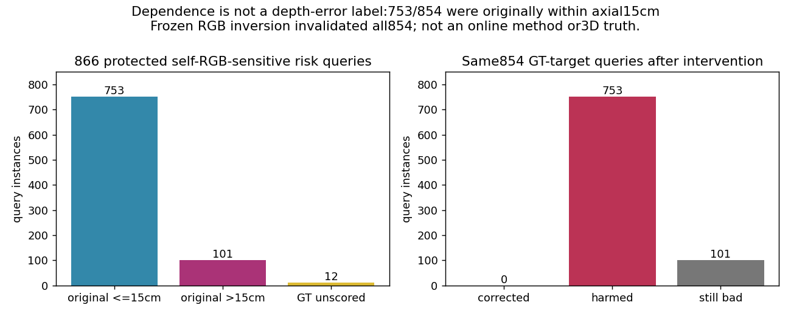
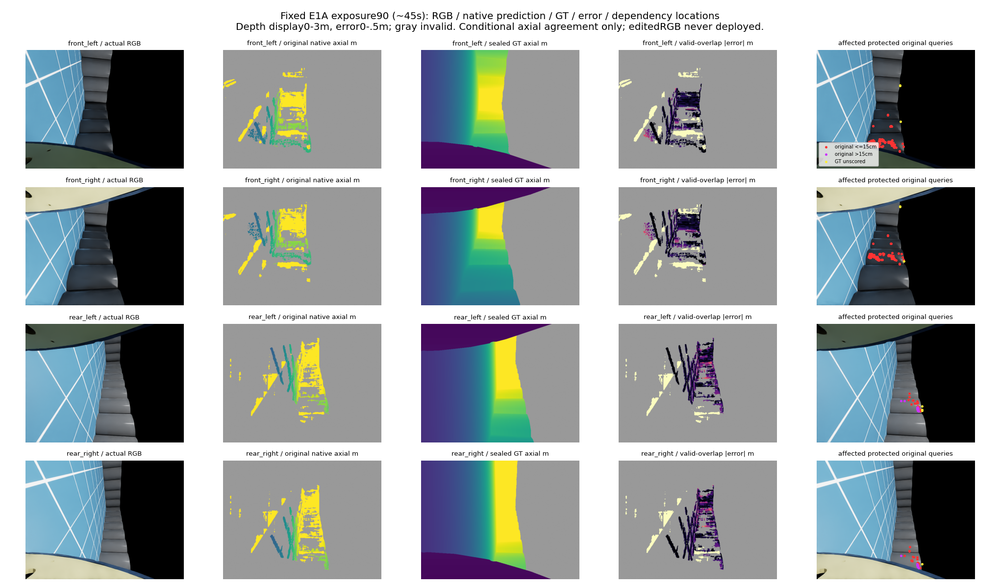

# 机体RGB依赖是否对应错距：封存输出GT归因

日期：2026-10-19。v123的机体RGB依赖见证不能直接等同错距，本轮只完成一次失败后的有界GT归因。未重跑原匹配器、原预测、修复、采集、拟合或导航。

**结论：不能把机体RGB依赖点统一当作错误信号。受影响且可评分的854个点中，原有753个（88.17%）符合轴向±15cm参考；固定RGB反转干预使这854个全部失去native有效测量，而非纠正原误差。**

## 固定输入与评分口径

输入是v123已seal的同4固定开发帧E0/0、E0/55、E1B/0、E1A/90的8份原生匹配器输出（原始/机体RGB反转）。原有12267风险点全部保留为归因分母；其中12052点的query及原取整partner局部BT/块支持均避开CAD和图像边缘，866点因干预失去有效深度或变化>15cm。

全部4915200像素实例、有限正GT2887203、无效GT2027997、原完整目标527344像素保持；没有只读正面个例或按GT选帧。首次读数值GT发生在原8预测封存之后。此归因没有重写v123完整域性能评分。

轴向参考一致性固定为GT深度在[.5,3]m且绝对误差≤.15m；GT无效或超范围单列UNKNOWN，不当自由。原声明目标另保留CAD/机体外/高度带条件。这个±.15m工程口径不是格中心0.15m误报定义、径向误差、语义正确性或3D安全证书。

## 完整条件分母与转移

| 查询域 | 可评分 | 原≤15cm | 原>15cm | 保持准测 | 原准测→不准/无效 | 原不准→准测 | 仍不准/无效 |
|---|---:|---:|---:|---:|---:|---:|---:|
| 全部原风险点中GT范围内 | 11621 | 10597 | 1024 | 9764 | 833 | 10 | 1014 |
| 全部protected中GT范围内 | 11420 | 10486 | 934 | 9712 | 774 | 10 | 924 |
| 受影响protected中GT范围内 | 854 | 753 | 101 | 0 | 753 | 0 | 101 |
| 受影响protected且在原目标域 | 854 | 753 | 101 | 0 | 753 | 0 | 101 |

“纠正0”只属于受影响protected子集；全部protected可评分点有10个纠正、774个由原准测变差/无效，不能把子集结论扩展成全图零纠正。受影响的866点中另外12点不评分：11点GT无效，1点正GT超[.5,3]m。854个范围内点也全部位于原目标域；作者保存数组核对确认854个native valid均为false，不只是深度落出范围。

| 固定帧/眼 | 受影响protected | 其中可评分目标 | 原准测 | 原不准 | 纠正 | 原准测损失 |
|---|---:|---:|---:|---:|---:|---:|
| E0/0/front_left | 0 | 0 | 0 | 0 | 0 | 0 |
| E0/0/front_right | 0 | 0 | 0 | 0 | 0 | 0 |
| E0/0/rear_left | 24 | 23 | 6 | 17 | 0 | 6 |
| E0/0/rear_right | 23 | 22 | 2 | 20 | 0 | 2 |
| E0/55/front_left | 0 | 0 | 0 | 0 | 0 | 0 |
| E0/55/front_right | 0 | 0 | 0 | 0 | 0 | 0 |
| E0/55/rear_left | 0 | 0 | 0 | 0 | 0 | 0 |
| E0/55/rear_right | 0 | 0 | 0 | 0 | 0 | 0 |
| E1B/0/front_left | 183 | 183 | 164 | 19 | 0 | 164 |
| E1B/0/front_right | 169 | 169 | 150 | 19 | 0 | 150 |
| E1B/0/rear_left | 64 | 64 | 64 | 0 | 0 | 64 |
| E1B/0/rear_right | 66 | 66 | 66 | 0 | 0 | 66 |
| E1A/90/front_left | 147 | 144 | 144 | 0 | 0 | 144 |
| E1A/90/front_right | 125 | 122 | 122 | 0 | 0 | 122 |
| E1A/90/rear_left | 35 | 32 | 17 | 15 | 0 | 17 |
| E1A/90/rear_right | 30 | 29 | 18 | 11 | 0 | 18 |

## 为什么停止这一解释

冻结的继续归因必要条件为：受影响目标非空、原不准多于原准测、纠正多于损失。只有非空成立，另两项失败。这只是是否继续把该依赖当统一抑制错误信号的工程前提，非新算法或正式导航验收门槛。

v123的证据支持“已知机体RGB会影响一些机体外输出”，本轮补充显示这些依赖中多数是原准测。故仅凭依赖排除信息，没有建立选择性去错依据。不能反过来声称机体RGB始终有益；全protected域确有10个纠正，也没有证明所有CAD-aware方法不可行。

这里干预的是原native SGBM已封存输出；v123的availability修复是非等价参考实现，涉及聚合及局部evidence候选集合。不能将本轮753个准测损失逐点套到那个参考修复，也不能唯一解释其79→73/7.595%失败。两条证据的范围各自保留，原拒绝、原始数组和旧台账不改。

## 执行、预算与来源

一次独立GT-only失败归因：北京时间17:40:48–17:40:50，父2619342/子2619343，正常0，无超时/信号/残留活或僵尸。cap1/1、恢复0关闭；原v123的4/4仍关闭。该新预算只用于此前未计算的GT归因，不是原native预测或失败评分的重试，不增加修复、source/matcher、模型、GT消费者或物理预算。

两份代码派发前非执行AST检查，输入/旧输出seal/旧台账和代码SHA均事前冻结。16份逐查询归因数组保存了UID、参考GT、原/干预深度、protected/affected/有效性及转移标签。独立保存数据复核18项通过，无新增Critical/Important；未重跑科学代码或GT评分。

当前无运行，原automation同id/原prompt/每小时ACTIVE。原A/B/C基线、语义N/A与低层/初始规范特权不变，可靠导航及学习增量仍未完成。

## 同步图像

固定E1A曝光90，展示原RGB、原native测距、GT、有效重合像素误差及受影响点位置。深度显示0–3m、误差0–.5m；灰色无效，红点为原准测、紫点为原不准、黄点无可评分GT。图像是同一已见开发帧，没有按本轮误差重新选帧。

本轮没有生成新深度源、BEV/长期记忆/轨迹或视频，这些新结果N/A，既有v122/v123保存产物不重画。

## 接续

这一“依赖即错距”的归因分支结束，不追加GT拆解、干预颜色/帧选择、CAD边界/系数或旧参考修复。后续必须先建立具体错误与在线信号之间的选择性关联，才讨论新修复/消费者；目前没有准入新候选，研究仍停滞。原弱基线和负消融可以交付，整体可靠导航与学习目标未完成。
