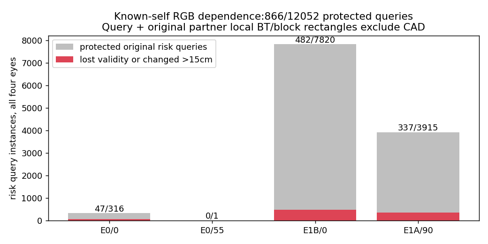
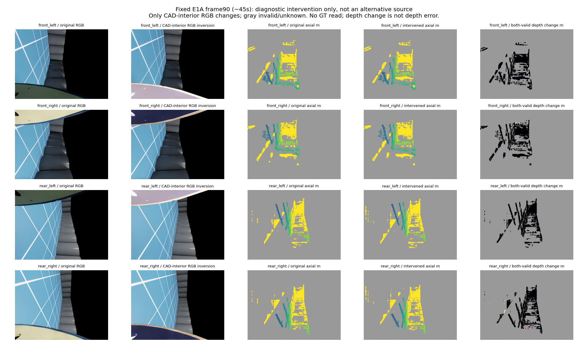
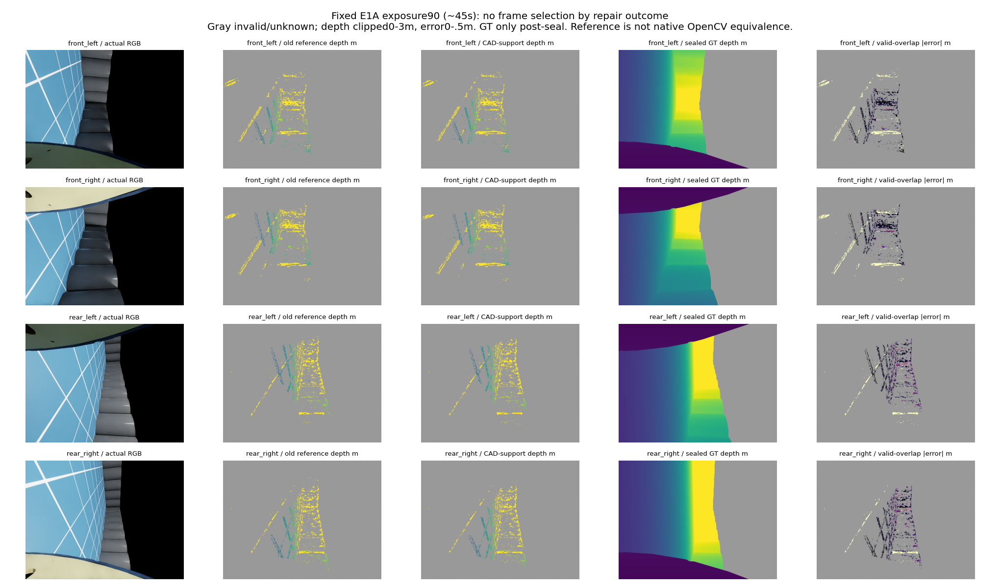
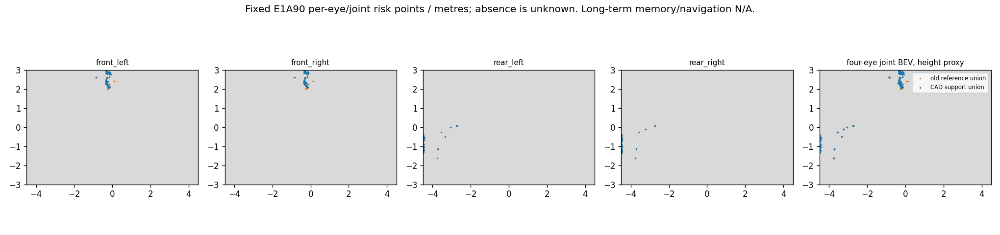
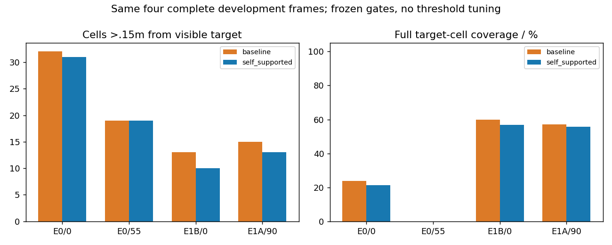

# 已知机体RGB依赖与一次CAD代价支持修复

日期：2026-10-19。先定位原因，再做一个受控修复。相机、原RGB数据、旧模型/源、旧拒绝及关闭预算保持。无新采集、拟合、物理或导航。

## 1. 定位到的具体依赖

原四路SGBM在计算视差时不使用CAD；仅在匹配后排除query和取整partner的中心CAD像素。旧v116只核机体几何选择覆盖，v117只改图外填充，v120参考的支持掩码只限制图像边界；这些均未测试图内已知机体RGB的影响。

复用原先按固定索引选定的E0/0、E0/55、E1B/0、E1A/90，不按错误选择帧。只将冻结CAD=true处RGB改为255−RGB；机体外RGB逐值不变，原遮罩/填充/参数/位姿/LR/门槛不变。修改608773/4915200像素实例。原输出64数组和48点数组全部字节exact，证明对照复现。

| 帧 | 局部支持避开CAD的原风险点 | 失效或深度变动>15cm |
|---|---:|---:|
| E0/0 | 316 | 47 |
| E0/55 | 1 | 0 |
| E1B/0 | 7820 | 482 |
| E1A/90 | 3915 | 337 |

合计866/12052=7.186%；全原风险点980/12267=7.989%发生上述变化。保护区是原query和原取整partner各自原图row±4、column±3的完整BT/块局部支持，且在图内。它没有排除其他视差候选、partner自身推断、子像素/中值/散斑或更长路径，不能将变化唯一归因SGM递推，也不能把深度变化称为真实深度误差。

这是一个已知机体外观干预的依赖见证，不是新的距离源、不变性安全保证或在线修复；原机体遮罩的像素准确性未因此认证。诊断未读取GT。独立15项保存数组/身份/点位审计通过。

## 2. 单因素工程修复与冻结条件

复制v120的float64 RGB/BT/三路径参考与evidence_decode，函数代码字节不变。仅将每个视差候选的availability进一步要求query/partner完整局部BT/块窗口CAD-free。rotated坐标用7×9膨胀和X−d查表，正负方向一致。成本数值、P1/P2、路径数、解码函数、LR/depth/points、位姿及评分不变；没有膨胀半径/颜色/阈值扫描。

availability同时送给聚合和局部evidence消费者，改变了可选候选集合；因此效果属于整条候选可用性合同，不能说仅由聚合内部mask造成。它不是原OpenCV的字节等价修复。原v120拒绝与预算不改，旧masked参考的4份预测只按SHA复用，不重跑原臂。

8项必要小检查通过：空CAD等价、query窗口排除、正反partner索引、自体RGB变化下支持代价/聚合/解码一致、全CAD保持unknown。随后仅生成4新预测，全部与4旧基线身份一起seal，再读数值GT评分。

冻结通过条件：偏离可见目标的格数减少≥20%，池化精确率损失≤1pp，池化及每帧覆盖损失≤5pp，有目标帧非空。所有条件必须同时成立；没有使用GT挑CAD、候选或门槛。

## 3. 完整声明域结果

完整像素4915200；有限正GT2887203，无效GT仍UNKNOWN2027997；条件目标像素527344、420目标格曝光实例。每帧四眼完整640×480，没有仅评分受影响点、缩目标或移除遮挡目标。

| 指标 | 原native源（封存上下文） | 旧参考基线 | CAD支持参考修复 |
|---|---:|---:|---:|
| 精确风险格/预测格 | 152/162 (93.827%) | 148/227 (65.198%) | 143/216 (66.204%) |
| 偏离可见目标>0.15m格数 | 10 | 79 | 73 |
| 覆盖格/完整目标格 | 128/420 (30.476%) | 139/420 (33.095%) | 131/420 (31.190%) |
| 有效测距目标像素 | 48825/527344 | 9253/527344 | 8977/527344 |
| 条件轴向深度P90m | 0.145456 | 0.165675 | 0.158857 |
| 条件径向深度P90m | 0.153241 | 0.179186 | 0.171819 |

**决定：拒绝。** 偏离格79→73，仅减少7.5949%<20%；覆盖139/420→131/420，下降1.9048个百分点；其他4项非劣/非空条件通过。原native源同域只有10个偏离格，不能把这项参考修复当作已优于当前源。

| 帧 | 偏离格：旧→修复 | 覆盖格/完整目标：旧→修复 |
|---|---:|---:|
| E0/0 | 32→31 | 38/159→34/159 |
| E0/55 | 19→19 | 0/89→0/89 |
| E1B/0 | 13→10 | 57/95→54/95 |
| E1A/90 | 15→13 | 44/77→43/77 |

| 修复各眼（四帧合计） | 精确/预测格实例 | 覆盖/目标格实例 | 有效/目标像素 |
|---|---:|---:|---:|
| front_left | 76/101 | 68/132 | 3004/112887 |
| front_right | 79/108 | 66/170 | 2994/100646 |
| rear_left | 54/88 | 59/98 | 1457/163887 |
| rear_right | 49/83 | 53/141 | 1522/149924 |

“偏离可见目标”是当前可见有限GT目标格0.15m参照，不能直接叫完整物理误报；无效GT、无输出和缺匹配保持unknown，未当自由。风险类别仍是弱高度代理，真实RGB语义N/A。

## 4. 解释与停止

当前证据支持：已知机体RGB会影响部分非机体输出，单靠匹配后的中心CAD过滤不能保证局部非机体支持不受影响。受控排除CAD相关候选只带来有限同域改善，未达到冻结修复收益；不能把机体RGB当作唯一故障原因，也不能声称所有CAD-aware方法无效。

该修复及预算关闭，不加CAD边界、不改解码/系数、不跑470全序列或新导航。原源仍按原身份工作；可靠导航和学习增量仍未完成。当前没有新的已准入修复；需要新的具体原因证据才继续，不用重跑此诊断或扩参数制造进展。

## 5. 原始运行与预算

总cap4明确包含已执行原因诊断1，再接口1/预测1/评分1；恢复0，全部正常0，无残留活/僵尸。没有阶段另领预算。

- 原因诊断北京时间16:39:43–16:39:59，父2557541/子2557545，32 native compute/8源重放，GT0、CAD生成0。
- 接口16:43:36，父2561754/子2561755。
- 新预测16:44:16–16:49:24，父2562462/子2562464。8GiB/swap0实时约束已读回，进程RSS样本约1.48GB，不当峰值。
- 评分16:49:57–16:49:59，父2568312/子2568313。

新参考每帧75–82秒，包含本实现成本/聚合/解码/LR/投影及输出IO，原CAD/位姿共用；不是完整端到端，更不满足0.5秒。旧v120两臂时间不能与本单臂时间直接算加速收益。无机器人视频或轨迹新增，长期BEV/记忆/实际导航本轮N/A；原A/B/C结果保持。

## 6. 固定同步图

按既有索引固定E1A曝光90，未按本轮错误选帧。深度图显示0–3m、误差0–0.5m；灰无效。BEV窗口[-4.5,4.5]×[-3,3]m仅展示，数值评分使用完整域。诊断图的深度差是干预变化，修复图的绝对误差才是封存后GT比较。

独立修复结果审查30项通过，无新增Critical/Important；包括输出身份、16眼CAD支持/LR/点位映射以及逐眼/合并指标算术。没有重跑科学代码或GT评分。原静态审查与原因诊断15项审查一并保存。
