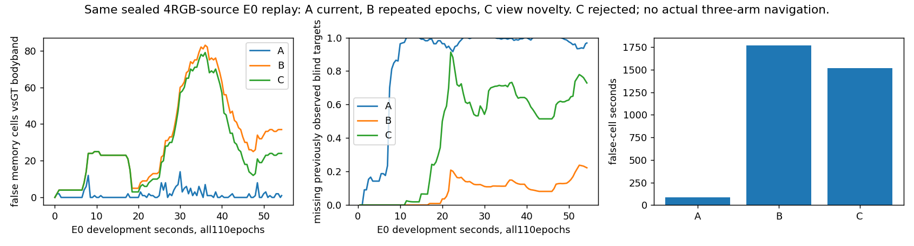

# 视点支持记忆：同输入回放与拒绝原因

日期：2026-10-17。当前四路真实RGB的固定SGBM输出，全部110组E0开发输入先封存；A/B/C记忆结果再封存，之后才读GT评分。新增物理、训练、源推理均0。它不是三臂实际导航，也不是独立泛化。

## 唯一变化与旧机制区别

A仅最近曝光；B为已有“近期10秒＋两个不同曝光epoch永久确认”。C只把B的永久确认条件换成：两个曝光的估计机体平移≥0.2m，固定旧端点到相机对中心的射线夹角≥5度。同一曝光的双眼不重复计确认；近期10秒、来源、位姿、网格及风险语义保持。参数事前固定，不按GT调整。

这区别于旧按时间计数、单一TTL、query去重、endpoint的floor/hazard冲突以及有限RGB外观佐证。直接核对的旧风险寿命35秒已知位姿对照仍保持原身份和拒绝，不冒充当前四路结果；旧teacher射线可见性也没有进入C。不是对全部历史的穷尽证明。

当前风险、近期历史和几何确认历史分别保留。没有足够新视点的过期假设变为unknown，不是观测自由；没有新射线清除或删除已确认风险。source的LR冲突只表现为无有效新测量，不反证旧障碍。再观察需求只是状态标记，没有修改动作。新视点不等于统计独立，原生位姿没有在线硬误差界。

## 预定标准与完整结果

| 同一输入回放 | A当前观测 | B原记忆 | C视点支持 |
|---|---:|---:|---:|
| 错误风险格×秒 | 83.50 | 1768.60 | 1516.70 |
| 曾被真实源覆盖、当前不可见目标的漏保留 | 18419/18868 | 2161/18868 | 10757/18868 |
| 上述漏保留率 | 97.62% | 11.45% | 57.01% |

“错误”按静态完整bodyband占据参照0.15m邻域；不是三维安全证书。盲区分母只包含以前被A当前源覆盖的GT目标格，不能拿全部曾可见但从未测出的目标冒充“被遗忘”。18868是跨时刻目标查询实例，非独立障碍物数。

C错误风险减少14.24%，未达事前20%；漏保留相对B增加45.56个百分点，超过允许5个百分点。110组中地图改变，全部当前正风险保持，必要因果/重复曝光/单视图过期unknown/有视差盲区保留/未来输入拒绝检查通过；这不代替性能通过。

**决定：关闭本固定C，不扫平移、角度、TTL或系数，不派C物理导航。**

## 问题在哪，下一步如何解决

相同源与位姿下，统一提高永久确认要求同时移除了错误和真实的历史支持，对真实单视点盲区记忆的损失远大于错误减少。它没有提供“哪些旧风险确实错了”的证据；不同视点下持续出现的错误也仍会被确认。

因此不能把修复归结为继续提高或放宽确认阈值。应保留尚未被反证的有用历史风险，先检查**当前有效距离是否真的能针对性反证旧错误风险**：区分当前表面更近造成遮挡、缺失/越界/无效、以及有有效更远表面的明确不一致。该检查只能使用封存真实预测及因果位姿形成候选证据，GT仅离线检验其误删真实障碍的代价。必须先有限核对旧冲突/清除方案；没有实质不同且可用的证据就不实现删除器。

P2完整实际三臂及P4学习尚未完成。本回放不能声称导航改善。

## 复现与证据

根：`experiments/view_supported_memory_20261017_v1`。`protocol.json`固定输入、单一变化、数值标准、cap1和恢复≤1；`replay_status.json`正常0，恢复0，`replay_seal.json`包含110组记忆SHA与完整源预测SHA。`evaluation_protocol.json`绑定原E0占据/目标与评分实现；`result.json`保存逐帧结果。`memory.py`为唯一新记忆实现，`replay.py`不读GT，`score.py`仅封存后评价。独立只读复核未发现影响本拒绝的重要问题。
